# Reviewed photo previews

These are licensed photographs illustrating the named dishes, not evidence that the site recipe was cooked or tested. Read the disclosed ingredient, cut, serving and appliance differences in [selected.csv](selected.csv).

## 3 Ingredient Biscuits — `3-ingredient-biscuits`

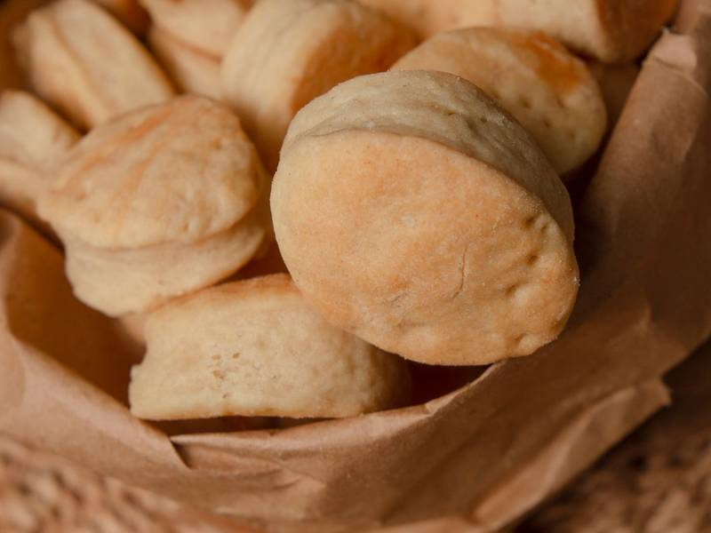

Plain baked American-style cream biscuits/scones; coherent recipe ingredients and finished crumb.

Photo: Natalia Olivera; [Pexels](https://www.pexels.com/photo/freshly-baked-homemade-biscuits-in-paper-bag-30666792/); [Pexels License](https://www.pexels.com/license/). Cropped and resized to 800×600.

## 3 Ingredient Fudge — `3-ingredient-fudge`

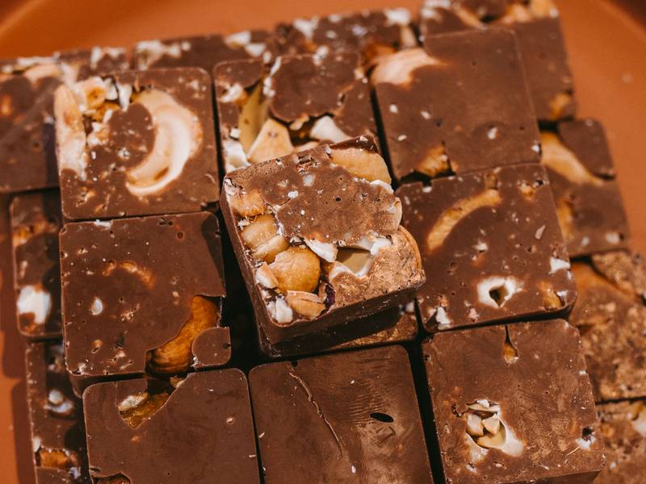

Cut chocolate fudge/confection squares with nuts; nut additions to plain condensed-milk fudge disclosed, no obvious wheat garnish.

Photo: Jonathan Borba; [Pexels](https://www.pexels.com/photo/delicious-chocolate-fudge-squares-on-a-plate-37976959/); [Pexels License](https://www.pexels.com/license/). Cropped and resized to 800×600.

## 5 Ingredient Chili — `5-ingredient-chili`

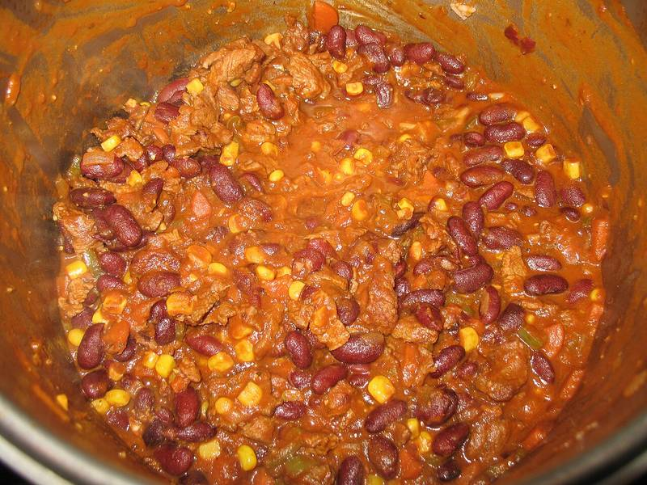

Primary source chilli con carne in cooking pot, visible kidney beans, mince and tomato sauce. Extra corn/pepper variation disclosed; cooked stew is finished form.

Photo: Aerith; [Wikimedia Commons](https://commons.wikimedia.org/wiki/File:Chili_con_carne_cuisson.jpg); [CC0](http://creativecommons.org/publicdomain/zero/1.0/deed.en). Cropped and resized to 800×600.

## Abbacchio alla Scottadito — `abbacchio-alla-scottadito`

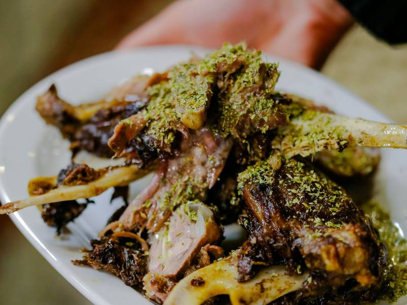

Grilled lamb cutlets with herbs, correct abbacchio/scottadito core; seasoning/appliance not independently established.

Photo: Doğu Tuncer; [Pexels](https://www.pexels.com/photo/holding-a-plate-of-grilled-lamb-chops-20226296/); [Pexels License](https://www.pexels.com/license/). Cropped and resized to 800×600.

## Air Fryer Apple Chips — `air-fryer-apple-chips`

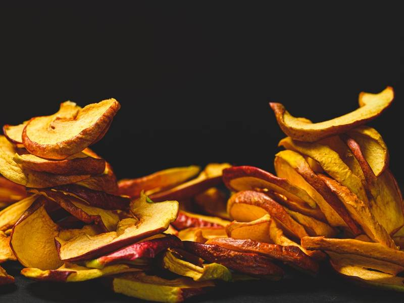

Prepared dried apple chips, appropriate vegan/GF snack; cooking appliance not established by photograph.

Photo: Jana Ohajdova; [Pexels](https://www.pexels.com/photo/close-up-shot-of-apple-chips-10245189/); [Pexels License](https://www.pexels.com/license/). Cropped and resized to 800×600.

## Air Fryer Chickpeas — `air-fryer-chickpeas`

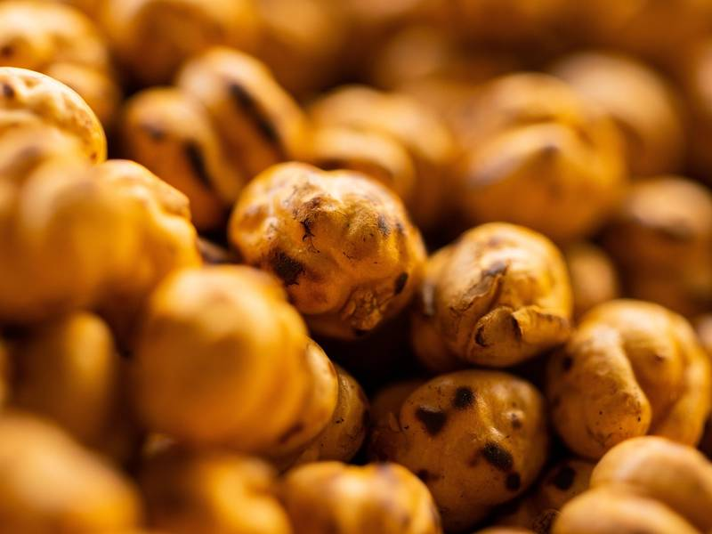

Roasted chickpeas with toasted skin; source explicitly identifies roasted chickpea, no visible conflicting foods.

Photo: Engin_Akyurt; [Pixabay](https://pixabay.com/photos/roasted-chickpea-chickpeas-roasted-6757545/); [Pixabay Content License](https://pixabay.com/service/license-summary/). Cropped and resized to 800×600.

## Air Fryer Corn Ribs — `air-fryer-corn-ribs`

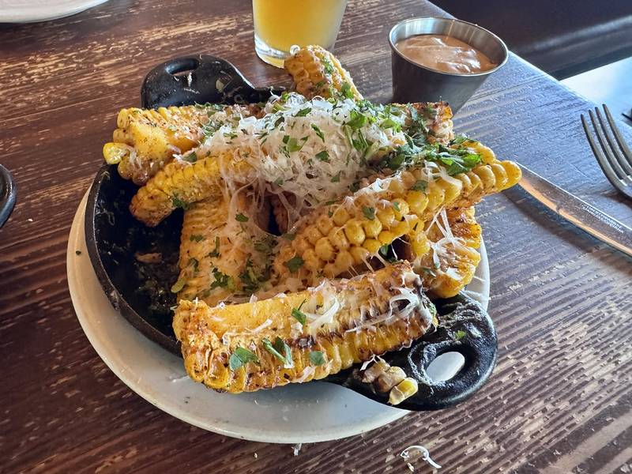

Actual corn riblets with grated parmesan and herbs; core dish matches. Dip and drink are restaurant serving additions.

Photo: Sarah Stierch; [Flickr](https://www.flickr.com/photos/7633518@N08/54835536228/); [CC0 1.0](https://creativecommons.org/publicdomain/zero/1.0/). Cropped and resized to 800×600.

## Air Fryer Donuts — `air-fryer-donuts`

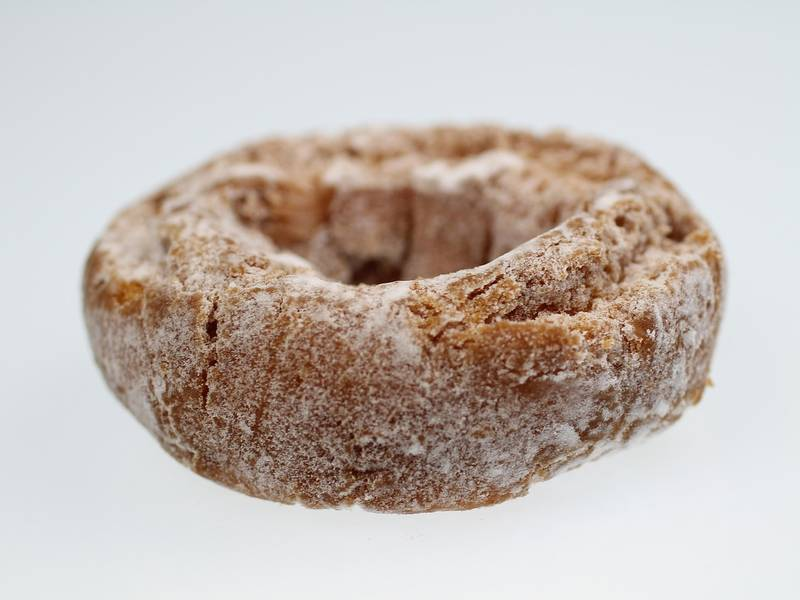

Actual cinnamon-sugar ring donut, strong flavour/shape match; air-fryer method not established.

Photo: h061152; [Pixabay](https://pixabay.com/photos/donut-confectionery-cinnamon-donuts-2394633/); [Pixabay Content License](https://pixabay.com/service/license-summary/). Cropped and resized to 800×600.

## Air Fryer Empanadas — `air-fryer-empanadas`

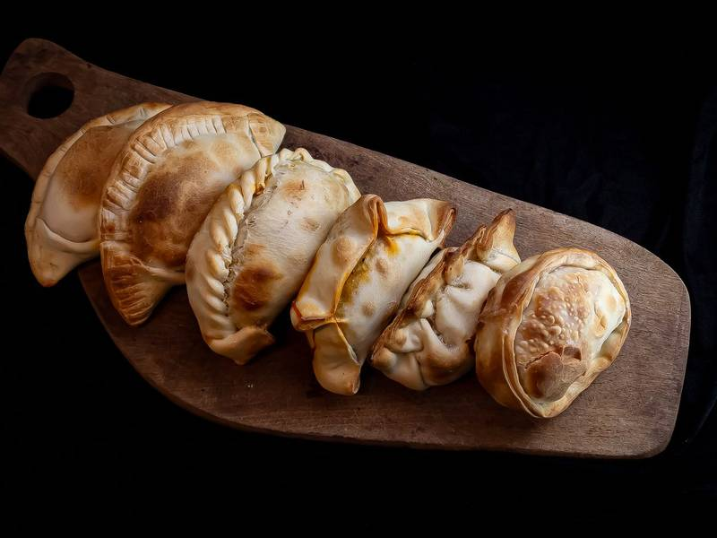

Golden baked empanadas with closed crimped edges, correct Argentine dish; filling hidden and appliance unverified.

Photo: jessica olivella; [Pexels](https://www.pexels.com/photo/traditional-argentine-empanadas-on-wooden-board-36905236/); [Pexels License](https://www.pexels.com/license/). Cropped and resized to 800×600.

## Air Fryer Fish Fingers — `air-fryer-fish-fingers`

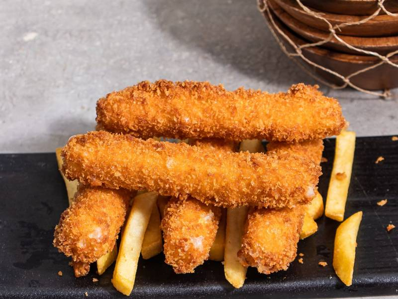

Golden elongated breaded fish fingers with fries; title and caption identify fish. Appliance and exact brand not established.

Photo: Lloyd Mitchel Guanzon; [Pexels](https://www.pexels.com/photo/a-close-up-shot-of-fish-and-chips-12310564/); [Pexels License](https://www.pexels.com/license/). Cropped and resized to 800×600.

## Air Fryer Garlic Bread — `air-fryer-garlic-bread`

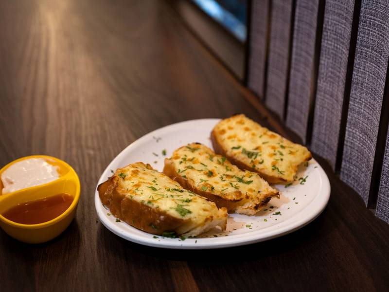

Prepared toasted garlic bread with herbs; dip is additional restaurant serving. Verify primary photography provenance before publishing.

Photo: nikhil bali; [Pexels](https://www.pexels.com/photo/garlic-bread-on-white-ceramic-plate-13062441/); [Pexels License](https://www.pexels.com/license/). Cropped and resized to 800×600.

## Air Fryer Green Beans — `air-fryer-green-beans`

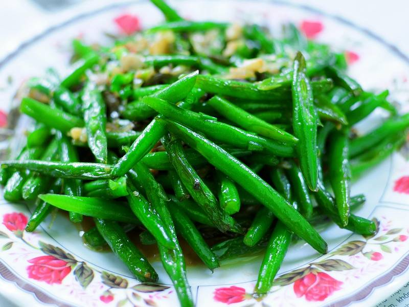

Cooked green beans with garlic, no visible meat/dairy; stir-fried source method differs from air fryer, disclose.

Photo: vudoan20170; [Pixabay](https://pixabay.com/photos/green-bean-food-green-healthy-1443290/); [Pixabay Content License](https://pixabay.com/service/license-summary/). Cropped and resized to 800×600.

## Air Fryer Grilled Cheese — `air-fryer-grilled-cheese`

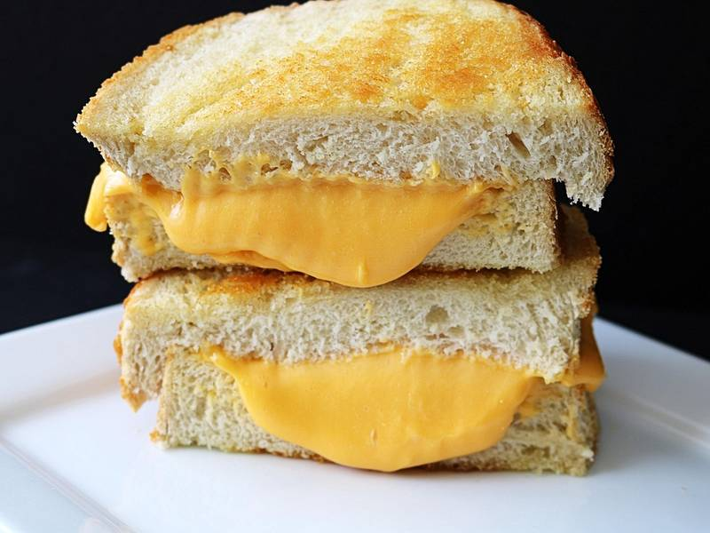

Grilled sourdough/cheddar sandwich, no visible meat; mozzarella/mustard not separately visible.

Photo: bpbowie; [Pixabay](https://pixabay.com/photos/sandwich-grilled-cheese-sour-dough-2573878/); [Pixabay Content License](https://pixabay.com/service/license-summary/). Cropped and resized to 800×600.

## Air Fryer Hash Browns — `air-fryer-hash-browns`

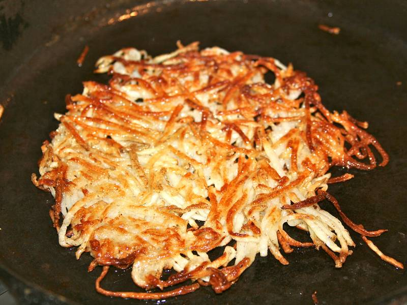

Browned shredded potato hash patty, source explicitly Coconut Oil; pan preparation and one large patty differ from small air-fryer patties.

Photo: cheeseslave; [Flickr](https://www.flickr.com/photos/19359283@N00/7159593410/); [CC BY 2.0](https://creativecommons.org/licenses/by/2.0/). Cropped and resized to 800×600.

## Air Fryer Lamb Chops — `air-fryer-lamb-chops`

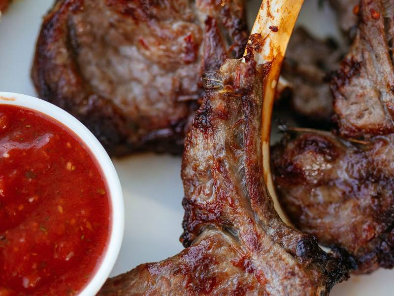

Cooked lamb rib chops with red sauce; recipe uses loin chops/lemon, disclose cut and sauce variation. No obvious DF/GF conflict.

Photo: Valeria Boltneva; [Pexels](https://www.pexels.com/photo/close-up-photo-of-a-grilled-lamb-chops-8862759/); [Pexels License](https://www.pexels.com/license/). Cropped and resized to 800×600.

## Air Fryer Meatballs — `air-fryer-meatballs`

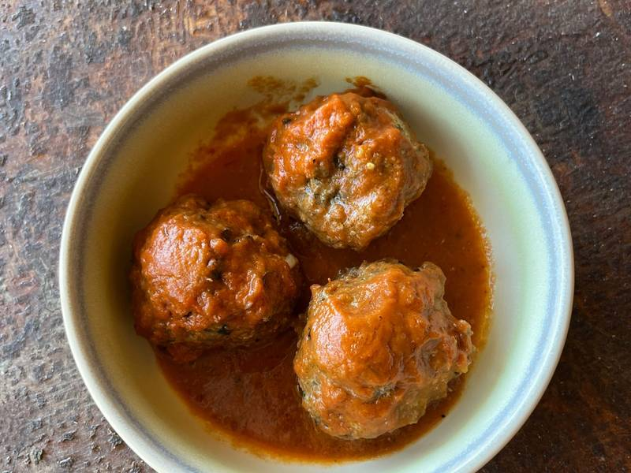

Cooked meatballs in tomato sauce; correct basic meatball dish, sauce is an extra serving.

Photo: Cookie Marenco; [Pexels](https://www.pexels.com/photo/delicious-homemade-meatballs-in-tomato-sauce-36958915/); [Pexels License](https://www.pexels.com/license/). Cropped and resized to 800×600.

## Air Fryer Onion Rings — `air-fryer-onion-rings`

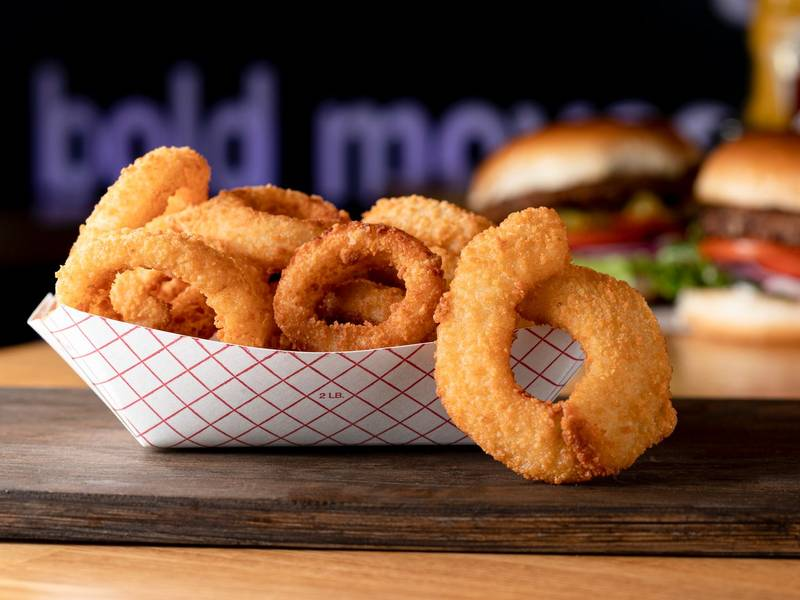

Golden breadcrumb onion rings; matching coating. Blurred burgers behind are additional restaurant context.

Photo: Nancy Pasel; [Pexels](https://www.pexels.com/photo/crispy-onion-rings-in-restaurant-setting-37358770/); [Pexels License](https://www.pexels.com/license/). Cropped and resized to 800×600.

## Air Fryer Pizza Rolls — `air-fryer-pizza-rolls`

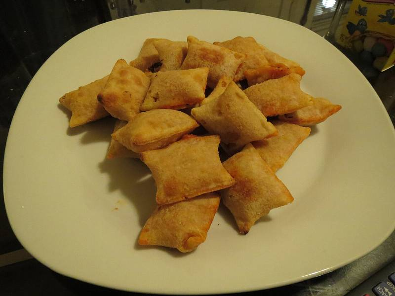

Browned closed pizza pockets, matching egg-roll-wrapper pizza-roll form; source confirms Pizza rolls.

Photo: zombieite; [Wikimedia Commons](https://commons.wikimedia.org/wiki/File:Pizza_rolls_(13791623443).jpg); [CC BY 2.0](https://creativecommons.org/licenses/by/2.0). Cropped and resized to 800×600.

## Air Fryer Quesadilla — `air-fryer-quesadilla`

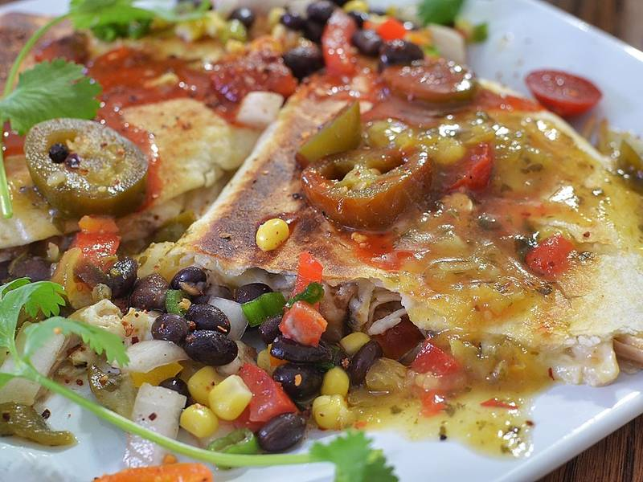

Finished quesadillas with visibly cooked shredded chicken, cheese, peppers and salsa/bean sides; actual target contains chicken and has no Vegetarian tag.

Photo: jeffreyw; [Flickr](https://www.flickr.com/photos/7927684@N03/8321603388/); [CC BY 2.0](https://creativecommons.org/licenses/by/2.0/). Cropped and resized to 800×600.

## Air Fryer Steak — `air-fryer-steak`

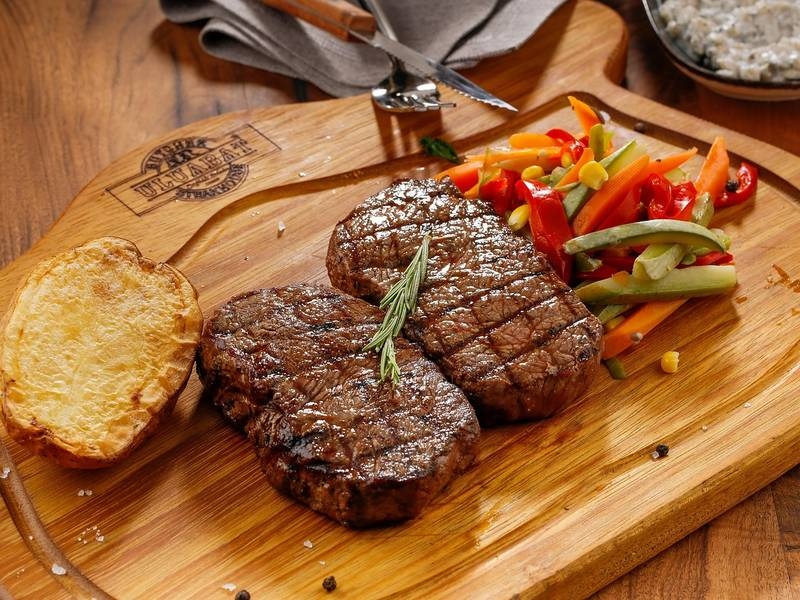

Cooked beef steaks with potato/vegetable sides; source explicit steak, appropriate core recipe; equipment unverified.

Photo: gurkanerol; [Pixabay](https://pixabay.com/photos/food-steak-meat-soup-beef-bbq-3676796/); [Pixabay Content License](https://pixabay.com/service/license-summary/). Cropped and resized to 800×600.

## Air Fryer Turkey Breast — `air-fryer-turkey-breast`

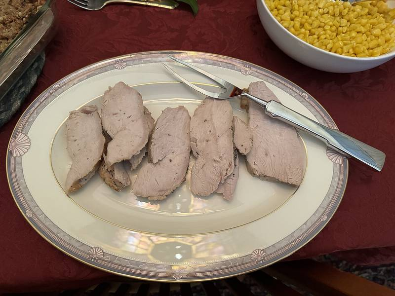

Sliced cooked turkey breast with browned edges; appropriate core recipe, plain serving without herbs/garnishes.

Photo: Missvain; [Wikimedia Commons](https://commons.wikimedia.org/wiki/File:Cooked_turkey_breast_-_November_2023_-_Sarah_Stierch.jpg); [CC BY 4.0](https://creativecommons.org/licenses/by/4.0). Cropped and resized to 800×600.

## Ajoblanco — `ajoblanco`

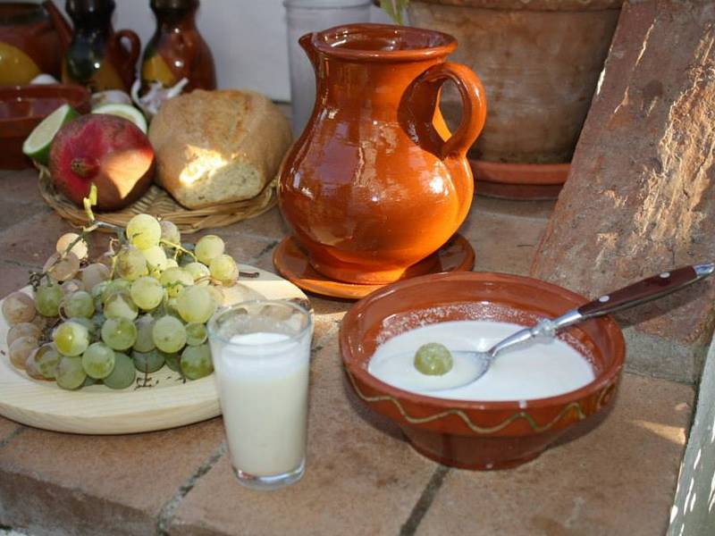

Native white almond/bread ajoblanco with grapes; dairy-looking colour is not evidence of milk; source identifies correct soup.

Photo: Instituto Andaluz del Patrimonio Histórico; [Wikimedia Commons](https://commons.wikimedia.org/wiki/File:Ajoblanco_en_Monda.jpg); [CC BY-SA 3.0](https://creativecommons.org/licenses/by-sa/3.0). Cropped and resized to 800×600.

## Antipasto Skewers — `antipasto-skewers`

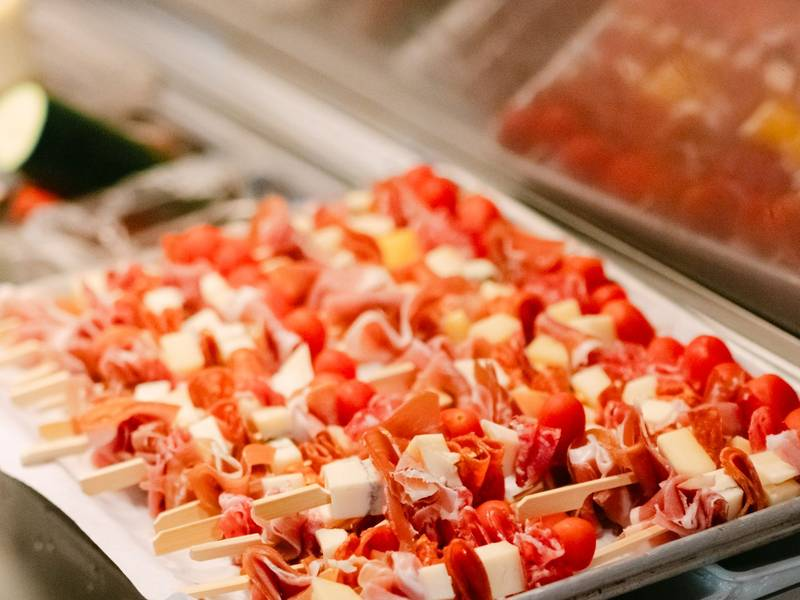

Antipasto skewers with meat/cheese/tomato; cheese cubes and ham/salami types differ from recipe balls, olive/artichoke ingredients not visible.

Photo: Brunxs; [Pexels](https://www.pexels.com/photo/delicious-antipasto-skewers-on-display-33763646/); [Pexels License](https://www.pexels.com/license/). Cropped and resized to 800×600.

## Appalachian Soup Beans — `appalachian-soup-beans`

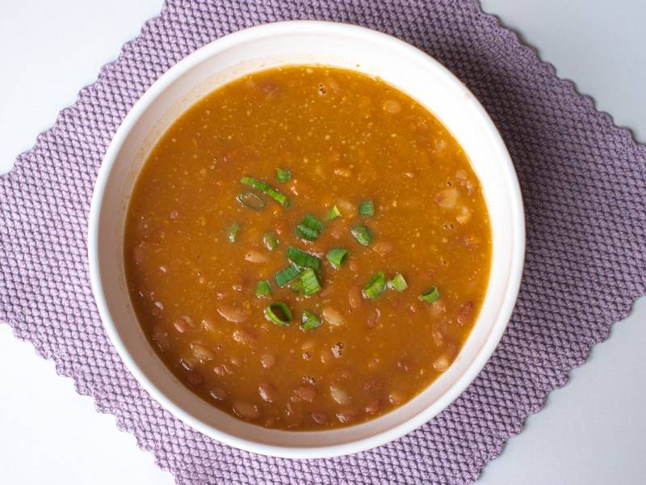

Cooked bean soup with scallions, no bread/dairy garnish; exact pinto/ham formulation not established, broad bean-soup illustration.

Photo: IARA MELO; [Pexels](https://www.pexels.com/photo/delicious-homemade-bean-soup-in-white-bowl-30635687/); [Pexels License](https://www.pexels.com/license/). Cropped and resized to 800×600.

## Apple Slice — `apple-slice`

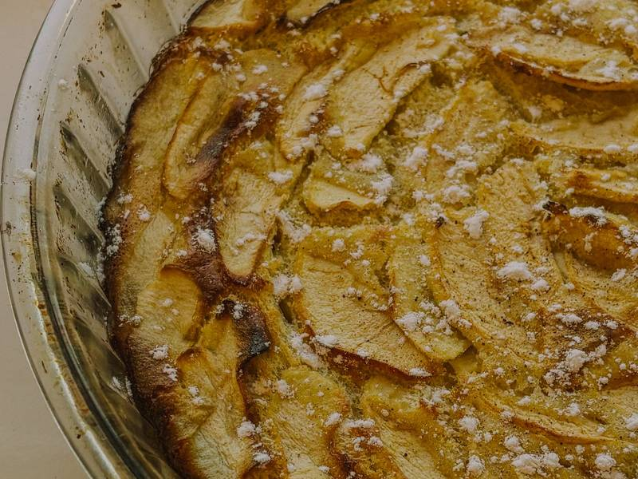

Baked apple pastry/tart, coherent apple-slice dessert; round form and no oat-crumble topping variation.

Photo: Yana Kuyan; [Pexels](https://www.pexels.com/photo/freshly-baked-apple-tart-in-glass-pie-dish-37126042/); [Pexels License](https://www.pexels.com/license/). Cropped and resized to 800×600.

## Baingan Masala — `baingan-masala`

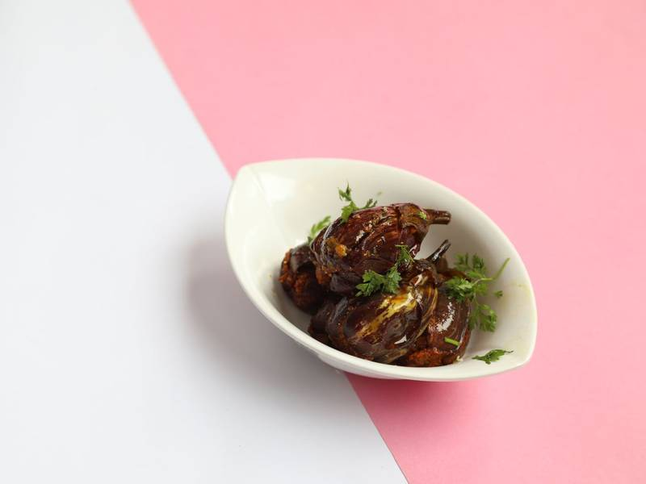

Finished Indian aubergine masala, stuffed baby aubergines rather than diced large aubergine; size/form variation disclosed.

Photo: Milton Das; [Pexels](https://www.pexels.com/photo/delicious-indian-stuffed-eggplant-curry-dish-34217296/); [Pexels License](https://www.pexels.com/license/). Cropped and resized to 800×600.

## Baked Beans from Scratch — `baked-beans-from-scratch`

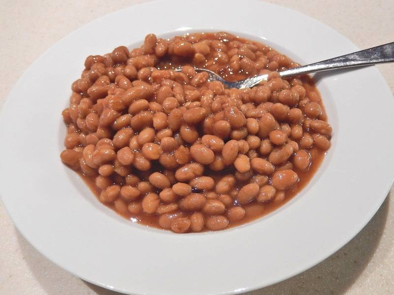

Cooked baked beans in brown sauce; correct basic DF dish, from-scratch method not established by photograph.

Photo: pixel1; [Pixabay](https://pixabay.com/photos/boston-baked-beans-molasses-671041/); [Pixabay Content License](https://pixabay.com/service/license-summary/). Cropped and resized to 800×600.

## Banoffee Cheesecake — `banoffee-cheesecake`

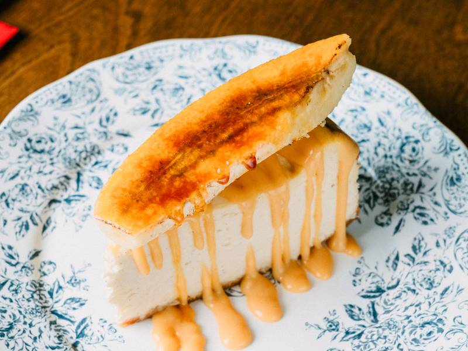

Cheesecake slice with banana and caramel; coherent banoffee flavour and biscuit-base form, garnish variation.

Photo: Deane Bayas; [Pexels](https://www.pexels.com/photo/delicious-cheesecake-with-banana-topping-39022200/); [Pexels License](https://www.pexels.com/license/). Cropped and resized to 800×600.

## BBQ Salmon — `bbq-salmon`

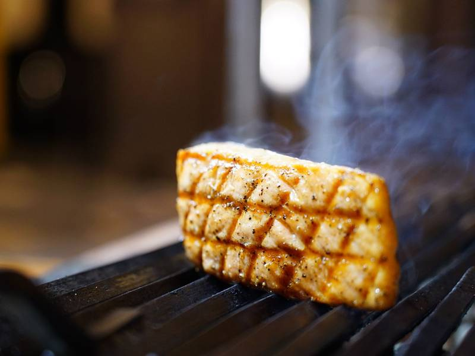

Cooked salmon on barbecue, grilled exterior; steak cut rather than fillet variation.

Photo: Mohamed  Olwy; [Pexels](https://www.pexels.com/photo/grilled-salmon-steak-on-a-smoky-barbecue-grill-36869542/); [Pexels License](https://www.pexels.com/license/). Cropped and resized to 800×600.

## Bean and Rice Burrito — `bean-and-rice-burrito`

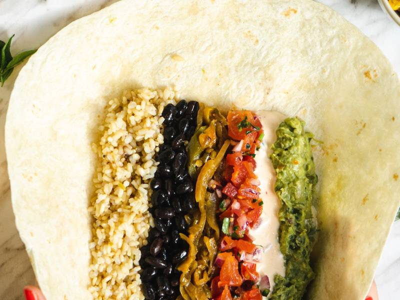

Primary caption burrito with beans, rice, vegetables and guacamole; finished filling shown in open flour tortilla, target refried-bean/cheddar filling varies with whole black beans and extra vegetables.

Photo: Gonzalo Mendiola; [Pexels](https://www.pexels.com/photo/person-holding-unwrapped-burrito-9258728/); [Pexels License](https://www.pexels.com/license/). Cropped and resized to 800×600.

## Black Bean and Rice Skillet — `black-bean-and-rice-skillet`

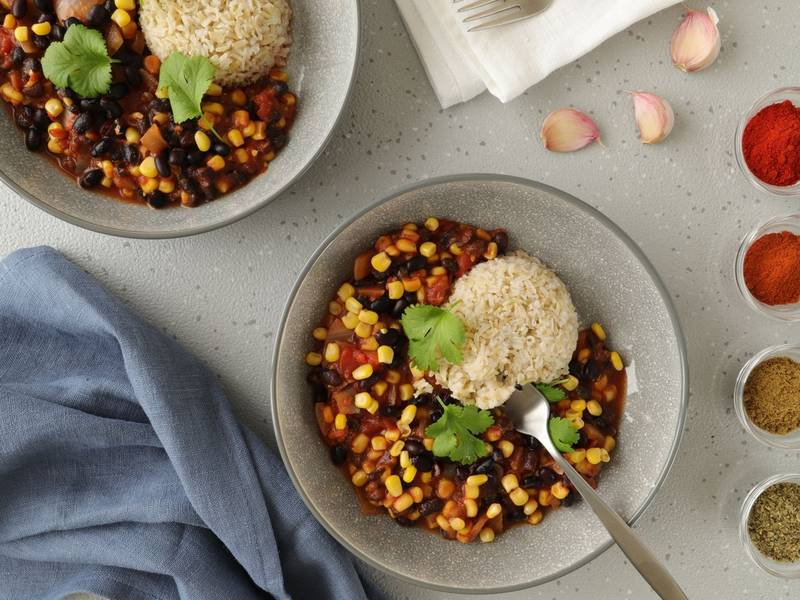

Source explicitly vegan black-bean/corn chili with rice, same core ingredients; plated separately rather than mixed skillet, cheese absent.

Photo: Nic Wood; [Pexels](https://www.pexels.com/photo/vegan-black-bean-chilli-28286173/); [Pexels License](https://www.pexels.com/license/). Cropped and resized to 800×600.

## Bounty Slice — `bounty-slice`

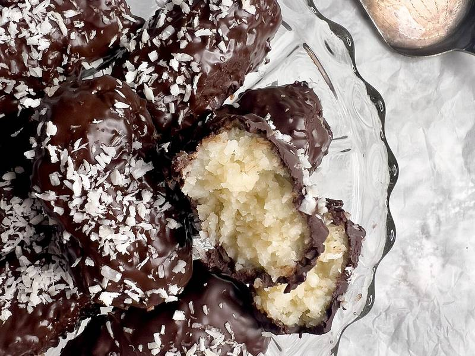

Primary source explicitly homemade GF coconut bounty bars, cut-open coconut filling; round rather than tray-cut squares. Requested linked ms-fox.pl credit required.

Photo: Ewelina Podrez-Siama; [Wikimedia Commons](https://commons.wikimedia.org/wiki/File:Homemade_bounty_-_coconut_bars_(KETO,_LCHF,_Low_Carb,_Gluten_free,_FIT)_-_52775014478.jpg); [CC BY 2.0](https://creativecommons.org/licenses/by/2.0). Cropped and resized to 800×600.

## Brisket with Onions — `brisket-with-onions`

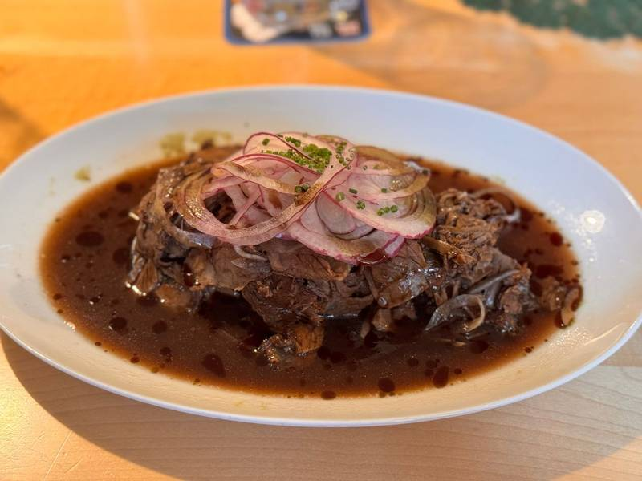

Braised beef brisket with onion garnish and brown gravy, correct dish; raw red-onion garnish additional to cooked-onion recipe.

Photo: Hussain Hussaini; [Pexels](https://www.pexels.com/photo/tender-beef-brisket-with-onions-and-gravy-32986967/); [Pexels License](https://www.pexels.com/license/). Cropped and resized to 800×600.

## Butter Chicken Pie — `butter-chicken-pie`

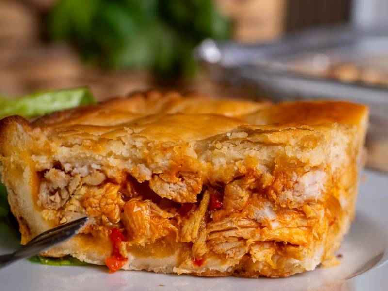

Chicken pie with orange sauce and pastry; primary tags explicitly Butter Chicken, coherent curry-pie subject.

Photo: Nano Erdozain; [Pexels](https://www.pexels.com/photo/delicious-chicken-pot-pie-with-flaky-crust-29535632/); [Pexels License](https://www.pexels.com/license/). Cropped and resized to 800×600.

## Cabbage and Potato Soup — `cabbage-and-potato-soup`

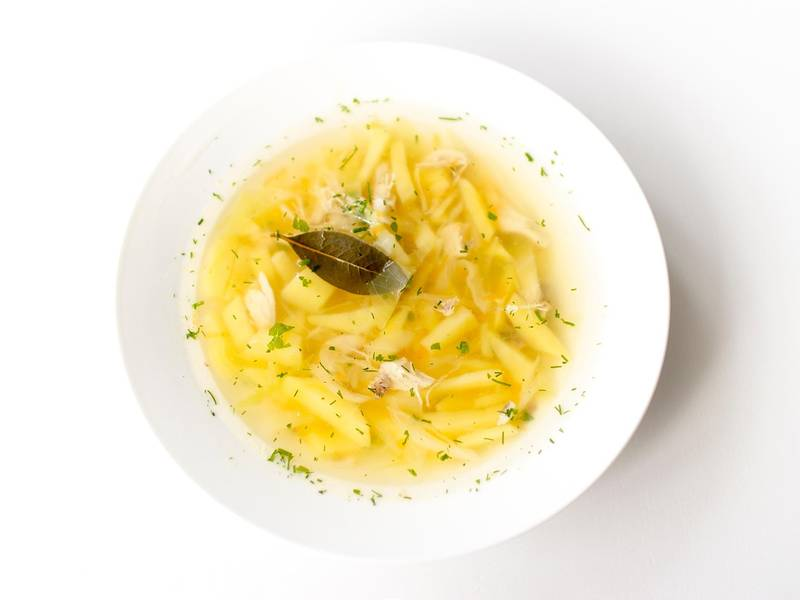

Primary source cabbage-potato soup, visible potato and cabbage strips in clear broth. Core target soup form; stock ingredients not established visually.

Photo: Irina_kukuts; [Pixabay](https://pixabay.com/photos/soup-cabbage-potato-food-nutrition-6100952/); [Pixabay Content License](https://pixabay.com/service/license-summary/). Cropped and resized to 800×600.

## Cabbage Salad with Peanut Dressing — `cabbage-salad-with-peanut-dressing`

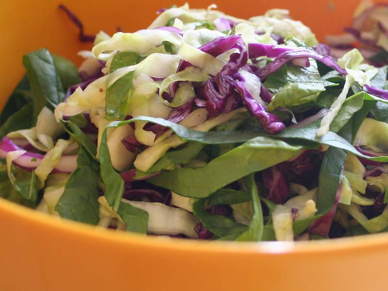

Source explicitly peanut/lime cabbage salad, strong salad/dressing identity.

Photo: Whitney; [Flickr](https://www.flickr.com/photos/29298849@N05/4664168752/); [CC BY 2.0](https://creativecommons.org/licenses/by/2.0/). Cropped and resized to 800×600.

## Cakey Brownies — `cakey-brownies`

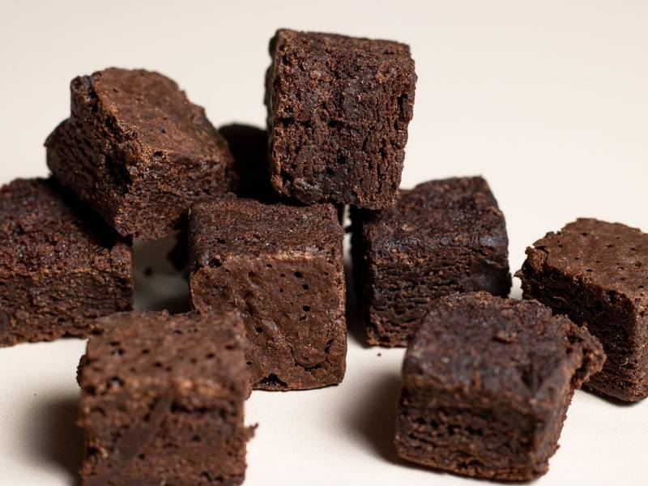

Tall baked chocolate brownie squares with visible cake crumb; optional frosting absent.

Photo: Bethany Hicks; [Pexels](https://www.pexels.com/photo/close-up-shot-of-brownies-14576526/); [Pexels License](https://www.pexels.com/license/). Cropped and resized to 800×600.

## Cannelloni — `cannelloni`

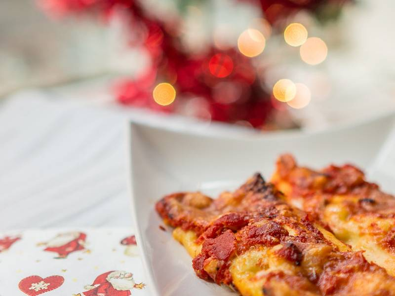

Cooked cannelloni tubes with red sauce and browned cheese. Filling hidden; source does not establish spinach/ricotta, disclose variation without claiming recipe testing.

Photo: Giuseppe Milo; [Flickr](https://www.flickr.com/photos/87690240@N03/11013323146/); [CC BY 2.0](https://creativecommons.org/licenses/by/2.0/). Cropped and resized to 800×600.

## Carrot Cake Loaf — `carrot-cake-loaf`

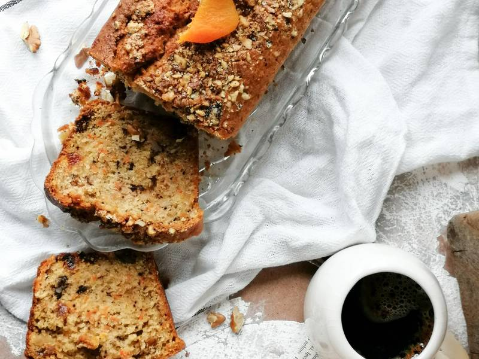

Carrot loaf cake with carrot garnish and nuts; cream-cheese frosting absent in this serving.

Photo: Hilal  Bülbül; [Pexels](https://www.pexels.com/photo/carrot-cake-and-tea-pot-12662758/); [Pexels License](https://www.pexels.com/license/). Cropped and resized to 800×600.

## Chantilly — `chantilly`

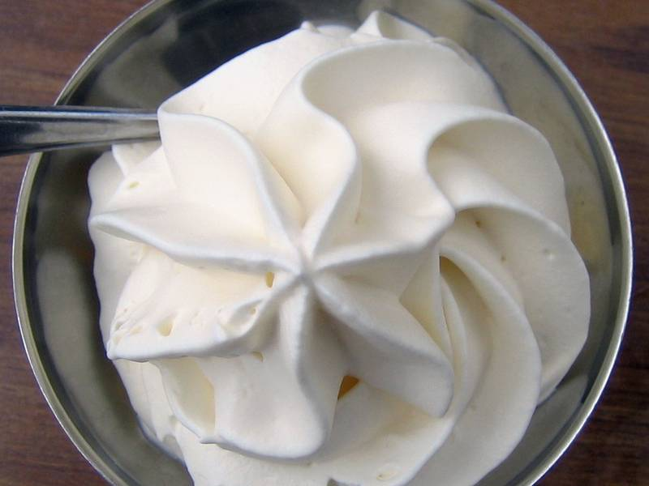

Bowl of piped Chantilly cream, exact subject with no additional dessert or conflicting food.

Photo: Paul Downey; [Wikimedia Commons](https://commons.wikimedia.org/wiki/File:Cr%C3%A8me_Chantilly.jpg); [CC BY 2.0](https://creativecommons.org/licenses/by/2.0). Cropped and resized to 800×600.

## Charoset — `charoset`

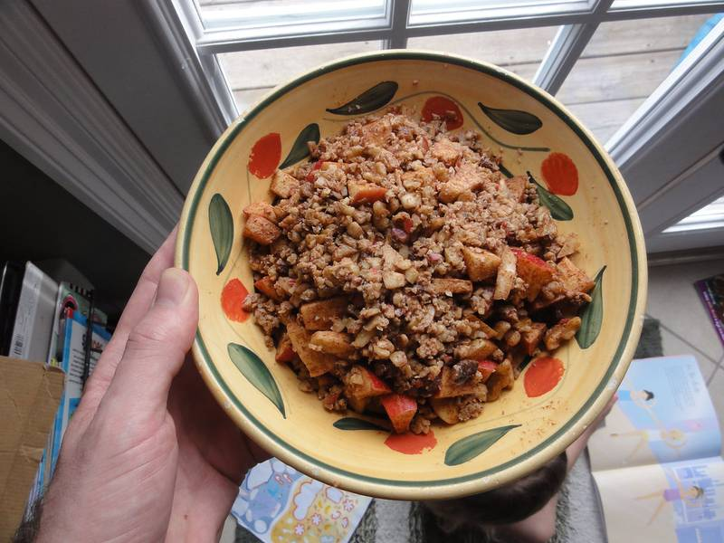

Apple/walnut/date charoset; source explicitly confirms ingredients and grape juice. Dates/grape juice instead of wine/honey are recorded variations, vegetarian/DF/GF compatible.

Photo: Bart Everson; [Flickr](https://www.flickr.com/photos/11018968@N00/7026721369/); [CC BY 2.0](https://creativecommons.org/licenses/by/2.0/). Cropped and resized to 800×600.

## Cheddar Jalapeno Bread — `cheddar-jalapeno-bread`

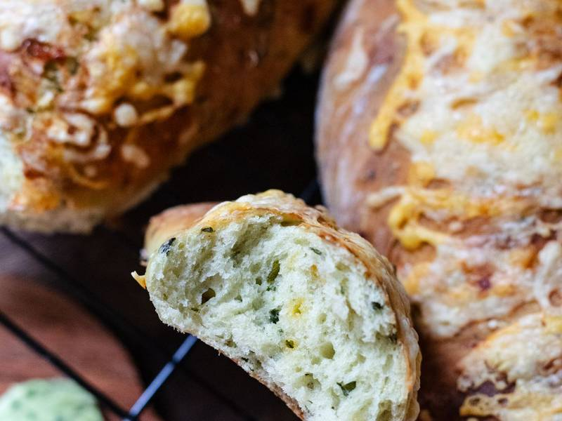

Cheddar-enriched bread with green herbs, similar loaf form; herbs rather than established jalapeño pieces, flavour variation disclosed.

Photo: Veronika Benz; [Pexels](https://www.pexels.com/photo/delicious-homemade-cheddar-herb-bread-loaves-37439108/); [Pexels License](https://www.pexels.com/license/). Cropped and resized to 800×600.

## Cheese and Egg Pie — `cheese-and-egg-pie`

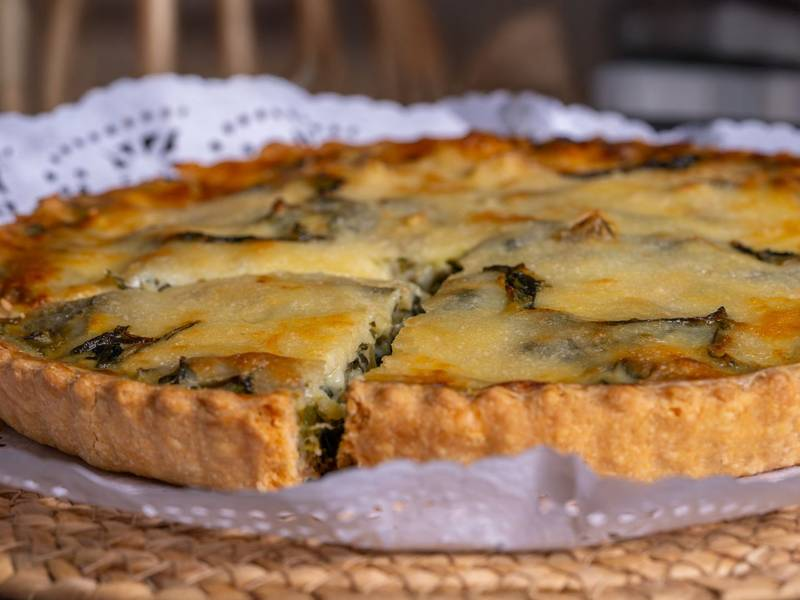

Cooked cheese-and-egg pastry/quiche; spinach and custard-style filling rather than chopped boiled eggs/bacon are disclosed formulation variations.

Photo: Nano Erdozain; [Pexels](https://www.pexels.com/photo/delicious-spinach-and-cheese-quiche-on-rustic-plate-29538422/); [Pexels License](https://www.pexels.com/license/). Cropped and resized to 800×600.

## Cheese Tortellini with Pesto — `cheese-tortellini-with-pesto`

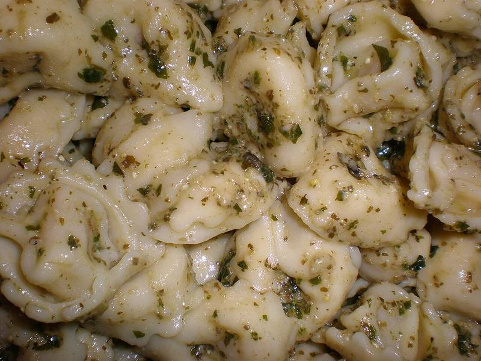

Cooked seven-cheese tortellini with visible green herb/pesto sauce, correct pasta shape and filling family.

Photo: BrokenSphere; [Wikimedia Commons](https://commons.wikimedia.org/wiki/File:7_cheese_tortellini_cooked.JPG); [CC BY-SA 3.0](https://creativecommons.org/licenses/by-sa/3.0). Cropped and resized to 800×600.

## Cheesy Cauliflower Casserole — `cheesy-cauliflower-casserole`

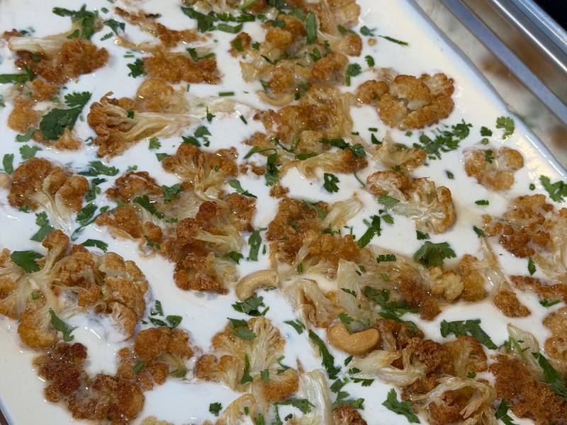

Cooked cauliflower casserole with creamy sauce and cashews, no obvious wheat coat established; cashew garnish rather than almond/cheddar topping variation, GF certification not established by photo.

Photo: Anthony Rahayel; [Pexels](https://www.pexels.com/photo/creamy-cauliflower-casserole-with-cashews-and-herbs-36367580/); [Pexels License](https://www.pexels.com/license/). Cropped and resized to 800×600.

## Cheesy Potato Bake — `cheesy-potato-bake`

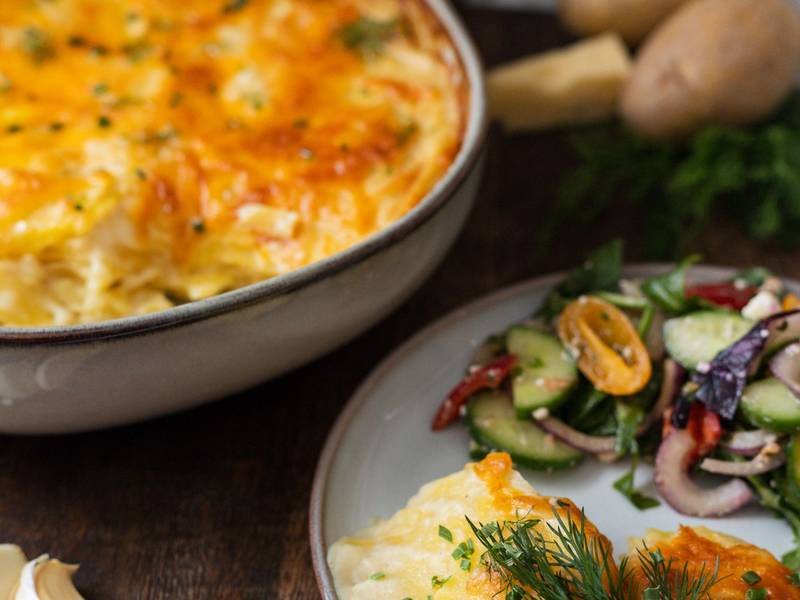

Cooked cheesy potato gratin, layered potatoes and golden top, strong core match.

Photo: Veronika Benz; [Pexels](https://www.pexels.com/photo/delicious-cheesy-potato-gratin-with-fresh-salad-37226786/); [Pexels License](https://www.pexels.com/license/). Cropped and resized to 800×600.

## Cheesy Rice Casserole — `cheesy-rice-casserole`

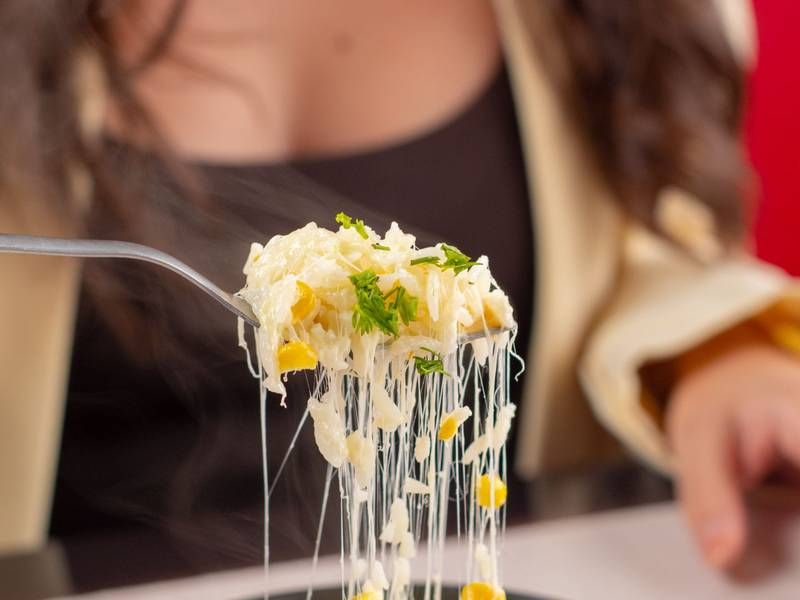

Prepared rice with melted cheese, corn and parsley; additional corn serving variation, no proof of oven-casserole method.

Photo: Arti.tic; [Pexels](https://www.pexels.com/photo/cheesy-corn-rice-bowl-being-enjoyed-in-ecuador-34110263/); [Pexels License](https://www.pexels.com/license/). Cropped and resized to 800×600.

## Chicken Reshmi Kebab — `chicken-reshmi-kebab`

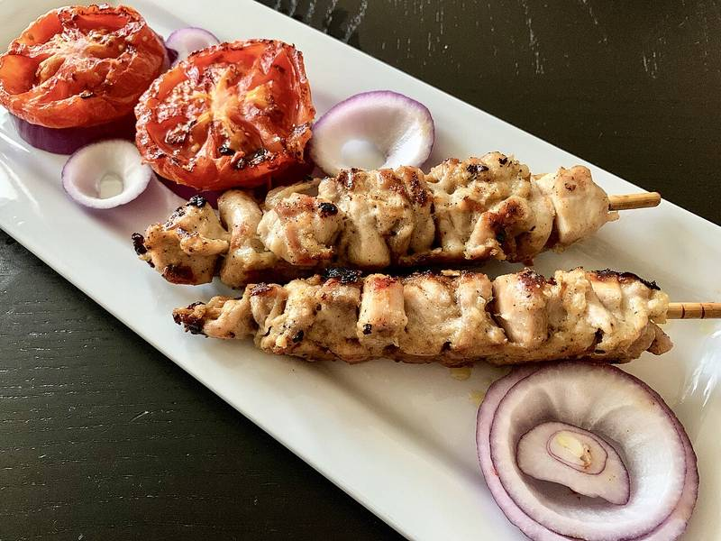

Cooked creamy chicken reshmi kebab skewers with tomato/onion. Source confirms dish; chicken pieces instead of minced shape are a recorded variation.

Photo: Prianxi; [Wikimedia Commons](https://commons.wikimedia.org/wiki/File:Chicken_reshmi_kebabs.jpg); [CC BY-SA 4.0](https://creativecommons.org/licenses/by-sa/4.0). Cropped and resized to 800×600.

## Chicken Roulade — `chicken-roulade`

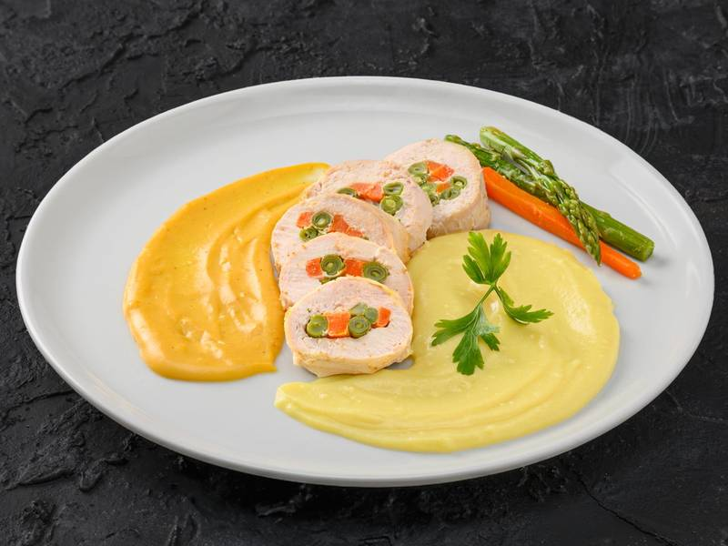

Cooked chicken roulade with vegetable filling, no visible breadcrumb coat; green-bean/carrot rather than spinach/tomato filling variation.

Photo: Christopher Welsch Leveroni; [Pexels](https://www.pexels.com/photo/gourmet-stuffed-chicken-breast-with-vegetables-and-puree-31987728/); [Pexels License](https://www.pexels.com/license/). Cropped and resized to 800×600.

## Chicken Sausage Pasta — `chicken-sausage-pasta`

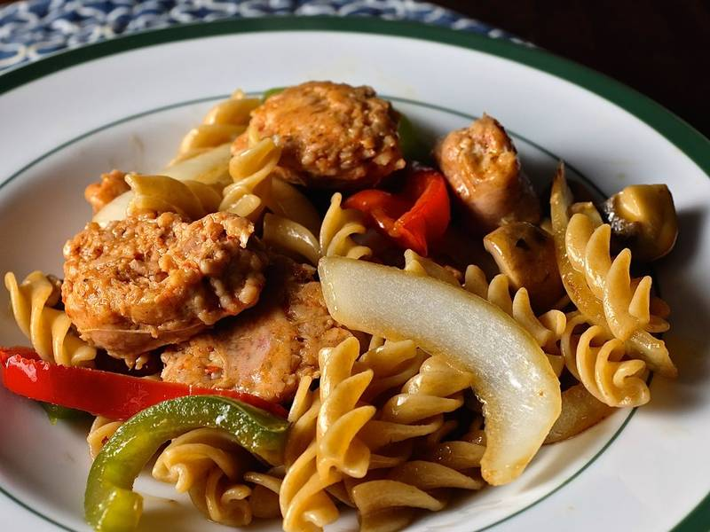

Chicken sausage pasta confirmed by photographer. Fusilli, peppers/mushrooms/onions rather than creamy spinach/penne are recorded ingredient/serving variations.

Photo: The Marmot; [Flickr](https://www.flickr.com/photos/38142119@N00/22122316008/); [CC BY 2.0](https://creativecommons.org/licenses/by/2.0/). Cropped and resized to 800×600.

## Chocolate Smoothie — `chocolate-smoothie`

Distinct tall chocolate milkshake in kitchen glass, core chocolate smoothie appearance; exact banana, peanut-butter and honey formula is not established by photograph.

Photo: Shubham Jain; [Pexels](https://www.pexels.com/photo/chocolate-milkshake-on-modern-kitchen-counter-39477468/); [Pexels License](https://www.pexels.com/license/). Cropped and resized to 800×600.

## Chorizo and Potato Stew — `chorizo-and-potato-stew`

Primary caption chorizo chickpea stew with potatoes; visible chorizo and potato core match, extra chickpeas/carrots are disclosed serving variation.

Photo: Alpha; [Flickr](https://www.flickr.com/photos/10559879@N00/4274081880/); [CC BY-SA 2.0](https://creativecommons.org/licenses/by-sa/2.0/). Cropped and resized to 800×600.

## Churro Waffles — `churro-waffles`

Primary caption classic waffles with Nutella and cinnamon sugar; proper flat waffles with cinnamon sugar and chocolate are a closer match than current rolled waffle/churro hero.

Photo: Nouhad Shaikh; [Wikimedia Commons](https://commons.wikimedia.org/wiki/File:Classic_Waffles_with_Chocolate_Fudge_Sauce_-_Home_-_Goa_-_IMG-20201027-WA0001.jpg); [CC BY-SA 4.0](https://creativecommons.org/licenses/by-sa/4.0). Cropped and resized to 800×600.

## Coffee Ice Cream — `coffee-ice-cream`

Actual coffee ice cream scoops in a bowl; vegan hazelnut analogue, no wafer/cone. Not proof of the site custard method.

Photo: Veganbaking.net from USA; [Wikimedia Commons](https://commons.wikimedia.org/wiki/File:Vegan_Hazelnut_Coffee_Ice_Cream_(5013027435).jpg); [CC BY-SA 2.0](https://creativecommons.org/licenses/by-sa/2.0). Cropped and resized to 800×600.

## Cookie Dough Bites — `cookie-dough-bites`

Chocolate-coated cookie dough bite candies with centres exposed; matches named confection and coating, commercial small-piece serving differs from homemade balls.

Photo: MarvelJason; [Wikimedia Commons](https://commons.wikimedia.org/wiki/File:Cookie_Dough_Bites_WIkipedia_image.png); [CC BY-SA 4.0](https://creativecommons.org/licenses/by-sa/4.0). Cropped and resized to 800×600.

## Cornetti — `cornetti`

Cooked Italian cornetti, primary source identifies lemon custard filling rather than apricot jam. Same pastry type; filling variation recorded.

Photo: Philip Mallis; [Flickr](https://www.flickr.com/photos/122687277@N03/53572040432/); [CC BY-SA 2.0](https://creativecommons.org/licenses/by-sa/2.0/). Cropped and resized to 800×600.

## Crispy Aromatic Duck — `crispy-aromatic-duck`

Crispy cooked duck served with pancakes, cucumber and sauce; sliced Peking-style breast rather than shredded legs variation.

Photo: Polina Tankilevitch; [Pexels](https://www.pexels.com/photo/overhead-shot-of-savory-peking-duck-dish-5848601/); [Pexels License](https://www.pexels.com/license/). Cropped and resized to 800×600.

## Crispy Smashed Potatoes — `crispy-smashed-potatoes`

Primary source baked smashed potatoes, visible squashed skin-on baby potatoes with herbs and crisp surfaces; strong target cut and form.

Photo: ParentingPatch; [Wikimedia Commons](https://commons.wikimedia.org/wiki/File:Baked_Smashed_Potatoes.JPG); [CC BY-SA 3.0](https://creativecommons.org/licenses/by-sa/3.0). Cropped and resized to 800×600.

## Divinity — `divinity`

White pecan divinity candy, source explicitly identifies product. Correct GF/DF confection.

Photo: Kate Hopkins; [Flickr](https://www.flickr.com/photos/54151899@N00/4971215544/); [CC BY 2.0](https://creativecommons.org/licenses/by/2.0/). Cropped and resized to 800×600.

## Egyptian Rice with Vermicelli — `egyptian-rice-with-vermicelli`

Primary source Egyptian rice, visible long grain rice mixed with toasted short vermicelli. Stronger match than current generic rice hero.

Photo: Showshow777; [Wikimedia Commons](https://commons.wikimedia.org/wiki/File:Egyptian_Rice.JPG); [CC BY-SA 4.0](https://creativecommons.org/licenses/by-sa/4.0). Cropped and resized to 800×600.

## Epinards a la Creme — `epinards-a-la-creme`

Native creamed spinach in its own casserole; other covered side-dish contents not assumed.

Photo: Marianne Casamance; [Wikimedia Commons](https://commons.wikimedia.org/wiki/File:Remoulins_H%C3%B4tel-restaurant_du_Nord_Riz_de_Camargue_et_%C3%A9pinard_%C3%A0_la_cr%C3%A8me.JPG); [CC BY-SA 4.0](https://creativecommons.org/licenses/by-sa/4.0). Cropped and resized to 800×600.

## Erbsensuppe — `erbsensuppe`

Prepared native German pea soup; fine soup texture, smoked ham/sausage not all separately visible.

Photo: Monstourz; [Wikimedia Commons](https://commons.wikimedia.org/wiki/File:DEU_Erbsensuppe_Siegelschale_71_MSZ111117.jpg); [CC BY-SA 3.0](https://creativecommons.org/licenses/by-sa/3.0). Cropped and resized to 800×600.

## Freezer Cookie Dough — `freezer-cookie-dough`

Portioned chocolate chip cookie dough on baking paper, correct intended freezer-preparation dish. Raw dough is the recipe subject, not a ready-to-eat claim; exact freezing method not proven.

Photo: Kate L; [Pexels](https://www.pexels.com/photo/chocolate-chip-cookie-dough-on-baking-sheet-31116129/); [Pexels License](https://www.pexels.com/license/). Cropped and resized to 800×600.

## Freezer Mac and Cheese — `freezer-mac-and-cheese`

Cooked elbow macaroni with creamy cheese sauce and breadcrumbs; correct core macaroni-cheese form. Photograph does not prove freezing suitability or a tested method.

Photo: Hayden Walker; [Pexels](https://www.pexels.com/photo/overhead-shot-of-a-plate-of-mac-and-cheese-9397238/); [Pexels License](https://www.pexels.com/license/). Cropped and resized to 800×600.

## Freezer Soup — `freezer-soup`

Primary source explicitly vegan lentil and rice soup, visible lentils and carrots. Extra rice and brown-lentil texture versus red-lentil/tomato target disclosed; no claim photograph proves freezing suitability.

Photo: tomatoes and friends; [Wikimedia Commons](https://commons.wikimedia.org/wiki/File:Vegan_Arabian_Lentil_and_Rice_Soup_(7230462472).jpg); [CC BY 2.0](https://creativecommons.org/licenses/by/2.0). Cropped and resized to 800×600.

## Fried Cabbage — `fried-cabbage`

Primary source stir-fried cabbage and bacon, visible cooked cabbage and pink-brown bacon pieces; core target form matches.

Photo: Christopher; [Wikimedia Commons](https://commons.wikimedia.org/wiki/File:Stir_Fried_Cabbage_and_Bacon_%E5%9F%B9%E6%A0%B9%E9%AB%98%E4%B8%BD%E8%8F%9C.jpg); [CC BY 2.0](https://creativecommons.org/licenses/by/2.0). Cropped and resized to 800×600.

## Fried Egg Sandwich — `fried-egg-sandwich`

Fried egg on bread with greens/tomato/avocado; open toast serving and bread type differ from closed white-bread/cheddar sandwich, no vegetarian conflict.

Photo: Alena Evseenko; [Pexels](https://www.pexels.com/photo/close-up-on-a-egg-sandwich-placed-on-the-wooden-tray-26736319/); [Pexels License](https://www.pexels.com/license/). Cropped and resized to 800×600.

## Fruit Punch — `fruit-punch`

Cold pink fruit punch with fruit/ice being served, source identifies punch. Mixed fruit and event serving differ from recipe.

Photo: Sergei Starostin; [Pexels](https://www.pexels.com/photo/vibrant-fruit-punch-being-served-at-outdoor-event-39388326/); [Pexels License](https://www.pexels.com/license/). Cropped and resized to 800×600.

## Gänsebraten — `gansebraten`

Cooked whole Christmas goose, explicit dated photographer caption Gänsebraten. Herb/salt crust and foil serving, no added dairy food.

Photo: Jörg Blobelt; [Wikimedia Commons](https://commons.wikimedia.org/wiki/File:20241225105DR_Dresden_G%C3%A4nsebraten_mit_Kl%C3%B6%C3%9Fen.jpg); [CC BY-SA 4.0](https://creativecommons.org/licenses/by-sa/4.0). Cropped and resized to 800×600.

## Garlic Chicken Pasta — `garlic-chicken-pasta`

Primary source cooked chicken breast with spaghetti and roasted garlic. Target penne and chicken bites vary in cut/shape; core garlic chicken pasta, without visible cream or cheese.

Photo: carlos lopez; [Pexels](https://www.pexels.com/photo/close-up-photograph-of-pasta-beside-slices-of-chicken-breast-9814661/); [Pexels License](https://www.pexels.com/license/). Cropped and resized to 800×600.

## Garlic Pull Apart Bread — `garlic-pull-apart-bread`

Cooked segmented pull-apart buns with melted cheese strings; core cheesy pull-apart bread form, garlic seasoning cannot be established visually.

Photo: Anhelina Vasylyk; [Pexels](https://www.pexels.com/photo/golden-homemade-pull-apart-bread-loaf-33658030/); [Pexels License](https://www.pexels.com/license/). Cropped and resized to 800×600.

## Gluten-Free Chicken Nuggets — `gluten-free-chicken-nuggets`

Primary source LEON chicken nuggets explicitly says gluten-free breadcrumb coating. Thigh versus target breast is a disclosed cut variation; photo is not home-cooking evidence.

Photo: Andy Li; [Wikimedia Commons](https://commons.wikimedia.org/wiki/File:GFC_Nuggets_(10_pieces)_-_Leon_2023-11-13.jpg); [CC0](http://creativecommons.org/publicdomain/zero/1.0/deed.en). Cropped and resized to 800×600.

## Gluten-Free Tortillas — `gluten-free-tortillas`

Real blue-corn tortillas; target is masa harina, water and salt, so maize tortilla form matches. Colour varies with maize variety; photo is not cross-contamination certification.

Photo: Miguel González; [Pexels](https://www.pexels.com/photo/close-up-of-blue-corn-tortillas-11384152/); [Pexels License](https://www.pexels.com/license/). Cropped and resized to 800×600.

## Grilled Romaine Salad — `grilled-romaine-salad`

Grilled romaine hearts with pale dressing; grapefruit serving variation, correct primary lettuce dish.

Photo: Valeria Boltneva; [Pexels](https://www.pexels.com/photo/delicious-grilled-romaine-wedge-salad-with-dressing-36179287/); [Pexels License](https://www.pexels.com/license/). Cropped and resized to 800×600.

## Ground Beef and Potato Skillet — `ground-beef-and-potato-skillet`

Cooked ground beef and potatoes in pan; peas/scallions rather than target peppers and cheddar are serving variations, core mince/potato form matches.

Photo: Laura oliveira; [Pexels](https://www.pexels.com/photo/hearty-minced-meat-and-potato-dish-in-bowl-34429592/); [Pexels License](https://www.pexels.com/license/). Cropped and resized to 800×600.

## Ham and Egg Pie — `ham-and-egg-pie`

Primary source proper bacon and egg pie, visibly cooked egg and cured pork enclosed in golden pastry. Bacon versus ham and puff versus shortcrust are disclosed variations of core pork/egg pie.

Photo: Ottomachin; [Wikimedia Commons](https://commons.wikimedia.org/wiki/File:Bacon%26egg_pie.jpg); [CC0](http://creativecommons.org/publicdomain/zero/1.0/deed.en). Cropped and resized to 800×600.

## Herb Burgers — `herb-burgers`

Cooked hamburger patty in bun with fries, correct beef-burger form. Herbs not separately provable; extra fries serving recorded.

Photo: yangmin00; [Pixabay](https://pixabay.com/photos/burger-hamburger-set-hamburger-fries-3683046/); [Pixabay Content License](https://pixabay.com/service/license-summary/). Cropped and resized to 800×600.

## Homemade Cola — `homemade-cola`

Cola-coloured carbonated drink with ice in glass. Source identifies Coca-Cola, a commercial serving representative; does not establish homemade preparation or recipe testing.

Photo: Cansın Balcı; [Pexels](https://www.pexels.com/photo/selective-focus-of-drink-with-coca-cola-20293341/); [Pexels License](https://www.pexels.com/license/). Cropped and resized to 800×600.

## Honey Garlic Pork Chops — `honey-garlic-pork-chops`

Cooked pork chops; lemongrass/fish-sauce seasoning and grilled serving rather than honey-garlic pan glaze, variation disclosed.

Photo: avlxyz; [Wikimedia Commons](https://commons.wikimedia.org/wiki/File:Julia%27s_Lemongrass_Pork_Chops.jpg); [CC BY-SA 2.0](https://creativecommons.org/licenses/by-sa/2.0). Cropped and resized to 800×600.

## Hühnersuppe mit Nudeln — `huhnersuppe-mit-nudeln`

Clear chicken-noodle soup matches chicken/carrot/herb recipe; Canon EOS 750D provenance dated 2025 supports actual photography, choose over uncertain recent Commons source.

Photo: Anhelina Vasylyk; [Pexels](https://www.pexels.com/photo/delicious-chicken-noodle-soup-in-natural-light-34326230/); [Pexels License](https://www.pexels.com/license/). Cropped and resized to 800×600.

## Instant Pot Beans and Ham — `instant-pot-beans-and-ham`

Primary caption explicitly ham braised with butter beans; tomato sauce and sliced ham serving variation to ham-hock broth.

Photo: In Memoriam: Andy / Andrew Fogg; [Flickr](https://www.flickr.com/photos/69024001@N00/122092545/); [CC BY 2.0](https://creativecommons.org/licenses/by/2.0/). Cropped and resized to 800×600.

## Instant Pot Beef Bourguignon — `instant-pot-beef-bourguignon`

Native beef bourguignon in red-wine sauce with carrots; correct finished stew.

Photo: Slayschips; [Wikimedia Commons](https://commons.wikimedia.org/wiki/File:Beef_bourguignon_NYT.jpg); [CC BY-SA 4.0](https://creativecommons.org/licenses/by-sa/4.0). Cropped and resized to 800×600.

## Instant Pot Beef Brisket — `instant-pot-beef-brisket`

Finished sliced cooked brisket, no raw/pre-cooking stage; smoker/crust presentation rather than braised gravy, method variation disclosed. Existing browning process preserved separately.

Photo: Bezalens JGP; [Pexels](https://www.pexels.com/photo/sliced-cooked-brisket-on-wooden-cutting-board-36869213/); [Pexels License](https://www.pexels.com/license/). Cropped and resized to 800×600.

## Instant Pot Beef Curry — `instant-pot-beef-curry`

Native Kerala beef curry, closer Indian curry form than initial Thai alternate; exact spice/yogurt formula not claimed.

Photo: Dr. Chinchu C.; [Wikimedia Commons](https://commons.wikimedia.org/wiki/File:Kerala_Beef_Curry.jpg); [CC BY 4.0](https://creativecommons.org/licenses/by/4.0). Cropped and resized to 800×600.

## Instant Pot Beef Stroganoff — `instant-pot-beef-stroganoff`

Creamy beef stroganoff with vegetables/rice instead of egg noodles; primary source identifies stroganoff, serving variation disclosed.

Photo: khezez  | خزاز; [Pexels](https://www.pexels.com/photo/delicious-beef-stroganoff-meal-with-vegetables-29935503/); [Pexels License](https://www.pexels.com/license/). Cropped and resized to 800×600.

## Instant Pot Butter Chicken — `instant-pot-butter-chicken`

Butter chicken in creamy orange tomato sauce, correct finished dish. Appliance not established.

Photo: Mohammad Fahim; [Pexels](https://www.pexels.com/photo/delicious-butter-chicken-curry-with-cream-40262820/); [Pexels License](https://www.pexels.com/license/). Cropped and resized to 800×600.

## Instant Pot Chicken Cacciatore — `instant-pot-chicken-cacciatore`

Native chicken cacciatore in tomato/olive sauce with polenta and green beans; no obvious wheat or dairy ingredient established in image, exact side formulation unverified.

Photo: Fiona Henderson; [Flickr](https://www.flickr.com/photos/25925793@N00/4748721766/); [CC BY 2.0](https://creativecommons.org/licenses/by/2.0/). Cropped and resized to 800×600.

## Instant Pot Chicken Thighs — `instant-pot-chicken-thighs`

Finished skin-on roasted chicken thighs with potato wedges; correct thigh cut and plain seasoning, closer than current coated Caesar-style boneless pieces. Photograph does not prove pressure-cooking method.

Photo: ArtHouse Studio; [Pexels](https://www.pexels.com/photo/cooked-chicken-with-potatoes-on-black-metal-tray-4589138/); [Pexels License](https://www.pexels.com/license/). Cropped and resized to 800×600.

## Instant Pot Chicken Tikka Masala — `instant-pot-chicken-tikka-masala`

Native chicken tikka masala with white rice, correct orange cream/tomato sauce and chunks.

Photo: Kelly Sue; [Wikimedia Commons](https://commons.wikimedia.org/wiki/File:Chicken_Tikka_Masala_KellySue.JPG); [CC BY 2.0](https://creativecommons.org/licenses/by/2.0). Cropped and resized to 800×600.

## Instant Pot Chili — `instant-pot-chili`

Cooked red tomato chili with visible beans and ground beef; primary source explicitly bacon, ground beef and bean chili. Extra bacon is a disclosed ingredient variation, no visible bread/dairy props. Photograph does not establish pressure cooking or certify gluten-free preparation.

Photo: Global Reactions from Macau, Macau; [Wikimedia Commons](https://commons.wikimedia.org/wiki/File:Bacon,_ground_beef,_and_bean_chili.jpg); [CC BY 2.0](https://creativecommons.org/licenses/by/2.0). Cropped and resized to 800×600.

## Instant Pot Dal — `instant-pot-dal`

Native yellow pigeon-pea dal with cumin/turmeric, matches vegetarian recipe.

Photo: Neha Sonal; [Wikimedia Commons](https://commons.wikimedia.org/wiki/File:Dal,_part_of_the_Indian_staple_diet.jpg); [CC BY-SA 4.0](https://creativecommons.org/licenses/by-sa/4.0). Cropped and resized to 800×600.

## Instant Pot Lamb Shanks — `instant-pot-lamb-shanks`

Cooked lamb shank with vegetables and couscous, no obvious dairy; couscous side is a serving variation, recipe has no GF tag.

Photo: stu_spivack; [Flickr](https://www.flickr.com/photos/35034346243@N01/4156519306/); [CC BY-SA 2.0](https://creativecommons.org/licenses/by-sa/2.0/). Cropped and resized to 800×600.

## Instant Pot Mac and Cheese — `instant-pot-mac-and-cheese`

Cooked elbow macaroni in cheese sauce, appropriate bowl form.

Photo: Valeria Boltneva; [Pexels](https://www.pexels.com/photo/delicious-creamy-mac-and-cheese-in-a-bowl-32083398/); [Pexels License](https://www.pexels.com/license/). Cropped and resized to 800×600.

## Instant Pot Meatballs — `instant-pot-meatballs`

Distinct cooked meatballs in red tomato sauce with parsley, strong matching core ingredients.

Photo: ERIVELTO Martins; [Pexels](https://www.pexels.com/photo/delicious-meatballs-in-rich-tomato-sauce-34314421/); [Pexels License](https://www.pexels.com/license/). Cropped and resized to 800×600.

## Instant Pot Orange Chicken — `instant-pot-orange-chicken`

Source explicitly orange chicken, cooked glazed pieces and orange garnish.

Photo: Evan Joshua Swigart; [Wikimedia Commons](https://commons.wikimedia.org/wiki/File:Flickr_preppybyday_4786746354--Orange_chicken.jpg); [CC BY 2.0](https://creativecommons.org/licenses/by/2.0). Cropped and resized to 800×600.

## Instant Pot Pulled Pork — `instant-pot-pulled-pork`

Finished cooked barbecued pork being pulled, source explicitly barbecued pulled pork. Smoked/barked exterior differs from Instant Pot method; no claim photo proves appliance or testing.

Photo: Thogru; [Wikimedia Commons](https://commons.wikimedia.org/wiki/File:Pulled_pork_while_pulling.JPG); [CC BY-SA 3.0](https://creativecommons.org/licenses/by-sa/3.0). Cropped and resized to 800×600.

## Instant Pot Risotto — `instant-pot-risotto`

Prepared creamy risotto; mushrooms added versus plain parmesan risotto, ingredient variation disclosed.

Photo: jefersonurias; [Pixabay](https://pixabay.com/photos/rice-risotto-vegetables-mushrooms-4457143/); [Pixabay Content License](https://pixabay.com/service/license-summary/). Cropped and resized to 800×600.

## Instant Pot Salmon — `instant-pot-salmon`

Cooked salmon fillet with lemon/herbs; salad/fries/wine additional restaurant serving. No visible wheat coating; source identifies salmon. Method unverified.

Photo: Pixabay; [Stockvault](https://www.stockvault.net/photo/198494/salmon-fillet); [CC0 1.0](https://creativecommons.org/publicdomain/zero/1.0/). Cropped and resized to 800×600.

## Instant Pot Whole Chicken — `instant-pot-whole-chicken`

Cooked whole roast chicken with lemon, onions and additional pomegranate/vegetables. Roasted skin differs from pressure cooking, recorded as serving/method variation.

Photo: Tim Douglas; [Pexels](https://www.pexels.com/photo/grilled-whole-chicken-with-vegetables-and-fruits-in-glass-bowl-6210876/); [Pexels License](https://www.pexels.com/license/). Cropped and resized to 800×600.

## Instant Pot Yogurt — `instant-pot-yogurt`

Plain yogurt bowl with strawberry garnish; fruit is serving variation, not evidence of Instant Pot method.

Photo: Özge Arsoy; [Pexels](https://www.pexels.com/photo/delicious-strawberry-yogurt-dessert-on-wooden-tray-38687432/); [Pexels License](https://www.pexels.com/license/). Cropped and resized to 800×600.

## Irish Cream — `irish-cream`

Cream liqueur in glass, source identifies Irish cream/Baileys. Commercial drink serving differs from homemade preparation, which is not claimed as tested.

Photo: aniamineeva; [Pixabay](https://pixabay.com/photos/baileys-baileys-irish-cream-amaretto-5876684/); [Pixabay Content License](https://pixabay.com/service/license-summary/). Cropped and resized to 800×600.

## Irish Whiskey Cake — `irish-whiskey-cake`

Primary source Irish fruit brack recipe explicitly includes Irish whiskey and dried mixed fruit; strong core whiskey-fruitcake match, proportions vary.

Photo: sylvar; [Flickr](https://www.flickr.com/photos/44124401501@N01/287344210/); [CC BY 2.0](https://creativecommons.org/licenses/by/2.0/). Cropped and resized to 800×600.

## Jacket Potato with Cheese — `jacket-potato-with-cheese`

Baked potato with melted raclette cheese and pickles. Semi-hard cheese variety and pickle/onion garnish differ from cheddar target; correct melted-cheese jacket-potato form.

Photo: TheAndrasBarta; [Pixabay](https://pixabay.com/photos/cheese-potato-pickles-wine-1264079/); [Pixabay Content License](https://pixabay.com/service/license-summary/). Cropped and resized to 800×600.

## Kala Chana — `kala-chana`

Native black-chickpea curry/soup, no obvious dairy garnish; caption confirms correct main legume. Stirring-stage surface crop accepted as prepared curry.

Photo: Tekksavvy; [Wikimedia Commons](https://commons.wikimedia.org/wiki/File:Black_Chick_peas_soup_(Kala_Chana_curry).jpg); [CC BY-SA 3.0](https://creativecommons.org/licenses/by-sa/3.0). Cropped and resized to 800×600.

## Kofte with Yoghurt — `kofte-with-yoghurt`

Source explicitly pideli köfte with yogurt at bottom; correct meatball/yogurt/bread subject.

Photo: E4024; [Wikimedia Commons](https://commons.wikimedia.org/wiki/File:Pideli_k%C3%B6fte_-_Istanbul.jpg); [CC BY-SA 4.0](https://creativecommons.org/licenses/by-sa/4.0). Cropped and resized to 800×600.

## Korean Beef Lettuce Wraps — `korean-beef-lettuce-wraps`

Actual Korean beef ssam lettuce wrap, primary source explicitly confirms dish. Sliced bulgogi vs minced beef variation; attribution requested to souschef.co.uk must be retained.

Photo: Sous Chef; [Flickr](https://www.flickr.com/photos/140536182@N03/26971629978/); [CC BY 2.0](https://creativecommons.org/licenses/by/2.0/). Cropped and resized to 800×600.

## Krupnik — `krupnik`

Native Polish krupnik with grains, potatoes, carrots and dill; sour cream not visible, serving variation.

Photo: Aw58; [Wikimedia Commons](https://commons.wikimedia.org/wiki/File:Krupnik_-_2024.06.01.jpg); [CC BY-SA 4.0](https://creativecommons.org/licenses/by-sa/4.0). Cropped and resized to 800×600.

## L&P Cake — `l-p-cake`

Prepared lemon sponge with lemon garnish; powdered sugar rather than lemon glaze, photo does not establish L&P soft-drink formulation.

Photo: moiranazzari; [Pixabay](https://pixabay.com/photos/cake-dessert-food-lemon-3060458/); [Pixabay Content License](https://pixabay.com/service/license-summary/). Cropped and resized to 800×600.

## Lamb Saag — `lamb-saag`

Source identifies lamb saag; cooked lamb with greens, no obvious dairy/wheat accompaniment.

Photo: jules; [Flickr](https://www.flickr.com/photos/58367355@N00/5186003617/); [CC BY 2.0](https://creativecommons.org/licenses/by/2.0/). Cropped and resized to 800×600.

## Lamb Shami Kebab — `lamb-shami-kebab`

Primary source minced mutton with spices and gram lentils, formed into shallow-fried patties. Strong lamb/chana-dal shami kebab match.

Photo: TabassumJawed; [Wikimedia Commons](https://commons.wikimedia.org/wiki/File:Shami_kebabs.jpg); [CC BY-SA 4.0](https://creativecommons.org/licenses/by-sa/4.0). Cropped and resized to 800×600.

## Lebanese Cabbage Salad — `lebanese-cabbage-salad`

Prepared shredded white cabbage with oil, lemon/lime and herb garnish; core lemon/oil cabbage salad match, parsley rather than mint disclosed.

Photo: RitaE; [Pixabay](https://pixabay.com/photos/white-cabbage-salad-herb-food-1393859/); [Pixabay Content License](https://pixabay.com/service/license-summary/). Cropped and resized to 800×600.

## Leg of Lamb — `leg-of-lamb`

Roasted leg of lamb on bone with vegetables, correct cut; tray vegetables are serving variation.

Photo: Tjena; [Pixabay](https://pixabay.com/photos/leg-of-lamb-tjena-kitchen-tomatoes-2729691/); [Pixabay Content License](https://pixabay.com/service/license-summary/). Cropped and resized to 800×600.

## Lemon Blueberry Cake — `lemon-blueberry-cake`

Frosted lemon/blueberry cake with lemon/berry/herb garnish; matches core cake/frosting. Flowers/herbs additional decoration, not recipe testing evidence.

Photo: Giulia Botan; [Pexels](https://www.pexels.com/photo/lemon-blueberry-cake-on-checkered-tablecloth-35241184/); [Pexels License](https://www.pexels.com/license/). Cropped and resized to 800×600.

## Lemon Chicken Orzo — `lemon-chicken-orzo`

Primary source cooked chicken orzo, visible chicken portions on orzo with herbs. Drumstick/thigh serving cut and tomato seasoning variation disclosed; lemon not visually proved.

Photo: Gözde Z.; [Pexels](https://www.pexels.com/photo/delicious-homemade-chicken-orzo-dish-38163945/); [Pexels License](https://www.pexels.com/license/). Cropped and resized to 800×600.

## Lemon Drizzle Loaf — `lemon-drizzle-loaf`

Primary source glazed lemon loaf, sliced golden loaf with pale lemon icing; core lemon drizzle loaf match, additional icing glaze disclosed.

Photo: pixel1; [Pixabay](https://pixabay.com/photos/sliced-loaf-cake-lemon-glaze-icing-770314/); [Pixabay Content License](https://pixabay.com/service/license-summary/). Cropped and resized to 800×600.

## Lemon Gelato — `lemon-gelato`

Lemon ice cream scoops with fresh lemon, no cone/wafer; only illustration of gelato, no evidence of site custard method.

Photo: DS stories; [Pexels](https://www.pexels.com/photo/a-person-holding-a-wooden-spoon-beside-a-cup-of-ice-cream-with-lemon-slices-9227966/); [Pexels License](https://www.pexels.com/license/). Cropped and resized to 800×600.

## Maids of Honour — `maids-of-honour`

Correct Maids of Honour curd tarts in bakery packaging, primary source names traditional product. Branding is incidental and source credit retained.

Photo: Amanda Slater; [Wikimedia Commons](https://commons.wikimedia.org/wiki/File:Maids_of_Honour_Cakes.jpg); [CC BY-SA 2.0](https://creativecommons.org/licenses/by-sa/2.0). Cropped and resized to 800×600.

## Meal Prep Chicken and Rice — `meal-prep-chicken-and-rice`

Prepared chicken, rice and broccoli meal-prep container; additional chickpeas/pumpkin are serving variations.

Photo: IARA MELO; [Pexels](https://www.pexels.com/photo/healthy-meal-prep-with-rice-and-vegetables-30635714/); [Pexels License](https://www.pexels.com/license/). Cropped and resized to 800×600.

## Mejillones a la Marinera — `mejillones-a-la-marinera`

Cooked mussels marinera in clay dish; primary photographer caption includes compatible tomato/onion/wine/paprika recipe. Bread serving omitted.

Photo: Hector Garcia from Barcelona, Catalonia, Spain; [Wikimedia Commons](https://commons.wikimedia.org/wiki/File:Barcelona_-_Mejillones_marinera.jpg); [CC BY-SA 2.0](https://creativecommons.org/licenses/by-sa/2.0). Cropped and resized to 800×600.

## Membrillo — `membrillo`

Actual smooth moulded quince paste/dulce de membrillo, no contradictory garnish.

Photo: Javier Lastras; [Flickr](https://www.flickr.com/photos/22662305@N04/4086830283/); [CC BY 2.0](https://creativecommons.org/licenses/by/2.0/). Cropped and resized to 800×600.

## Menestra de Verduras — `menestra-de-verduras`

Cooked mixed menestra vegetables with peas/carrot/sprouts; vegetable mix varies from artichoke/asparagus and ham is not visible, disclosed.

Photo: Juan Emilio Prades Bel; [Wikimedia Commons](https://commons.wikimedia.org/wiki/File:Menestra_de_verduras_salteadas.jpg); [CC BY 4.0](https://creativecommons.org/licenses/by/4.0). Cropped and resized to 800×600.

## Microwave Rice Pudding — `microwave-rice-pudding`

Primary source creamy rice pudding with berry sauce, visible rice grains and jam-like fruit topping; correct rice/milk pudding. Cherry rather than strawberry serving variation; microwave method not established.

Photo: Gundula Vogel; [Pexels](https://www.pexels.com/photo/delicious-rice-pudding-with-berries-and-sauce-33088381/); [Pexels License](https://www.pexels.com/license/). Cropped and resized to 800×600.

## Mint Jelly — `mint-jelly`

Prepared green mint jelly in jar with spoon; source identifies mint jelly. No dairy/egg/wheat food visible.

Photo: Peachyeung316; [Wikimedia Commons](https://commons.wikimedia.org/wiki/File:A_mint_jelly_in_the_jar.jpg); [CC BY-SA 4.0](https://creativecommons.org/licenses/by-sa/4.0). Cropped and resized to 800×600.

## Miso Dressing — `miso-dressing`

Miso dressing with dill/tahini, thicker than target miso/ginger dressing. Same condiment, flavour/thickener variation recorded; tahini is a seed paste, no visible dairy.

Photo: Kari Sullivan from Austin, TX; [Wikimedia Commons](https://commons.wikimedia.org/wiki/File:Dill_Miso_Tahini_Dressing_(2945507199).jpg); [CC BY 2.0](https://creativecommons.org/licenses/by/2.0). Cropped and resized to 800×600.

## Mole Verde — `mole-verde`

Native mole verde con pollo, correct sauce and chicken with rice; target includes poached chicken, no vegan claim.

Photo: Wotancito; [Wikimedia Commons](https://commons.wikimedia.org/wiki/File:Mole_verde.jpg); [CC BY-SA 4.0](https://creativecommons.org/licenses/by-sa/4.0). Cropped and resized to 800×600.

## Moroccan Orange Salad — `moroccan-orange-salad`

Primary source Moroccan salad, sliced oranges and olives with salad garnish; core orange salad with optional black olives. Extra vegetables disclosed.

Photo: sdostal77; [Flickr](https://www.flickr.com/photos/23425670@N07/2239348314/); [CC BY 2.0](https://creativecommons.org/licenses/by/2.0/). Cropped and resized to 800×600.

## Mushroom Burgers — `mushroom-burgers`

Actual whole portobello mushroom burger, vegetarian restaurant; cheese absent in this serving variation.

Photo: SweetOnVeg; [Wikimedia Commons](https://commons.wikimedia.org/wiki/File:Portobello_Mushroom_Burger_at_Loving_Hut_Restaurant.jpg); [CC BY 2.0](https://creativecommons.org/licenses/by/2.0). Cropped and resized to 800×600.

## Nasi Uduk — `nasi-uduk`

Native nasi uduk rice with omelet and fried tempeh explicitly confirmed by source; brown pieces are not assumed meat. Added coconut/peanut garnish is serving variation.

Photo: Takeaway; [Wikimedia Commons](https://commons.wikimedia.org/wiki/File:Nasi_uduk_netherlands.jpg); [CC BY-SA 3.0](https://creativecommons.org/licenses/by-sa/3.0). Cropped and resized to 800×600.

## No Bake Chocolate Pie — `no-bake-chocolate-pie`

Prepared chocolate tart with chocolate crumb crust, core chocolate pie; walnut/fruit garnish variation and no-bake method not established by photograph.

Photo: Paulina Kłys; [Pexels](https://www.pexels.com/photo/delicious-chocolate-walnut-tart-on-display-36105159/); [Pexels License](https://www.pexels.com/license/). Cropped and resized to 800×600.

## No Bake Key Lime Pie — `no-bake-key-lime-pie`

Primary source key lime pie, pale lime filling on biscuit crumb base with grated lime; core target form matches, no-bake method not established visually.

Photo: Caramelle  Gastronomia; [Pexels](https://www.pexels.com/photo/sliced-key-lime-pie-on-white-ceramic-plate-4529015/); [Pexels License](https://www.pexels.com/license/). Cropped and resized to 800×600.

## No Churn Ice Cream — `no-churn-ice-cream`

Prepared creamy ice cream in container, no visible wheat garnish; method and exact vanilla formula not established.

Photo: ROMAN ODINTSOV; [Pexels](https://www.pexels.com/photo/close-up-of-ice-cream-5060290/); [Pexels License](https://www.pexels.com/license/). Cropped and resized to 800×600.

## Nougat de Montelimar — `nougat-de-montelimar`

Authentic white Montélimar nougat bars with nuts, dairy-free recipe-compatible visible subject.

Photo: 1falt; [Wikimedia Commons](https://commons.wikimedia.org/wiki/File:Nougat_de_Mont%C3%A9limar_(Wei%C3%9Fer_Nougat).jpg); [CC BY-SA 4.0](https://creativecommons.org/licenses/by-sa/4.0). Cropped and resized to 800×600.

## Oatmeal Bars — `oatmeal-bars`

Prepared oatmeal bar squares; almond/caramel variant rather than banana/peanut-butter/raisin formula, disclosed serving/formulation variation.

Photo: Razane Adra; [Pexels](https://www.pexels.com/photo/a-caramel-bars-on-a-white-surface-8258765/); [Pexels License](https://www.pexels.com/license/). Cropped and resized to 800×600.

## Olan — `olan`

Native coconut-milk olan with beans and gourd; orange gourd rather than ash gourd variation.

Photo: Kavya Manohar; [Wikimedia Commons](https://commons.wikimedia.org/wiki/File:Olan.jpg); [CC BY-SA 3.0](https://creativecommons.org/licenses/by-sa/3.0). Cropped and resized to 800×600.

## One Pot Black Bean Soup — `one-pot-black-bean-soup`

Primary source explicitly vegan black-bean soup; coherent dark cooked black-bean soup, sour-cream garnish absent.

Photo: J Doll; [Wikimedia Commons](https://commons.wikimedia.org/wiki/File:Black_Bean_Soup_(140491813).jpeg); [CC BY 3.0](https://creativecommons.org/licenses/by/3.0). Cropped and resized to 800×600.

## One Pot Breakfast — `one-pot-breakfast`

Primary caption confirms spinach, tomato, bacon and eggs with potato hash; correct breakfast ingredients and no obvious wheat accompaniment.

Photo: Nikkorz; [Flickr](https://www.flickr.com/photos/35839371@N04/50267979298/); [CC BY 2.0](https://creativecommons.org/licenses/by/2.0/). Cropped and resized to 800×600.

## One Pot Garlic Parmesan Chicken — `one-pot-garlic-parmesan-chicken`

Source explicitly chicken with garlic parmesan rice; chicken breast and rice rather than thighs/orzo are cut/side variations.

Photo: MattCC716; [Flickr](https://www.flickr.com/photos/27874898@N00/52233773472/); [CC BY-SA 2.0](https://creativecommons.org/licenses/by-sa/2.0/). Cropped and resized to 800×600.

## One Pot Gnocchi — `one-pot-gnocchi`

Prepared gnocchi with tomato, spinach and grated cheese, strong match.

Photo: Celia Ferreira; [Pexels](https://www.pexels.com/photo/homemade-gnocchi-with-tomato-sauce-and-spinach-35569021/); [Pexels License](https://www.pexels.com/license/). Cropped and resized to 800×600.

## One Pot Lasagne Soup — `one-pot-lasagne-soup`

Source explicitly three-cheese lasagne soup; short pasta shape rather than broken sheets, shape variation disclosed.

Photo: Jim Hammer; [Flickr](https://www.flickr.com/photos/7365168@N03/15337732390/); [CC BY-SA 2.0](https://creativecommons.org/licenses/by-sa/2.0/). Cropped and resized to 800×600.

## One Pot Ramen — `one-pot-ramen`

Chicken ramen broth with noodles and spring onions; restaurant photo is not proof of site one-pot method.

Photo: Sarah Stierch; [Flickr](https://www.flickr.com/photos/7633518@N08/48633585646/); [CC0 1.0](https://creativecommons.org/publicdomain/zero/1.0/). Cropped and resized to 800×600.

## Painkiller — `painkiller`

Explicit Pusser’s Painkiller with nutmeg, correct coconut-rum drink; required credit/link to CestLaVibe.com must be preserved.

Photo: anaxmedia; [Flickr](https://www.flickr.com/photos/72547033@N06/23416412351/); [CC BY-SA 2.0](https://creativecommons.org/licenses/by-sa/2.0/). Cropped and resized to 800×600.

## Pannenkoeken — `pannenkoeken`

Native thin Dutch pancake with apple rings, matches apple topping; bacon not visible in this serving.

Photo: Martin Lewison; [Flickr](https://www.flickr.com/photos/9036889@N06/3831701476/); [CC BY-SA 2.0](https://creativecommons.org/licenses/by-sa/2.0/). Cropped and resized to 800×600.

## Pasta alla Norcina — `pasta-alla-norcina`

Source explicitly Italian sausage/porcini cream pasta; pappardelle rather than penne and mushroom addition disclosed.

Photo: Andy Li; [Wikimedia Commons](https://commons.wikimedia.org/wiki/File:Pappardelle_Pasta_Cooked_in_Poreini_Mushrooms_Italian_Sausage_%26_Cream_-_Enzo%27s_2026-05-05.jpg); [CC0](http://creativecommons.org/publicdomain/zero/1.0/deed.en). Cropped and resized to 800×600.

## Pasta con le Zucchine — `pasta-con-le-zucchine`

Prepared courgette pasta with basil; long pasta rather than target short penne is a shape variation.

Photo: Luca Volpe Productions; [Pexels](https://www.pexels.com/photo/pasta-on-white-ceramic-plate-11675216/); [Pexels License](https://www.pexels.com/license/). Cropped and resized to 800×600.

## Peanut Butter Smoothie — `peanut-butter-smoothie`

Source explicitly fruit-and-peanut-butter smoothie; berries/fruit added to banana/PB base, no obvious wheat garnish.

Photo: SharonDawn; [Wikimedia Commons](https://commons.wikimedia.org/wiki/File:Fruit_and_peanut_butter_smoothie.jpg); [CC BY-SA 4.0](https://creativecommons.org/licenses/by-sa/4.0). Cropped and resized to 800×600.

## Pear Cake — `pear-cake`

Baked pear cake with fruit pieces; pecan/lavender garnish rather than plain almond cake, disclosed garnish variation.

Photo: Tawnyowl; [Pixabay](https://pixabay.com/photos/pear-cake-lavender-pecans-pear-1647877/); [Pixabay Content License](https://pixabay.com/service/license-summary/). Cropped and resized to 800×600.

## Pita Chips — `pita-chips`

Crisp baked pita triangles, source explicitly pita chips; garlic rather than za’atar seasoning variation.

Photo: Famartin; [Wikimedia Commons](https://commons.wikimedia.org/wiki/File:2021-06-22_15_52_21_Prince_Omar_Garlic_Pita_Chips_in_the_Franklin_Farm_section_of_Oak_Hill,_Fairfax_County,_Virginia.jpg); [CC BY-SA 4.0](https://creativecommons.org/licenses/by-sa/4.0). Cropped and resized to 800×600.

## Pizza Bread — `pizza-bread`

Prepared cheese-topped bread pizzas; additional vegetables, shape compatible with sliced bread.

Photo: Nishant Aneja; [Pexels](https://www.pexels.com/photo/yummy-mini-bread-pizzas-on-tray-4203044/); [Pexels License](https://www.pexels.com/license/). Cropped and resized to 800×600.

## Placinta cu Branza — `placinta-cu-branza`

Native savoury sheep-cheese folded plăcintă, correct salty cheese type; pan-fried round rather than baked sheet variation.

Photo: Mr mircear; [Wikimedia Commons](https://commons.wikimedia.org/wiki/File:Pl%C4%83cint%C4%83_crea%C8%9B%C4%83_cu_br%C3%A2nz%C4%83_iute_de_oaie,_Lumini%C8%99u,_S%C4%83laj.JPG); [CC BY-SA 3.0](https://creativecommons.org/licenses/by-sa/3.0). Cropped and resized to 800×600.

## Po Boy Sandwich — `po-boy-sandwich`

Primary source explicitly New Orleans fried-shrimp po-boy; visible crusty roll filled with golden battered prawns, lettuce/tomato/pickle alongside and fries/beer as serving props. Strong core match, arrangement of salad differs; exact cornmeal/coating formula is not established by photograph.

Photo: Infrogmation of New Orleans; [Wikimedia Commons](https://commons.wikimedia.org/wiki/File:Fried_shrimp_po-boy_sandwich_with_fries_and_beer.jpg); [CC BY-SA 3.0](https://creativecommons.org/licenses/by-sa/3.0). Cropped and resized to 800×600.

## Polpettone — `polpettone`

Italian cooked sliced meatloaf/polpettone, vegetable stuffing and no tomato sauce are formulation/serving variations.

Photo: valtercirillo; [Pixabay](https://pixabay.com/photos/meatloaf-italian-cuisine-3599882/); [Pixabay Content License](https://pixabay.com/service/license-summary/). Cropped and resized to 800×600.

## Pommes Anna — `pommes-anna`

Native layered browned potato cake, pommes Anna; crisp dark edges are not evidence of unsafe food.

Photo: Herry Lawford from Stockbridge, UK; [Wikimedia Commons](https://commons.wikimedia.org/wiki/File:Pommes_Anna_(32311397556).jpg); [CC BY 2.0](https://creativecommons.org/licenses/by/2.0). Cropped and resized to 800×600.

## Pommes Dauphine — `pommes-dauphine`

Native pommes dauphine, quenelle-shaped potato/choux puffs rather than round shape variation.

Photo: Jonco; [Wikimedia Commons](https://commons.wikimedia.org/wiki/File:Pommes_Dauphine.jpg); [CC BY-SA 4.0](https://creativecommons.org/licenses/by-sa/4.0). Cropped and resized to 800×600.

## Prego no Pao — `prego-no-pao`

Cooked sliced steak on crusty bread with fries; core steak sandwich form for prego no pão, precise wine/garlic/mustard marinade unverified.

Photo: Amine Kübranur Çakıroğlu; [Pexels](https://www.pexels.com/photo/sizzling-steak-sandwich-with-crispy-fries-38673828/); [Pexels License](https://www.pexels.com/license/). Cropped and resized to 800×600.

## Puerto Rican Tembleque — `puerto-rican-tembleque`

Primary source explicitly creamy coconut tembleque with mango sauce and cinnamon; added mango serving variation.

Photo: Arnold Gatilao from Oakland, CA, USA; [Wikimedia Commons](https://commons.wikimedia.org/wiki/File:Tembleque_-_coconut_pudding.jpg); [CC BY 2.0](https://creativecommons.org/licenses/by/2.0). Cropped and resized to 800×600.

## Pumpkin Hummus — `pumpkin-hummus`

Primary description explicitly pumpkin-seed topped hummus, correct pumpkin/chickpea dip.

Photo: Ali Dashti; [Pexels](https://www.pexels.com/photo/close-up-of-a-creamy-paste-with-pumpkin-seeds-21856039/); [Pexels License](https://www.pexels.com/license/). Cropped and resized to 800×600.

## Rajska Omacka — `rajska-omacka`

Native finished Czech rajská tomato-cream sauce in pot, actual sauce subject; meat/dumplings not in image.

Photo: Pohled 111; [Wikimedia Commons](https://commons.wikimedia.org/wiki/File:Rajsk%C3%A1_om%C3%A1%C4%8Dka_Czech_Republic.jpg); [CC0](http://creativecommons.org/publicdomain/zero/1.0/deed.en). Cropped and resized to 800×600.

## Ranch Water — `ranch-water`

Primary caption explicitly tequila, lime and Topo Chico mineral water, correct ranch-water cocktail; commercial bottle incidental.

Photo: The Marmot; [Flickr](https://www.flickr.com/photos/38142119@N00/51379028307/); [CC BY 2.0](https://creativecommons.org/licenses/by/2.0/). Cropped and resized to 800×600.

## Ratatouille Bake — `ratatouille-bake`

Layered aubergine, courgette and tomato bake, core ratatouille vegetables with tomato sauce. Slices instead of target chunks are disclosed cut variation.

Photo: Merve Gülhan; [Pexels](https://www.pexels.com/photo/colorful-ratatouille-in-rustic-baking-dish-36863876/); [Pexels License](https://www.pexels.com/license/). Cropped and resized to 800×600.

## Raw Mango Curry — `raw-mango-curry`

Native raw-mango uddamethi curry, cooked coconut/curd sauce matches target flavour family.

Photo: Siddhesh Salelkar; [Wikimedia Commons](https://commons.wikimedia.org/wiki/File:Raw-Mango-Uddamethi.jpg); [CC BY-SA 4.0](https://creativecommons.org/licenses/by-sa/4.0). Cropped and resized to 800×600.

## Red Lentil Kofte — `red-lentil-kofte`

Native red-lentil/bulgur köfte with herbs and lemon, correct prepared finger-pressed shape.

Photo: Samizambak; [Wikimedia Commons](https://commons.wikimedia.org/wiki/File:Izmir_mercimek_k%C3%B6ftesi.jpg); [CC BY-SA 4.0](https://creativecommons.org/licenses/by-sa/4.0). Cropped and resized to 800×600.

## Rhabarberkuchen — `rhabarberkuchen`

Visible golden sponge, pink cooked rhubarb and thick pale browned meringue top; primary source tags explicitly Meringue and Rhubarb. Strong core match, round cake/wedge rather than rectangular tray/squares is a disclosed tin-shape variation.

Photo: m_krohn; [Pixabay](https://pixabay.com/photos/rhubarb-cake-cake-dessert-fruit-pie-6395195/); [Pixabay Content License](https://pixabay.com/service/license-summary/). Cropped and resized to 800×600.

## Risotto agli Asparagi — `risotto-agli-asparagi`

Clearly creamy swollen risotto rice with cooked green asparagus and Parmesan-like grated cheese; primary explicitly sundried-tomato asparagus risotto. Sundried tomato changes colour/flavour and is a disclosed extra, correct asparagus-risotto core; photograph is not gluten-free certification or recipe testing.

Photo: Vegan Feast Catering; [Wikimedia Commons](https://commons.wikimedia.org/wiki/File:Sundried_Tomato_Asparagus_Risotto_(3953677022).jpg); [CC BY 2.0](https://creativecommons.org/licenses/by/2.0). Cropped and resized to 800×600.

## Risotto al Radicchio — `risotto-al-radicchio`

Native creamy radicchio risotto, orange garnish is an additional serving variation.

Photo: Luca Nebuloni; [Wikimedia Commons](https://commons.wikimedia.org/wiki/File:Risotto_with_radicchio_and_oranges_(32407613653).jpg); [CC BY 2.0](https://creativecommons.org/licenses/by/2.0). Cropped and resized to 800×600.

## Risotto allo Zafferano — `risotto-allo-zafferano`

Native saffron risotto with yellow rice and parmesan, strong match.

Photo: Giorgio Minguzzi from Italy; [Wikimedia Commons](https://commons.wikimedia.org/wiki/File:Risotto_allo_zafferano_(5515746268).jpg); [CC BY-SA 2.0](https://creativecommons.org/licenses/by-sa/2.0). Cropped and resized to 800×600.

## Roast Cabbage Wedges — `roast-cabbage-wedges`

Cooked browned cabbage wedges in pan; grill/pan rather than oven method variation disclosed.

Photo: Gu Ko; [Pexels](https://www.pexels.com/photo/grilled-cabbage-wedges-cooking-in-a-skillet-37332207/); [Pexels License](https://www.pexels.com/license/). Cropped and resized to 800×600.

## Roasted Potatoes and Onions — `roasted-potatoes-and-onions`

Cooked roasted small potatoes served with sliced onions; core potato/onion combination. Target onion wedges roast together, while visible onions are pale garnish, disclosed serving variation.

Photo: Change C.C; [Pexels](https://www.pexels.com/photo/savory-roasted-potatoes-in-buffet-warmer-38549530/); [Pexels License](https://www.pexels.com/license/). Cropped and resized to 800×600.

## Ruisleipa — `ruisleipa`

Primary source rye bread produced by Finnish Porokylän Leipomo, dark rye loaf slices. Core Finnish rye bread match; exact home yeast/yoghurt formula unverified.

Photo: Tiia Monto; [Wikimedia Commons](https://commons.wikimedia.org/wiki/File:Rye_bread.png); [CC BY-SA 4.0](https://creativecommons.org/licenses/by-sa/4.0). Cropped and resized to 800×600.

## Salmon Fillet with Dill Sauce — `salmon-fillet-with-dill-sauce`

Cooked salmon fillets with pale green herb cream sauce and broccoli; core creamy-herb salmon match. Mashed potato side varies, precise dill seasoning unverified.

Photo: Valeria Boltneva; [Pexels](https://www.pexels.com/photo/fish-in-sauce-for-dinner-20182304/); [Pexels License](https://www.pexels.com/license/). Cropped and resized to 800×600.

## Salmon Fish Cakes — `salmon-fish-cakes`

Primary caption explicitly leftover cooked salmon, mashed potatoes, eggs and onions made into fish cakes; strong ingredient evidence.

Photo: Ross Dunn; [Wikimedia Commons](https://commons.wikimedia.org/wiki/File:Fish_Cakes_(49849478523).jpg); [CC BY-SA 2.0](https://creativecommons.org/licenses/by-sa/2.0). Cropped and resized to 800×600.

## Salmon Poke Bowls — `salmon-poke-bowls`

Raw salmon poke bowl with edamame, avocado/vegetables and sesame; photo does not establish parasite controls, site sourcing instructions remain necessary.

Photo: akvampy; [Pixabay](https://pixabay.com/photos/poke-bowls-salmon-poke-salmon-food-5420879/); [Pixabay Content License](https://pixabay.com/service/license-summary/). Cropped and resized to 800×600.

## Salted Caramel Cookies — `salted-caramel-cookies`

Caramel cookies with toffee drizzle and popcorn garnish; core caramel-cookie match. Popcorn topping differs from target caramel chunks and sea salt.

Photo: Sofia Lonshakova; [Pexels](https://www.pexels.com/photo/gourmet-caramel-popcorn-cookies-with-toffee-drizzle-32084506/); [Pexels License](https://www.pexels.com/license/). Cropped and resized to 800×600.

## Samoan Chop Suey — `samoan-chop-suey`

Cooked transparent glass noodles with chicken and vegetables, source explicitly chop suey. Core soy-seasoned glass-noodle/chicken form matches; Samoan origin not established by photo.

Photo: juno1412; [Pixabay](https://pixabay.com/photos/chop-suey-meal-dish-stir-food-5666461/); [Pixabay Content License](https://pixabay.com/service/license-summary/). Cropped and resized to 800×600.

## Sheet Pan Apple Crisp — `sheet-pan-apple-crisp`

Source explicitly apple crisp with whipped cream; coherent baked apple/crumble dessert, portion compressed into slice and nuts garnish added.

Photo: jeffreyw; [Wikimedia Commons](https://commons.wikimedia.org/wiki/File:01_Mmm..._Apple_Crisp_with_Whipped_Cream.jpg); [CC BY 2.0](https://creativecommons.org/licenses/by/2.0). Cropped and resized to 800×600.

## Sheet Pan Breakfast Hash — `sheet-pan-breakfast-hash`

Cooked potato/pepper breakfast hash topped with eggs and toast; bacon rather than sausage variation, target has no GF claim.

Photo: Ruth Hartnup from Vancouver, Canada; [Wikimedia Commons](https://commons.wikimedia.org/wiki/File:Breakfast_hash_at_Legends_Bistro_(21838853126).jpg); [CC BY 2.0](https://creativecommons.org/licenses/by/2.0). Cropped and resized to 800×600.

## Sheet Pan Chicken and Potatoes — `sheet-pan-chicken-and-potatoes`

Roasted bone-in chicken with potatoes in skillet, correct core dish; skillet rather than sheet-tray presentation.

Photo: Tahir Xəlfəquliyev; [Pexels](https://www.pexels.com/photo/delicious-home-cooked-chicken-and-potatoes-dish-33328012/); [Pexels License](https://www.pexels.com/license/). Cropped and resized to 800×600.

## Sheet Pan Chicken Parmesan — `sheet-pan-chicken-parmesan`

Prepared breaded chicken parmesan with tomato and cheese; pasta accompaniment is serving variation.

Photo: Mahmoud Salem; [Pexels](https://www.pexels.com/photo/delicious-chicken-parmesan-with-pasta-and-cheese-31064273/); [Pexels License](https://www.pexels.com/license/). Cropped and resized to 800×600.

## Sheet Pan Cod and Vegetables — `sheet-pan-cod-and-vegetables`

Source identifies prepared New Zealand blue cod with vegetables, no visible bread (white strips are vegetables); different cod species and vegetables disclosed.

Photo: Daderot; [Wikimedia Commons](https://commons.wikimedia.org/wiki/File:Blue_cod,_mushrooms,_asparagus,_and_other_vegetables_-_Auckland,_New_Zealand.jpg); [CC0](http://creativecommons.org/publicdomain/zero/1.0/deed.en). Cropped and resized to 800×600.

## Sheet Pan Fish Tacos — `sheet-pan-fish-tacos`

Primary source fish tacos, visible cooked fish in corn tortillas with salsa. Rice and lemonade sides disclosed; oven sheet-pan method not established.

Photo: FranHogan; [Wikimedia Commons](https://commons.wikimedia.org/wiki/File:Fish_tacos_with_lemonade.jpg); [CC BY-SA 4.0](https://creativecommons.org/licenses/by-sa/4.0). Cropped and resized to 800×600.

## Sheet Pan Nachos — `sheet-pan-nachos`

Loaded tortilla-chip nachos with cheese, salsa, jalapeños, guacamole and sour cream; no apparent meat.

Photo: tarheelgarden; [Pixabay](https://pixabay.com/photos/nachos-chips-food-mexican-plate-4454941/); [Pixabay Content License](https://pixabay.com/service/license-summary/). Cropped and resized to 800×600.

## Sheet Pan Pork Chops — `sheet-pan-pork-chops`

Primary source homecooked bone-in pork chops, visible cooked chops. Target roast sweet-potato/apple accompaniments absent; core meat cut matches, sheet-pan method unverified.

Photo: penny from Oakland, California, USA; [Wikimedia Commons](https://commons.wikimedia.org/wiki/File:Pork_chops_167541218.jpg); [CC BY 2.0](https://creativecommons.org/licenses/by/2.0). Cropped and resized to 800×600.

## Sheet Pan Sausage and Vegetables — `sheet-pan-sausage-and-vegetables`

Cooked sausages and peppers/corn on barbecue; vegetable selection and barbecue versus sheet-pan method variations disclosed.

Photo: Lora  Rikky; [Pexels](https://www.pexels.com/photo/grilled-vegetables-and-sausages-on-outdoor-barbecue-28531018/); [Pexels License](https://www.pexels.com/license/). Cropped and resized to 800×600.

## Sheet Pan Shrimp Boil — `sheet-pan-shrimp-boil`

Prepared shrimp, corn and potato boil; shell-on shrimp rather than peeled, sausage absent, serving variations disclosed.

Photo: Cristian Jacinto; [Pexels](https://www.pexels.com/photo/delicious-seafood-boil-with-shrimp-and-corn-32854866/); [Pexels License](https://www.pexels.com/license/). Cropped and resized to 800×600.

## Shrimp and Pepper Stir-Fry — `shrimp-and-pepper-stir-fry`

Cooked shrimp and peppers in stir-fry with extra vegetables; coherent Dairy-Free finished dish.

Photo: Patrick Nizan; [Pexels](https://www.pexels.com/photo/delicious-shrimp-stir-fry-with-vegetables-36865007/); [Pexels License](https://www.pexels.com/license/). Cropped and resized to 800×600.

## Skillet Gnocchi with Spinach — `skillet-gnocchi-with-spinach`

Prepared gnocchi with creamy spinach, matches core recipe closely.

Photo: Sylwester Ficek; [Pexels](https://www.pexels.com/photo/delicious-gnocchi-with-spinach-on-plate-31329414/); [Pexels License](https://www.pexels.com/license/). Cropped and resized to 800×600.

## Slow Cooker Apple Crisp — `slow-cooker-apple-crisp`

Cooked apple crisp with cream, appropriate vegetarian dessert; oven versus slow-cooker method not established.

Photo: Infrogmation of New Orleans; [Wikimedia Commons](https://commons.wikimedia.org/wiki/File:Fresh_baked_apple_crisp_01.jpg); [CC BY-SA 4.0](https://creativecommons.org/licenses/by-sa/4.0). Cropped and resized to 800×600.

## Slow Cooker Apple Sauce — `slow-cooker-apple-sauce`

Actual cooked apple sauce in bowl, correct smooth purée and dietary appearance.

Photo: Veganbaking.net from USA; [Wikimedia Commons](https://commons.wikimedia.org/wiki/File:Apple_sauce_(6315193022).jpg); [CC BY-SA 2.0](https://creativecommons.org/licenses/by-sa/2.0). Cropped and resized to 800×600.

## Slow Cooker Baked Beans — `slow-cooker-baked-beans`

Prepared haricot beans in tomato sauce; bacon/treacle not visible, UK-style rather than dark Boston-style serving variation.

Photo: HotelArizonaHD; [Pixabay](https://pixabay.com/photos/beans-food-meals-kitchen-1268099/); [Pixabay Content License](https://pixabay.com/service/license-summary/). Cropped and resized to 800×600.

## Slow Cooker Bean Soup — `slow-cooker-bean-soup`

Actual Senate white-bean/ham soup, strong match to haricot/bacon/vegetable target; no bread side.

Photo: Thomson200; [Wikimedia Commons](https://commons.wikimedia.org/wiki/File:Senate_bean_soup,_United_States_Capitol_Visitor_Center,_April_2019.jpg); [CC0](http://creativecommons.org/publicdomain/zero/1.0/deed.en). Cropped and resized to 800×600.

## Slow Cooker Beef Curry — `slow-cooker-beef-curry`

Prepared Indian beef curry with spinach and rice, no obvious wheat side; spinach addition, exact thickener and slow-cooker method not established.

Photo: frank saptel; [Flickr](https://www.flickr.com/photos/88943473@N00/6966474552/); [CC BY 2.0](https://creativecommons.org/licenses/by/2.0/). Cropped and resized to 800×600.

## Slow Cooker Butter Chicken — `slow-cooker-butter-chicken`

Butter chicken in creamy tomato sauce, correct core dish; appliance/method not established.

Photo: Firefly✨; [Pexels](https://www.pexels.com/photo/delicious-butter-chicken-in-creamy-sauce-37295815/); [Pexels License](https://www.pexels.com/license/). Cropped and resized to 800×600.

## Slow Cooker Cheesecake — `slow-cooker-cheesecake`

Baked cheesecake with berry/cream garnish, appropriate plain vanilla cheesecake core.

Photo: JillWellington; [Pixabay](https://pixabay.com/photos/cheesecake-fruit-strawberries-4353495/); [Pixabay Content License](https://pixabay.com/service/license-summary/). Cropped and resized to 800×600.

## Slow Cooker Chili — `slow-cooker-chili`

Prepared chili bowl with beans, tomato and visible mince/vegetables; corn/celery additions, no obvious dairy garnish. Per-photo CC0 verified.

Photo: Tim Sullivan; [StockSnap](https://stocksnap.io/photo/chili-bowl-TOPPXSZHAV); [CC0 1.0](https://creativecommons.org/publicdomain/zero/1.0/). Cropped and resized to 800×600.

## Slow Cooker Lentil Soup — `slow-cooker-lentil-soup`

Prepared lentil/vegetable soup with carrots and greens; some quinoa-like grains appear, texture variation disclosed, no obvious dairy/meat.

Photo: Whoisjohngalt; [Wikimedia Commons](https://commons.wikimedia.org/wiki/File:Bowl_of_lentil_soup_with_green_and_red_lentils.jpg); [CC BY-SA 4.0](https://creativecommons.org/licenses/by-sa/4.0). Cropped and resized to 800×600.

## Slow Cooker Meatballs — `slow-cooker-meatballs`

Distinct cooked meatballs with tomato/basil serving, no sauce bath; dry rather than sauce-covered serving variation.

Photo: RitaE; [Pixabay](https://pixabay.com/photos/meatballs-flesh-minced-meat-dinner-4511773/); [Pixabay Content License](https://pixabay.com/service/license-summary/). Cropped and resized to 800×600.

## Slow Cooker Oatmeal — `slow-cooker-oatmeal`

Cooked porridge/oatmeal with banana and berries; rolled rather than steel-cut oat texture and fruit garnish variations.

Photo: Iulian Sandu; [Pexels](https://www.pexels.com/photo/delicious-oatmeal-with-banana-and-raspberry-topping-33874707/); [Pexels License](https://www.pexels.com/license/). Cropped and resized to 800×600.

## Slow Cooker Pasta — `slow-cooker-pasta`

Tomato-sauced short pasta with pork and parmesan; rigatoni/bacon rather than penne/sausage/mozzarella variations disclosed.

Photo: Max Griss; [Pexels](https://www.pexels.com/photo/delicious-rigatoni-pasta-with-parmesan-cheese-37180268/); [Pexels License](https://www.pexels.com/license/). Cropped and resized to 800×600.

## Slow Cooker Peach Cobbler — `slow-cooker-peach-cobbler`

Primary source peach cobbler with baked golden biscuit topping and visible peach juices. Core target cobbler; cooking appliance not established.

Photo: Mark Pellegrini; [Wikimedia Commons](https://commons.wikimedia.org/wiki/File:Peach_cobbler_(cropped).jpg); [CC BY-SA 3.0](https://creativecommons.org/licenses/by-sa/3.0). Cropped and resized to 800×600.

## Slow Cooker Pulled Beef — `slow-cooker-pulled-beef`

Primary source pulled beef from barbecue pit, clearly cooked shreddable beef. Target slow cooker method differs and barbecue crust disclosed; core pulled-beef form matches.

Photo: Autor: Thogru; [Wikimedia Commons](https://commons.wikimedia.org/wiki/File:Pulled_beef.jpg); [CC BY 3.0](https://creativecommons.org/licenses/by/3.0). Cropped and resized to 800×600.

## Slow Cooker Risotto — `slow-cooker-risotto`

Prepared creamy risotto with peas/edamame, vegetable addition to plain parmesan recipe; distinct image from Instant Pot risotto.

Photo: Alesia  Kozik; [Pexels](https://www.pexels.com/photo/edamame-bean-risotto-in-ceramic-bowl-6544227/); [Pexels License](https://www.pexels.com/license/). Cropped and resized to 800×600.

## Slow Cooker Sticky Toffee Pudding — `slow-cooker-sticky-toffee-pudding`

Primary source sticky date and ginger pudding served with toffee sauce and ice cream. Core date/toffee sponge matches; ginger/ice-cream serving variation and cooking appliance not established.

Photo: Peter O'Connor aka anemoneprojectors; [Wikimedia Commons](https://commons.wikimedia.org/wiki/File:GOC_Wheathampstead_Xmas_2013_071_Sticky_date_%26_ginger_pudding_(11511735456).jpg); [CC BY-SA 2.0](https://creativecommons.org/licenses/by-sa/2.0). Cropped and resized to 800×600.

## Soba Noodle Salad — `soba-noodle-salad`

Prepared soba noodle salad with vegetables and tofu; grapefruit/peanut sauce additions to target sesame dressing, disclosed ingredient variation.

Photo: Karen and Brad Emerson; [Wikimedia Commons](https://commons.wikimedia.org/wiki/File:Grapefruit_Soba_Noodle_Salad_with_Spicy_Peanut_Sauce_(3252903979).jpg); [CC BY 2.0](https://creativecommons.org/licenses/by/2.0). Cropped and resized to 800×600.

## Sol Kadhi — `sol-kadhi`

Primary source home solkadi explicitly kokum in coconut milk; pale pink drink/curry with coriander, native dish match.

Photo: Siddhesh Salelkar; [Wikimedia Commons](https://commons.wikimedia.org/wiki/File:Solkadi-Konkani-Home.jpg); [CC BY-SA 4.0](https://creativecommons.org/licenses/by-sa/4.0). Cropped and resized to 800×600.

## Soupe Aux Choux — `soupe-aux-choux`

Native cooked cabbage/potato/carrot soup, source vegan analogue to bacon/chicken-stock target; coherent cabbage soup.

Photo: Silar; [Wikimedia Commons](https://commons.wikimedia.org/wiki/File:02024_0002_Soupe_aux_choux_(v%C3%A9g%C3%A9talien,_vegan).jpg); [CC BY-SA 4.0](https://creativecommons.org/licenses/by-sa/4.0). Cropped and resized to 800×600.

## South African Pap — `south-african-pap`

Primary source cooked maize pap bought in Windhoek, visible stiff maize porridge. Correct core pap, tomato/onion gravy not shown; commercial packaging retained honestly, no endorsement claim.

Photo: Markbenecke; [Wikimedia Commons](https://commons.wikimedia.org/wiki/File:Maize_pap_as_take_away_food_in_windhoeck_namibia_2018_mark_benecke.jpg); [CC BY-SA 4.0](https://creativecommons.org/licenses/by-sa/4.0). Cropped and resized to 800×600.

## Spaghetti al Limone — `spaghetti-al-limone`

Primary source lemon spaghetti, visible spaghetti with lemon peel and grated cheese. Wholemeal rather than ordinary spaghetti is a disclosed pasta variation.

Photo: Luca Nebuloni from Milan, Italy; [Wikimedia Commons](https://commons.wikimedia.org/wiki/File:Lemon_Spaghetti_(14179778117).jpg); [CC BY 2.0](https://creativecommons.org/licenses/by/2.0). Cropped and resized to 800×600.

## Spaghetti alla Norma — `spaghetti-alla-norma`

Primary source pasta Norma, visible spaghetti with aubergine, grated cheese and basil; strong core recipe match.

Photo: Muesse; [Wikimedia Commons](https://commons.wikimedia.org/wiki/File:Pasta_Norma_Villa_Principe_di_Belmonte_Ispica_2017.jpg); [CC BY-SA 4.0](https://creativecommons.org/licenses/by-sa/4.0). Cropped and resized to 800×600.

## Spaghetti Frittata — `spaghetti-frittata`

Primary source explicitly spaghetti frittata, browned egg/pasta omelet, correct form.

Photo: Albertomos; [Wikimedia Commons](https://commons.wikimedia.org/wiki/File:Frittata-di-spaghetti.jpg); [CC BY-SA 4.0](https://creativecommons.org/licenses/by-sa/4.0). Cropped and resized to 800×600.

## Spinach Stuffed Chicken — `spinach-stuffed-chicken`

Cooked chicken breast stuffed with spinach and creamy cheese; no visible breadcrumb crust, strong GF-compatible visual subject.

Photo: Yash Maramangallam; [Pexels](https://www.pexels.com/photo/close-up-of-a-chicken-breast-roulade-with-spinach-filling-6358977/); [Pexels License](https://www.pexels.com/license/). Cropped and resized to 800×600.

## Strawberry Syrup — `strawberry-syrup`

Primary source identifies strawberry syrup, red syrup in bowl without unrelated garnish.

Photo: farmerdir; [Pixabay](https://pixabay.com/photos/strawberry-syrup-syrup-drink-fruit-4402678/); [Pixabay Content License](https://pixabay.com/service/license-summary/). Cropped and resized to 800×600.

## Taquitos — `taquitos`

Primary source explicitly chicken-breast taquitos with guacamole, tomato and feta; correct tortilla/chicken dish, garnish variation.

Photo: m c from California, USA; [Wikimedia Commons](https://commons.wikimedia.org/wiki/File:Taquitos_(3371321240).jpg); [CC BY-SA 2.0](https://creativecommons.org/licenses/by-sa/2.0). Cropped and resized to 800×600.

## Tequenos — `tequenos`

Primary source explicitly Venezuelan tequeños, visible spiral pastry-wrapped fried cheese sticks; native dish and form match.

Photo: Benoît Prieur; [Wikimedia Commons](https://commons.wikimedia.org/wiki/File:Teque%C3%B1os_v%C3%A9n%C3%A9zu%C3%A9liens_%C3%A0_Arepado_(Lyon),_avril_2019_(2).jpg); [CC0](http://creativecommons.org/publicdomain/zero/1.0/deed.en). Cropped and resized to 800×600.

## Thai Peanut Noodles — `thai-peanut-noodles`

Prepared peanut-sauce noodles with spring onion/chilli; broad noodles and missing carrot/cucumber garnish are variations, no GF claim.

Photo: Lunarly; [Pexels](https://www.pexels.com/photo/delicious-bowl-of-spicy-peanut-noodles-39415354/); [Pexels License](https://www.pexels.com/license/). Cropped and resized to 800×600.

## Tian Provencal — `tian-provencal`

Primary source tian provençal with aubergines and tomatoes, visible courgette/aubergine/tomato layered baked vegetables. Matches native dish, colour cast retained honestly.

Photo: Marianne Casamance; [Wikimedia Commons](https://commons.wikimedia.org/wiki/File:Tian_proven%C3%A7al_aux_aubergines_et_aux_tomates.jpg); [CC BY-SA 4.0](https://creativecommons.org/licenses/by-sa/4.0). Cropped and resized to 800×600.

## Trenette al Pesto — `trenette-al-pesto`

Native trenette al pesto explicitly with potatoes and green beans, strong ingredient/form match.

Photo: LazyBaby; [Wikimedia Commons](https://commons.wikimedia.org/wiki/File:Trenette_al_pesto_con_patate_e_fagiolini.jpg); [CC BY 3.0](https://creativecommons.org/licenses/by/3.0). Cropped and resized to 800×600.

## Trinidadian Pelau — `trinidadian-pelau`

Primary source Pelau, rice dish from Trinidad and Tobago, cooked rice with meat/beans. Boneless presentation versus target bone-in thighs is a serving variation.

Photo: Grueslayer; [Wikimedia Commons](https://commons.wikimedia.org/wiki/File:MISC_Pelau.jpg); [CC BY-SA 4.0](https://creativecommons.org/licenses/by-sa/4.0). Cropped and resized to 800×600.

## Tuna Poke Bowls — `tuna-poke-bowls`

Raw tuna poke bowl with avocado, edamame and sesame; pickled-onion variation. Photo does not verify raw-fish safety controls.

Photo: Gonzalo Mendiola; [Pexels](https://www.pexels.com/photo/tuna-and-vegetables-served-in-bowls-24706547/); [Pexels License](https://www.pexels.com/license/). Cropped and resized to 800×600.

## Turkish Meatballs — `turkish-meatballs`

Native cooked Turkish köfte with vegetables and rice, correct formed minced-meat patties.

Photo: E4024; [Wikimedia Commons](https://commons.wikimedia.org/wiki/File:Turkish_meatballs.jpg); [CC BY-SA 4.0](https://creativecommons.org/licenses/by-sa/4.0). Cropped and resized to 800×600.

## Turon — `turon`

Primary source turon na saging, fried banana lumpia/rolls, caramelised exterior; strong core banana spring-roll match.

Photo: Herbertkikoy; [Wikimedia Commons](https://commons.wikimedia.org/wiki/File:Turon_na_Saging.jpg); [CC BY-SA 4.0](https://creativecommons.org/licenses/by-sa/4.0). Cropped and resized to 800×600.

## Vegan Cupcakes — `vegan-cupcakes`

Primary source explicitly vegan lemon cupcakes; lemon versus vanilla flavour variation, proper vegan frosted cupcake form.

Photo: Vegan Feast Catering; [Wikimedia Commons](https://commons.wikimedia.org/wiki/File:Vegan_Lemon_Cupcakes_(4531471528).jpg); [CC BY 2.0](https://creativecommons.org/licenses/by/2.0). Cropped and resized to 800×600.

## Vegetable Wellington — `vegetable-wellington`

Finished sliced vegetable Wellington with orange squash and greens, coherent layered vegetable/pastry subject.

Photo: Johan Jönsson (Julle); [Wikimedia Commons](https://commons.wikimedia.org/wiki/File:Vegetable_Wellington,_done.jpg); [CC BY-SA 4.0](https://creativecommons.org/licenses/by-sa/4.0). Cropped and resized to 800×600.

## Veloute de Champignons — `veloute-de-champignons`

Primary source creamy mushroom soup, mushroom slice garnish and cream soup appearance; strong core velouté match with bread as serving variation.

Photo: alleksana; [Pexels](https://www.pexels.com/photo/bread-beside-a-bowl-of-soup-5950437/); [Pexels License](https://www.pexels.com/license/). Cropped and resized to 800×600.

## White Bean Chili — `white-bean-chili`

Actual vegetarian-blog white-bean chili with tomatillo; same beans/green-chilli core, tomatillo addition disclosed.

Photo: Thriving Vegetarian; [Wikimedia Commons](https://commons.wikimedia.org/wiki/File:Roasted_Tomatillo_and_White_Bean_Chili.jpg); [CC BY 2.0](https://creativecommons.org/licenses/by/2.0). Cropped and resized to 800×600.

## Witch Finger Cookies — `witch-finger-cookies`

Actual baked almond-nailed witch finger cookies with red jam decoration, closer natural colour to recipe than existing yellow-cast hero. Wider Halloween scene includes people; no identifying claim or endorsement made.

Photo: Yaroslav Shuraev; [Pexels](https://www.pexels.com/photo/a-child-getting-a-halloween-treat-shaped-as-fingers-5607524/); [Pexels License](https://www.pexels.com/license/). Cropped and resized to 800×600.

## Yorkshire Pudding Wraps — `yorkshire-pudding-wraps`

Actual Yorkshire-pudding wrap with cooked beef and gravy, strong finished-dish match.

Photo: Ciaran101uk; [Wikimedia Commons](https://commons.wikimedia.org/wiki/File:Yorkshire_pudding_wrap.jpg); [CC BY-SA 4.0](https://creativecommons.org/licenses/by-sa/4.0). Cropped and resized to 800×600.

## Yuxiang Aubergine — `yuxiang-aubergine`

Primary source spicy-sauce eggplants, visible cooked aubergine in glossy red Sichuan-style sauce. Correct core yuxiang aubergine form; minced pork amount not established by photo.

Photo: Alpha from Melbourne, Australia; [Wikimedia Commons](https://commons.wikimedia.org/wiki/File:Eggplants_in_Spicy_Sauce_%E9%B1%BC%E9%A6%99%E8%8C%84%E5%AD%90_(1649076916).jpg); [CC BY-SA 2.0](https://creativecommons.org/licenses/by-sa/2.0). Cropped and resized to 800×600.
