# Reviewed photo previews

34 real-photo selections. Credits and licences below refer to independent archive photographs, not photographs of a tested Weekly Delight bake. Review every serving/method difference before integration with newer Claude recipe edits.

## gildas

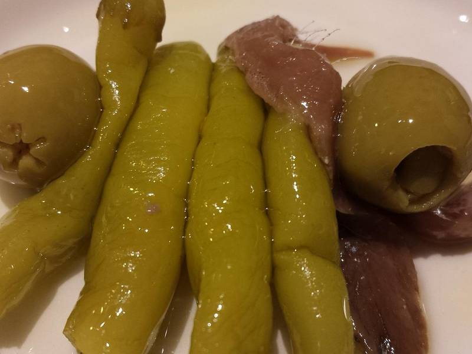

[Gilda Skewer Olive - Free photo on Pixabay](https://pixabay.com/photos/gilda-skewer-olive-anchovy-333931/) — maitesan; [Pixabay Content License](https://pixabay.com/service/license-summary/).

Finished Gildas show olives, pickled green peppers and anchovies, matching the cold skewer recipe and its gluten-free/dairy-free ingredients. Source photo published in 2014, before current image generators.

## dolma

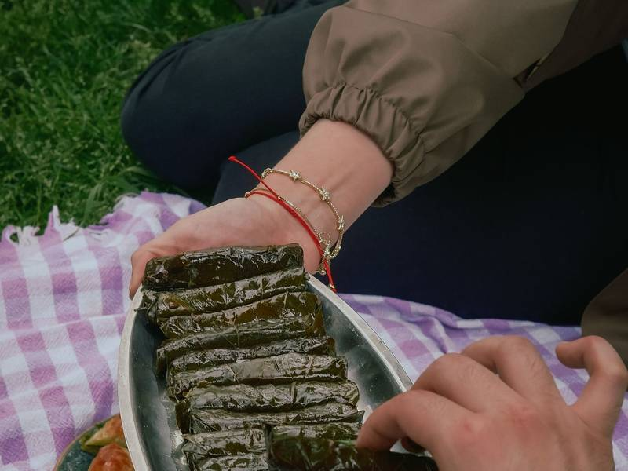

[Picnic with Dolma and Traditional Cuisine](https://www.pexels.com/photo/picnic-with-dolma-and-traditional-cuisine-37407507/) — Beyza Emişen; [Pexels License](https://www.pexels.com/license/).

Cooked vine-leaf rolls served cold on a picnic plate, matching the dish presentation. The filling is enclosed and cannot be identified visually; source names dolma without declaring meat. This is an independently photographed illustration, not the recipe being tested.

## air-fryer-banana-bread

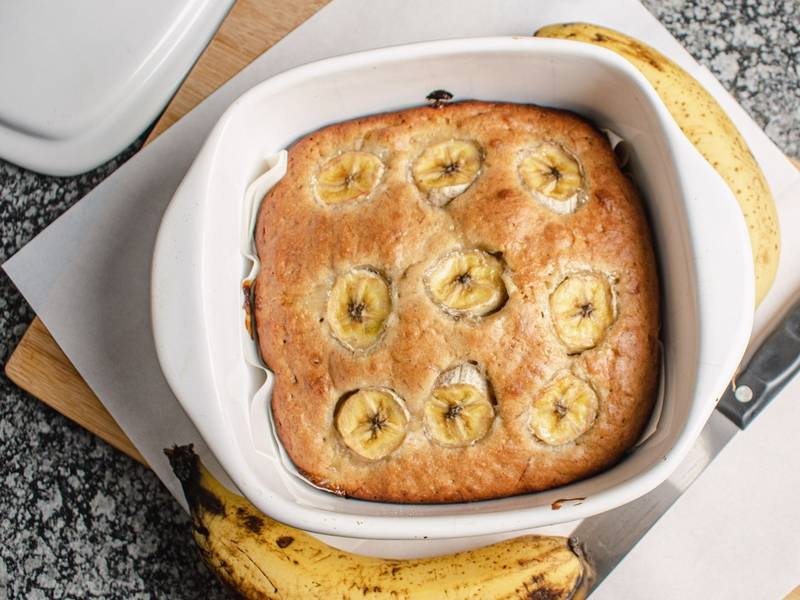

[Overhead Shot of a Banana Bread in a White Container](https://www.pexels.com/photo/overhead-shot-of-a-banana-bread-in-a-white-container-11481927/) — Oregolele Finger; [Pexels License](https://www.pexels.com/license/).

Finished banana bread in a small square baking dish with banana slices on top. The recipe uses a small loaf tin; shape and banana garnish differ. The photograph does not establish use of an air fryer.

## air-fryer-chicken-nuggets

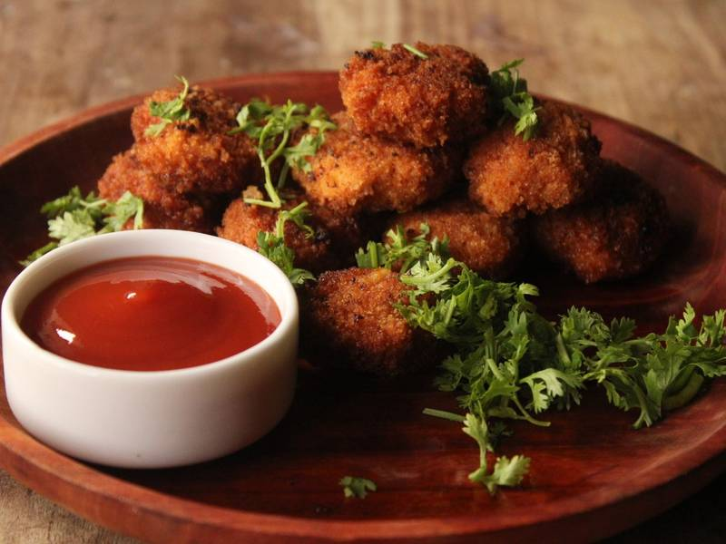

[Crispy Chicken Nuggets with Dip on Rustic Plate](https://www.pexels.com/photo/crispy-chicken-nuggets-with-dip-on-rustic-plate-39853099/) — Jahra Tasfia Reza; [Pexels License](https://www.pexels.com/license/).

Golden breadcrumb-coated chicken nuggets with ketchup alongside, matching the chicken/panko coating and dip. The photo does not establish which cooking appliance was used.

## air-fryer-cinnamon-rolls

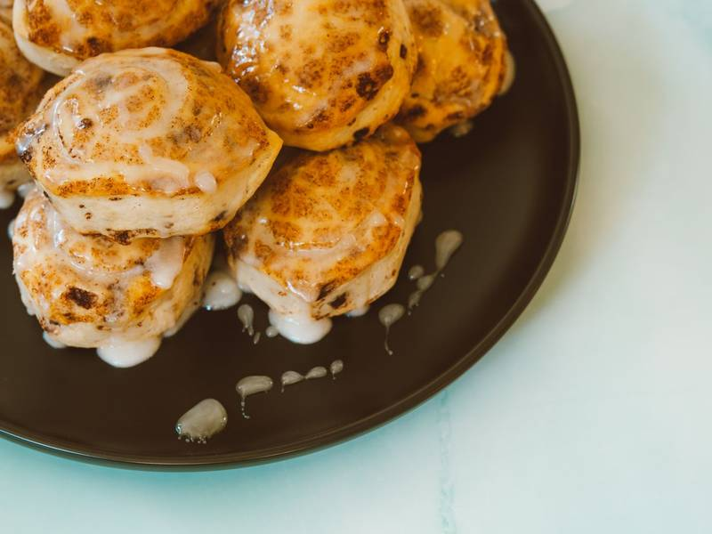

[Cinnamon Rolls with Icing ](https://www.pexels.com/photo/cinnamon-rolls-with-icing-5507698/) — Jess Loiterton; [Pexels License](https://www.pexels.com/license/).

Baked spiral cinnamon rolls with white icing match the finished dish; this stock photograph does not establish air-fryer use or the exact icing formulation.

## air-fryer-drumsticks

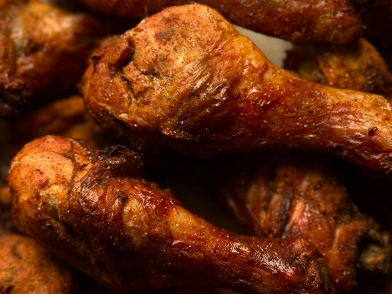

[Delicious Crispy Fried Chicken Drumsticks](https://www.pexels.com/photo/delicious-crispy-fried-chicken-drumsticks-37484986/) — Ashik  Christy; [Pexels License](https://www.pexels.com/license/).

Browned skin-on drumsticks with red seasoning and no visible breadcrumb coating match the paprika/garlic chicken recipe. Archive caption says fried; the cooking appliance and exact seasoning are not established.

## air-fryer-gyoza

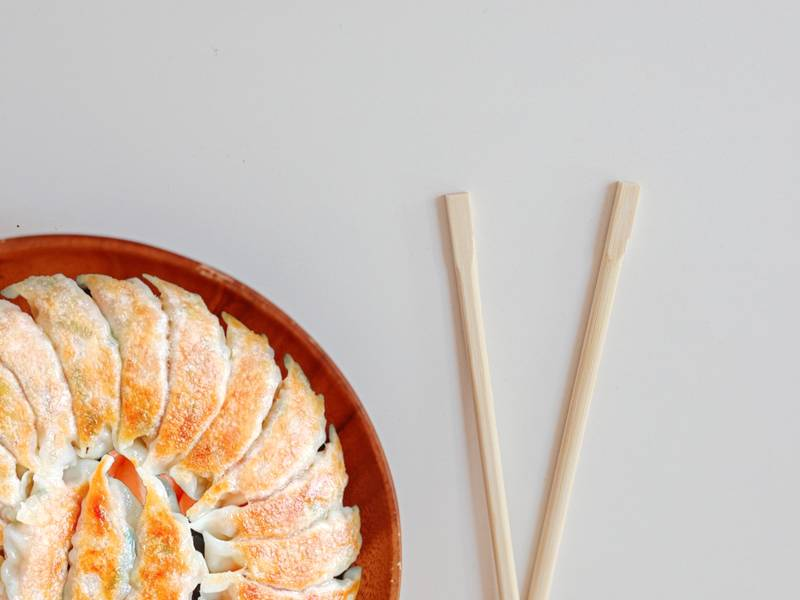

[Gyoza in a Bowl and Chopsticks ](https://www.pexels.com/photo/gyoza-in-a-bowl-and-chopsticks-9499017/) — จีรนันท์ จันทร์งาม; [Pexels License](https://www.pexels.com/license/).

Cooked folded gyoza with browned bases match the purchased pork gyoza recipe. Filling and cooking appliance cannot be established from a closed dumpling; no conflicting filling is declared by the source. Sauce is not shown.

## air-fryer-samosas

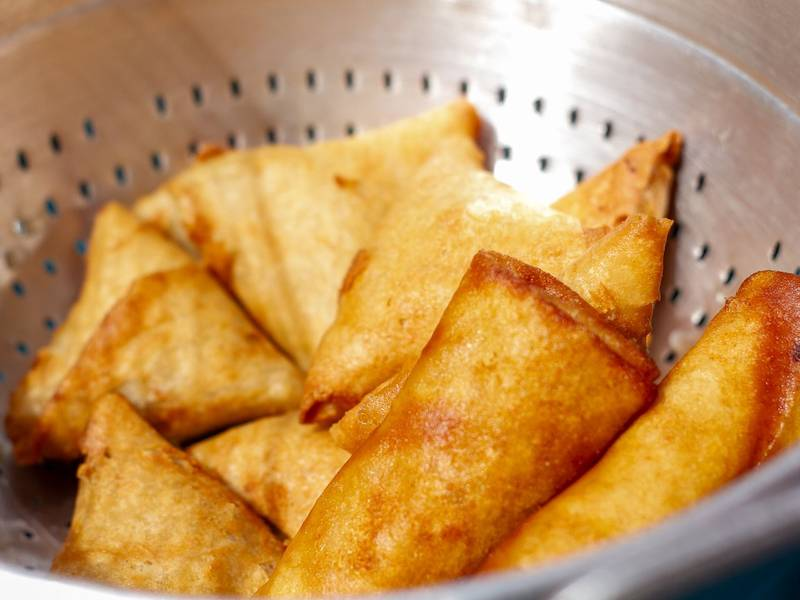

[Crispy Fried Samosas in Metal Colander](https://www.pexels.com/photo/crispy-fried-samosas-in-metal-colander-29037272/) — Hashtag Melvin; [Pexels License](https://www.pexels.com/license/).

Finished golden triangular thin-pastry samosas match the recipe shape. Source identifies fried samosas; this is an illustrative photo and does not establish air-fryer use. Enclosed potato/pea filling cannot be verified visually.

## beetroot-relish

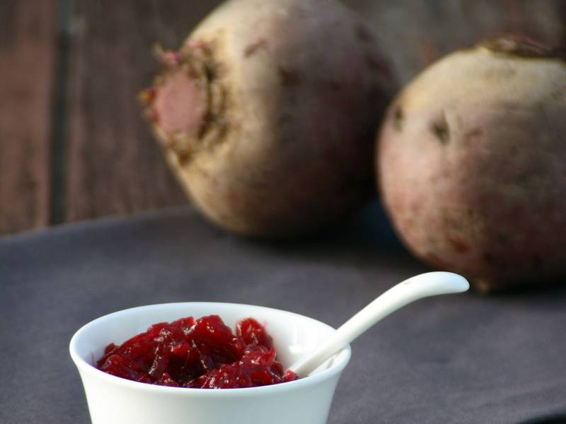

[Beetroots Relish in a Bowl](https://www.pexels.com/photo/beetroots-relish-in-a-bowl-5472026/) — Ines Iachelini; [Pexels License](https://www.pexels.com/license/).

Cooked deep-red chopped beetroot relish on a spoon, matching the sweet-sharp relish. Raw whole beetroot appears as background context; the prepared relish is the primary subject.

## 5-ingredient-lasagna

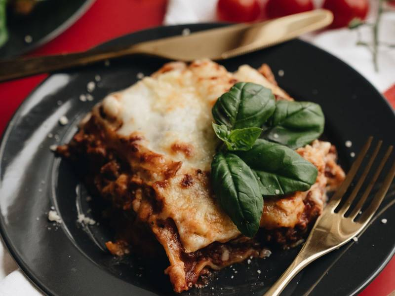

[Baked Lasagna on a Black Plate](https://www.pexels.com/photo/baked-lasagna-on-a-black-plate-5949903/) — alleksana; [Pexels License](https://www.pexels.com/license/).

A cooked slice of meat-and-tomato lasagna with browned cheese and basil garnish, matching the beef, tomato, pasta and cheese recipe; basil is a serving garnish, not an ingredient claim.

## air-fryer-cookies

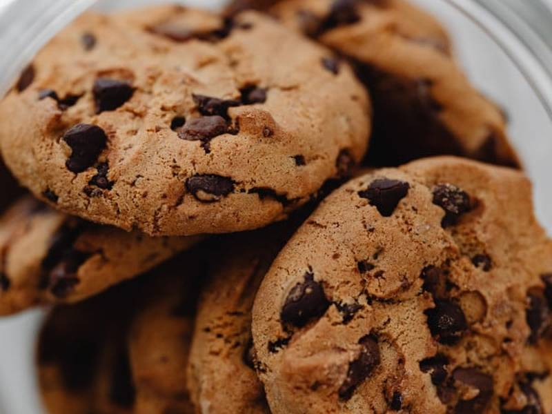

[Overhead Close-Up of Chocolate Chip Cookies inside a Clear Glass Jar](https://kaboompics.com/photo/20139/overhead-close-up-of-chocolate-chip-cookies-inside-a-clear-glass-jar) — Karolina Grabowska; [Kaboompics Standard License](https://kaboompics.com/page/license-and-faq).

Finished plain-dough chocolate-chunk cookies match the butter/egg/flour/chocolate recipe. Source uploaded 2021-02-01 and credits Karolina Grabowska. Cooking appliance is not established. Individual page expressly permits personal and commercial use; Standard License, not CC0.

## nalesniki

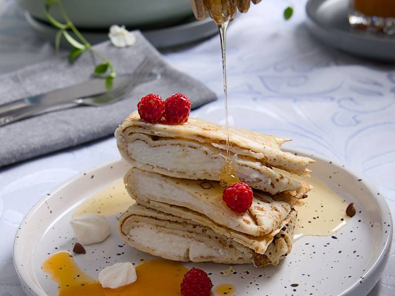

[naleśniki z serem](https://www.pexels.com/photo/nalesniki-z-serem-27097266/) — Sylwester Ficek; [Pexels License](https://www.pexels.com/license/).

Folded thin crepes with visible white curd-cheese filling match naleśniki z serem. Raspberries and syrup garnish differ from the recipe's raisins and soured-cream serving suggestion.

## pink-lemonade

[Pink Lemonade Summer Outdoors - Free photo on Pixabay](https://pixabay.com/photos/pink-lemonade-summer-outdoors-795029/) — JillWellington; [Pixabay Content License](https://pixabay.com/service/license-summary/).

Prepared pink lemonade with ice in a glass and pitcher, photographed outdoors; illustrates the chilled strawberry/lemon drink. Source published 2015. Exact fruit formulation is not established.

## roasted-garlic-soup

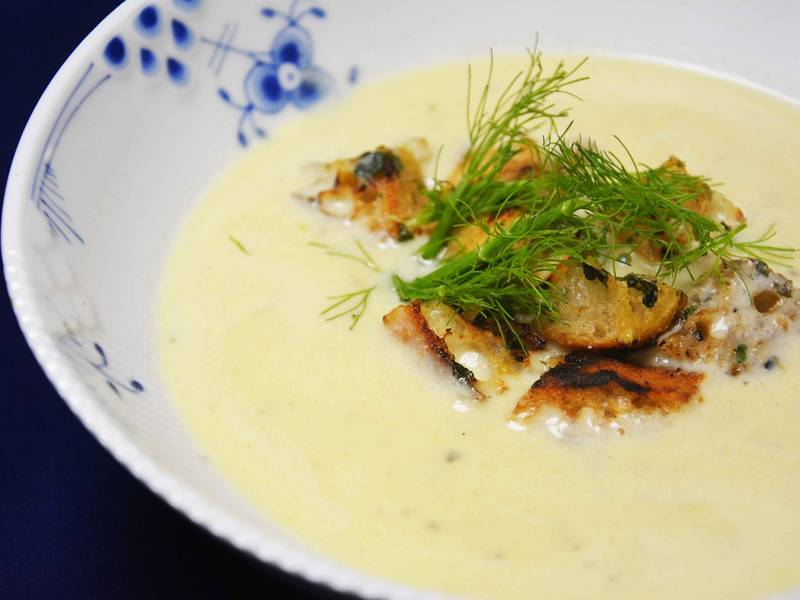

[Garlic Soup Food - Free photo on Pixabay](https://pixabay.com/photos/garlic-soup-soup-food-dinner-eat-2554678/) — laustkehlet; [Pixabay Content License](https://pixabay.com/service/license-summary/).

Creamy pale garlic soup matches the potato/cream/garlic soup. Source published 2017. Croutons and dill garnish differ from the recipe; the picture does not demonstrate the garlic roasting method.

## slow-cooker-bread-pudding

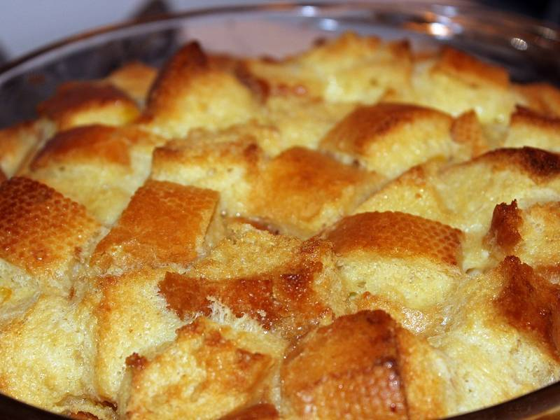

[Bread Pudding Food Dessert - Free photo on Pixabay](https://pixabay.com/photos/bread-pudding-food-dessert-bread-683918/) — genniebee512; [Pixabay Content License](https://pixabay.com/service/license-summary/).

Cooked cubed-bread custard pudding with a browned top; source published 2015. This illustrates bread pudding, with browning that may differ from a slow-cooker finish. No appliance claim is made by the source.

## slow-cooker-rice-pudding

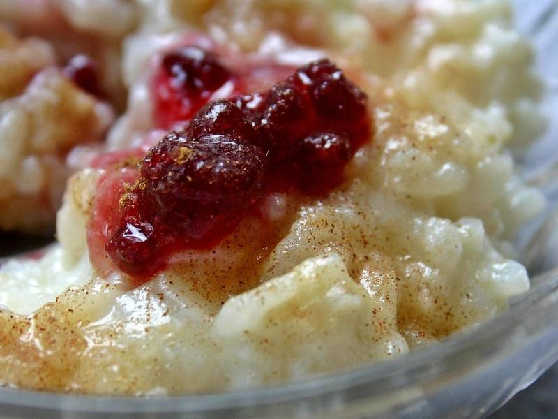

[Rice Pudding Cute Sweet - Free photo on Pixabay](https://pixabay.com/photos/rice-pudding-rice-cute-sweet-dish-480823/) — Catkin; [Pixabay Content License](https://pixabay.com/service/license-summary/).

Visible creamy rice pudding with red fruit jam and spice matches the milk/cream/rice pudding with raspberry jam. Source published 2014. Cooking appliance is not established.

## sour-cream-pound-cake

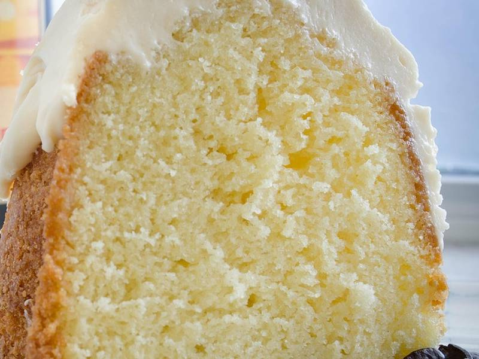

[Cakes Sour Cream Pound Cake Treats - Free photo on Pixabay](https://pixabay.com/photos/cakes-sour-cream-pound-cake-treats-3707536/) — tncarlos; [Pixabay Content License](https://pixabay.com/service/license-summary/).

Sliced plain sour-cream pound cake with a close yellow crumb, identified by the source. Source published 2018. Icing is a serving variation; the crop removes the coffee-liqueur bottle to keep the recipe illustration focused on the cake.

## air-fryer-brownies

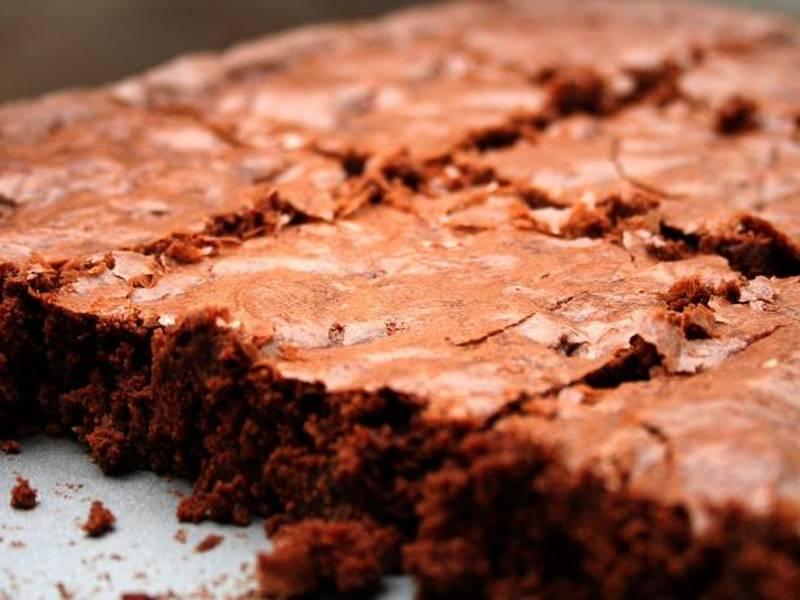

[Free photo of Fudge Brownies](https://www.stockvault.net/photo/208819/fudge-brownies) — Unknown; [CC0 1.0](https://creativecommons.org/publicdomain/zero/1.0/).

Finished chocolate fudge brownies with a crackled top match the brownie recipe. Stockvault's individual record declares CC0; its image URL records a 2016 archive path. Archive uploader is Pixabay; actual photographer is not named, so credit uses Unknown. The photo does not establish air-fryer use.

## bbq-beef-brisket

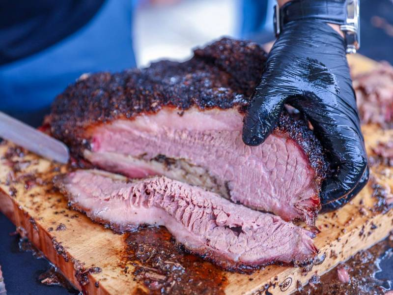

[A Person Slicing Barbecue Beef Brisket](https://www.pexels.com/photo/a-person-slicing-barbecue-beef-brisket-9397270/) — Hayden Walker; [Pexels License](https://www.pexels.com/license/).

Cooked sliced barbecue beef brisket with a dark seasoned crust matches the barbecue brisket dish. The photo does not demonstrate this recipe's oven/braising technique or sauce formulation.

## strawberry-daiquiri-mocktail

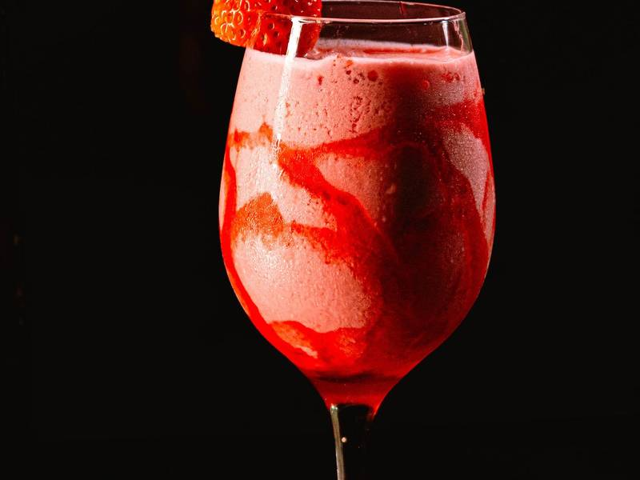

[Elegant Strawberry Daiquiri with Fresh Garnish](https://www.pexels.com/photo/elegant-strawberry-daiquiri-with-fresh-garnish-28902889/) — pedro furtado; [Pexels License](https://www.pexels.com/license/).

A red blended strawberry drink with a strawberry garnish. The individual source explicitly includes the Mocktail tag; no alcoholic brand or bottle is shown. Exact formulation is not established.

## no-bake-cherry-cheesecake

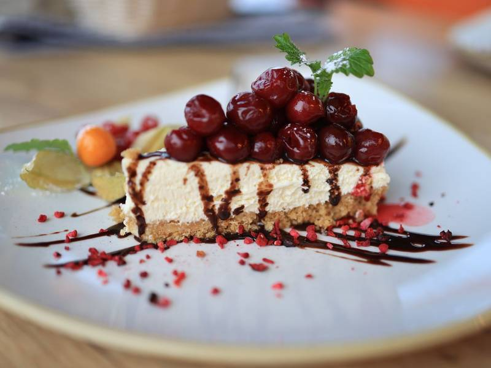

[A Cheesecake with Cherries on Top](https://www.pexels.com/photo/a-cheesecake-with-cherries-on-top-14608739/) — Valeria Boltneva; [Pexels License](https://www.pexels.com/license/).

Creamy cheesecake slice on a biscuit base with cherries, matching the dish. Whole cherries, chocolate drizzle and mint garnish differ from the recipe's cherry-pie filling; this archive image does not establish the setting/baking method.

## cucumber-mint-cooler

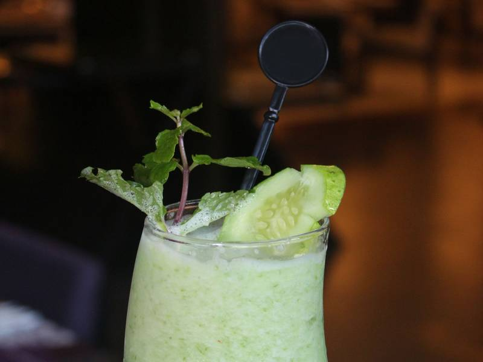

[Clear Drinking Glass With Cucumber Cooler ](https://www.pexels.com/photo/clear-drinking-glass-with-cucumber-cooler-5335918/) — bams awey; [Pexels License](https://www.pexels.com/license/).

Pale-green blended cucumber drink with visible mint and cucumber garnish matches the cucumber/mint/lime cooler. The source documents a cucumber cooler and a 2015 camera photograph, without an alcoholic ingredient claim.

## buckwheat-with-mushrooms

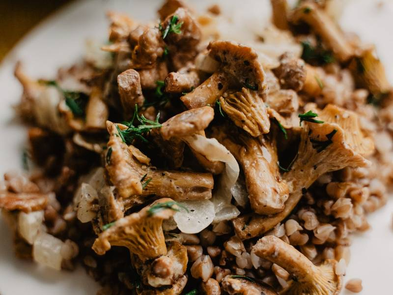

[Cooked Mushrooms on White Ceramic Plate](https://www.pexels.com/photo/cooked-mushrooms-on-white-ceramic-plate-6629120/) — Alesia  Kozik; [Pexels License](https://www.pexels.com/license/).

Cooked buckwheat groats topped with sauteed chanterelle mushrooms and onions. The source description expressly names vegan mushrooms with buckwheat; the recipe uses generic sliced mushrooms and butter. Chanterelles are a mushroom variety, not a meat substitute.

## bengali-sandesh

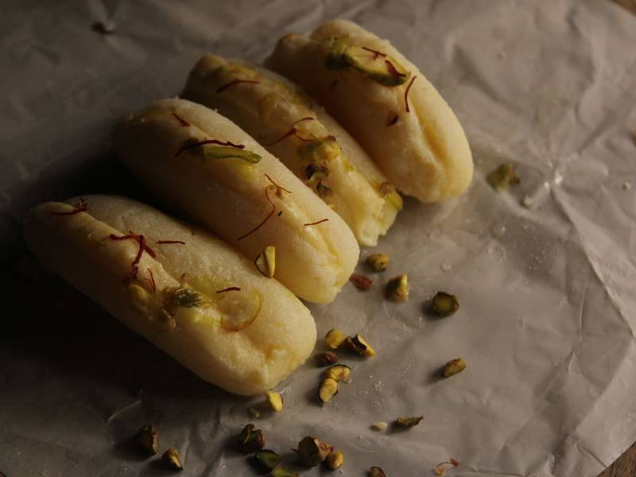

[Closeup of Delicious Indian Sandesh with Pistachios](https://www.pexels.com/photo/closeup-of-delicious-indian-sandesh-with-pistachios-39959151/) — Jahra Tasfia Reza; [Pexels License](https://www.pexels.com/license/).

Prepared shaped milk sweets with pistachios, explicitly identified as Indian sandesh by the photographer. Source camera information supports real photography. Saffron strands are a garnish variation.

## bbq-baked-beans

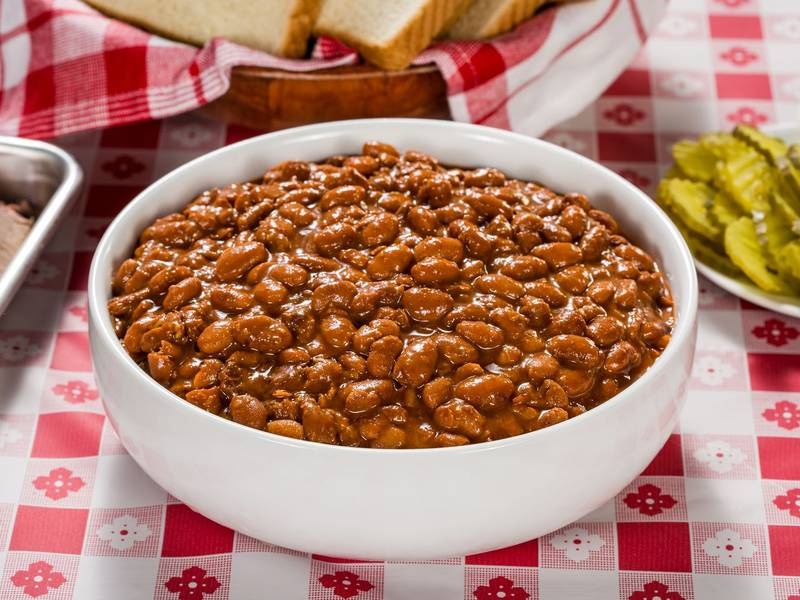

[Delicious Baked Beans on Red Checkered Tablecloth](https://www.pexels.com/photo/delicious-baked-beans-on-red-checkered-tablecloth-30146171/) — tom davis; [Pexels License](https://www.pexels.com/license/).

A cooked bowl of beans in a dark barbecue-style sauce matches the bacon/molasses/barbecue-sauce beans. The exact sauce and concealed bacon ingredients cannot be verified visually; the source documents a real 2015 camera photograph.

## cheesecake-bars

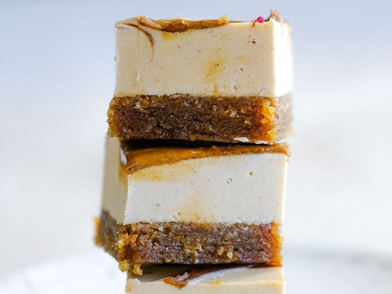

[A Close-Up Shot of a Stack of Delicious Cheesecake](https://www.pexels.com/photo/a-close-up-shot-of-a-stack-of-delicious-cheesecake-7679477/) — Canto Photography; [Pexels License](https://www.pexels.com/license/).

Two cut cheesecake bars with a thick pale filling on a golden crumb base. Brown topping/garnish differs from the plain vanilla recipe; source identifies cheesecake and records a real 2020 camera photograph.

## creamy-pesto-gnocchi

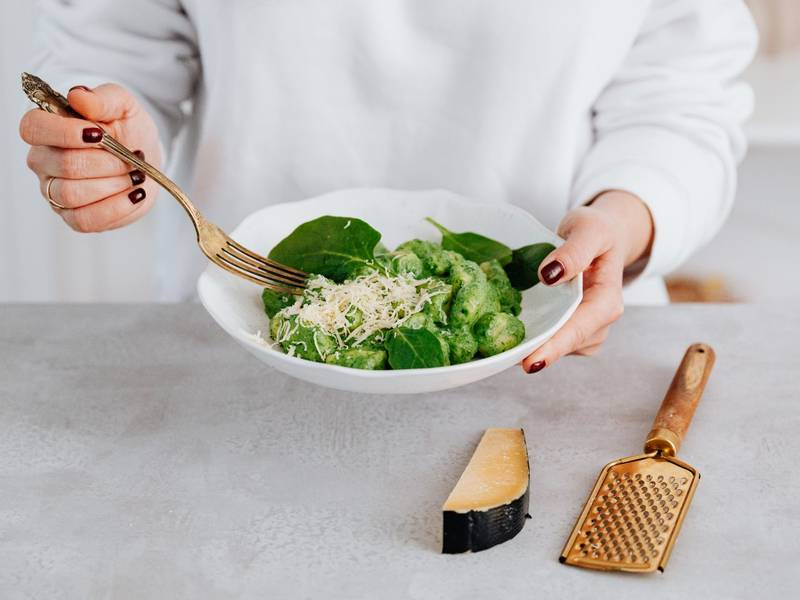

[A Close-Up Shot of a Person Eating a Bowl of Gnocchi](https://www.pexels.com/photo/a-close-up-shot-of-a-person-eating-a-bowl-of-gnocchi-6659543/) — Kaboompics; [Pexels License](https://www.pexels.com/license/).

Cooked green pesto-coated gnocchi with grated cheese matches the creamy pesto gnocchi dish. Source specifies spinach pesto and whole spinach garnish, while the recipe uses basil pesto and peas. Photograph predates current generators (published January 2021). Photographer is credited through the linked Kaboompics creator profile.

## crispy-tofu-bites

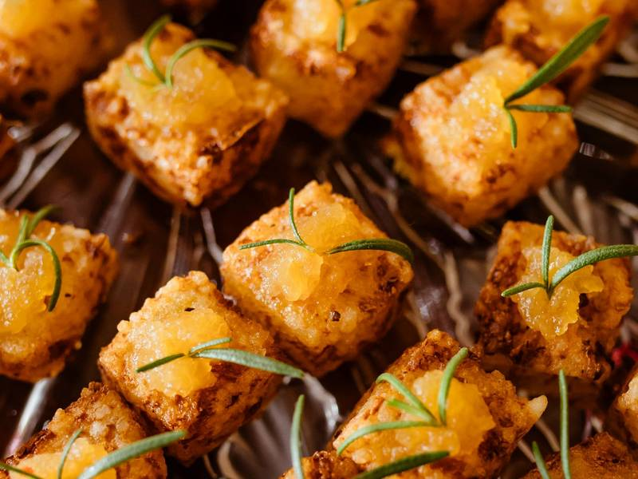

[Tofu Served on a Tray ](https://www.pexels.com/photo/tofu-served-on-a-tray-19863288/) — Jonathan Borba; [Pexels License](https://www.pexels.com/license/).

Finished golden tofu cubes with a crisp coating. Source description expressly identifies vegan tofu appetizers and camera metadata supports photography. Rosemary garnish differs from the recipe and sweet chilli sauce is not shown.

## gnocchi-bake

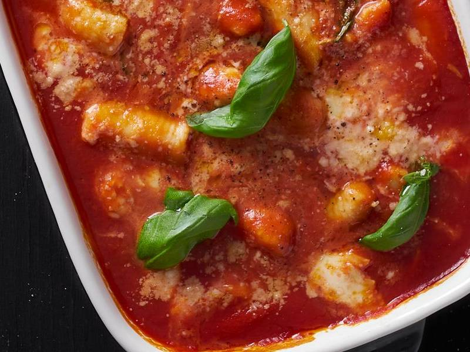

[Appetizing Tomato and Pasta Bake with Olive Oil](https://www.pexels.com/photo/appetizing-tomato-and-pasta-bake-with-olive-oil-11889305/) — Max Griss; [Pexels License](https://www.pexels.com/license/).

Cooked ridged gnocchi in tomato sauce with cheese and basil in a baking dish. Source description expressly names baked gnocchi. Crop removes a branded truffle-oil bottle; recipe uses ordinary olive oil.

## mussels-marinara

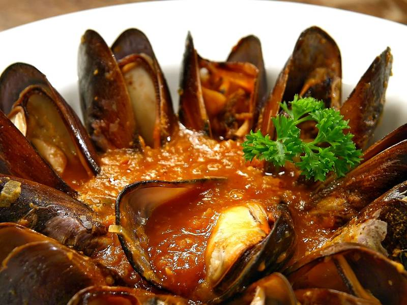

[Mussels with Sauce on Plate](https://www.pexels.com/photo/mussels-with-sauce-on-plate-26586448/) — Luiz Henrique  Mendes; [Pexels License](https://www.pexels.com/license/).

Cooked open mussels in red tomato sauce with parsley match mussels marinara. Camera record dates the photograph to 2009; the exact wine/garlic/chilli quantities are not established.

## norwegian-waffles

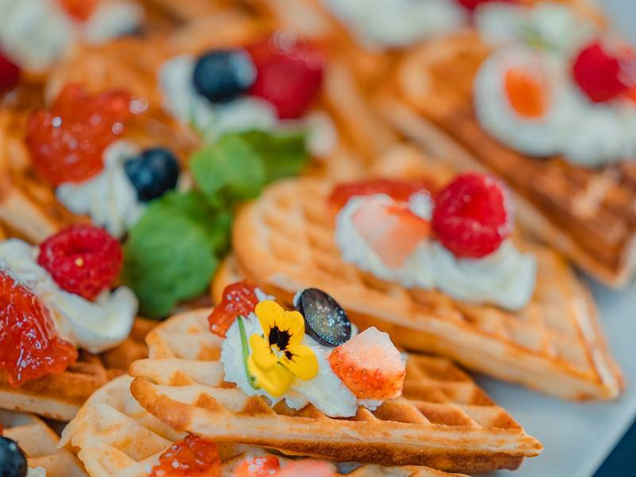

[Heart-Shaped Waffles with Cream and Fruits on Top](https://www.pexels.com/photo/norwegian-waffles-27243929/) — Nguyen Ngoc Tien; [Pexels License](https://www.pexels.com/license/).

Thin heart-shaped waffles with cream and fruit match the Norwegian waffle form. Fresh berries and piped cream differ from the jam and soured cream serving suggestion. The source records a photographed-at date.

## dairy-free-pancakes

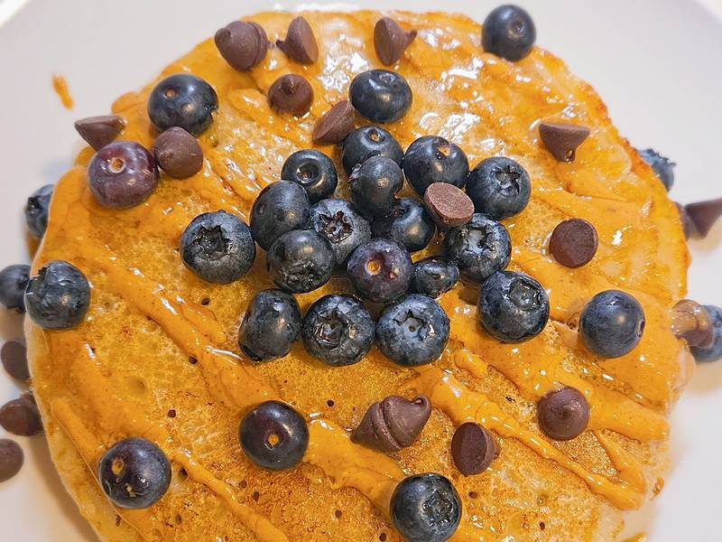

[Delicious Vegan Pancakes with Blueberries and Chocolate](https://www.pexels.com/photo/delicious-vegan-pancakes-with-blueberries-and-chocolate-35095536/) — Tansholpan  Barney; [Pexels License](https://www.pexels.com/license/).

Cooked pancakes explicitly described as vegan by the source, compatible with the dairy-free recipe. Blueberries, chocolate chips and an additional spread are serving variations; the recipe suggests maple syrup. Phone camera metadata supports photography.

## sausage-and-cheese-pasta

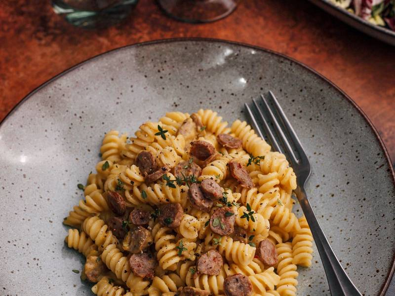

[Fusili with Sausage](https://www.pexels.com/photo/fusili-with-sausage-16010637/) — Marlein Topciu; [Pexels License](https://www.pexels.com/license/).

Finished fusilli with sliced sausage and a pale sauce. Recipe specifies penne and cheddar; the photograph illustrates a pasta-shape/serving variation and does not establish exact cheese formulation. Camera record dates it to 2020.

## fruit-loaf

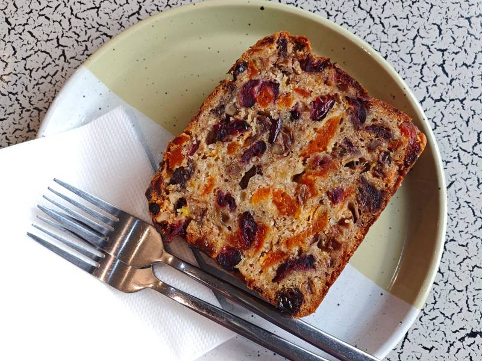

[Delicious Slice of Fruit and Nut Bread](https://www.pexels.com/photo/delicious-slice-of-fruit-and-nut-bread-36915992/) — Mariia Stepanova; [Pexels License](https://www.pexels.com/license/).

A sliced dense dried-fruit loaf with plentiful visible fruit, matching the tea-soaked fruit-loaf form. Source identifies fruit-and-nut bread; nuts are a source variation and are not added to the recipe. Actual camera metadata records a 2026 photo. The raising agent and tea-soaking method are not established by the image.
