# Selected photographs — 20 October 2026

178 photographs prepared on `images/missing-recipe-photos`. These are third-party photographs of the dishes, not evidence that this site cooked or tested these exact recipes. Source license and author credit accompany every image; serving differences are recorded.

| Recipe and preview | Attribution | Review notes |
| --- | --- | --- |
| **Almond Butter** (`almond-butter`) 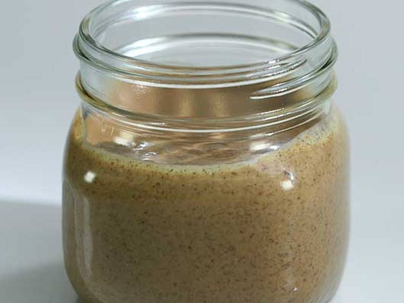 | Breville USA · [CC BY 2.0](https://creativecommons.org/licenses/by/2.0) [Source photograph](https://commons.wikimedia.org/wiki/File:Breville_Boss-_Almond_Butter_(square_crop).jpg) | Smooth almond butter in an unbranded glass jar. The archive crop is only 529 × 520 pixels; acceptable dish match but modest source resolution is retained in the provenance record. |
| **Arroz Caldo** (`arroz-caldo`) 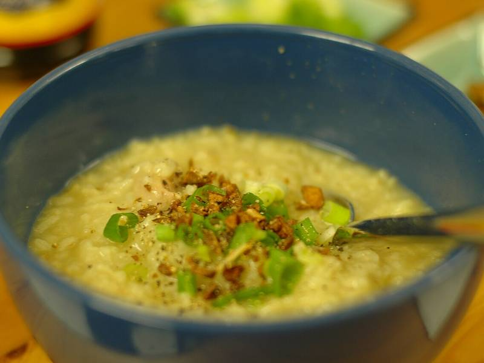 | Ernesto Andrade · [CC BY 2.0](https://creativecommons.org/licenses/by/2.0) [Source photograph](https://commons.wikimedia.org/wiki/File:Home_-_Dinner.jpg) | Cooked yellow chicken-rice porridge with scallion and fried-garlic garnish. The optional boiled-egg serving is not shown. |
| **Empire Biscuits** (`empire-biscuits`) 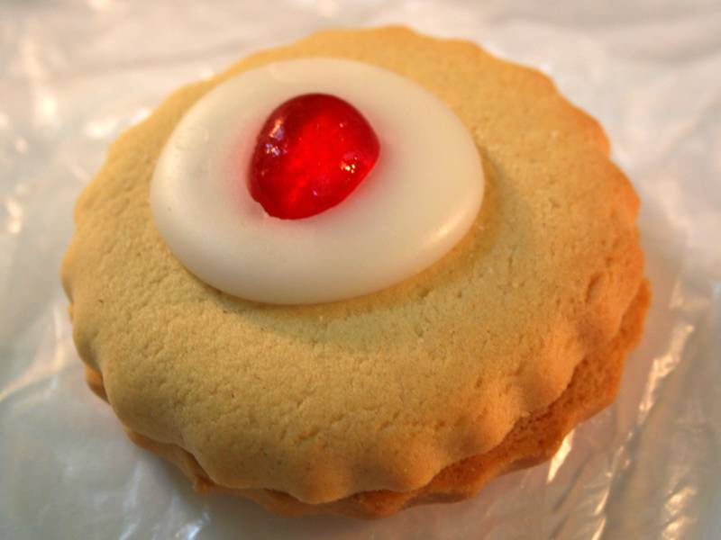 | Davidspiers at English Wikipedia · [Public domain]() [Source photograph](https://commons.wikimedia.org/wiki/File:German_biscuit.png) | Jam-sandwiched shortbread biscuits with white icing and a cherry; matches the assembled dish. |
| **Iced Buns** (`iced-buns`) 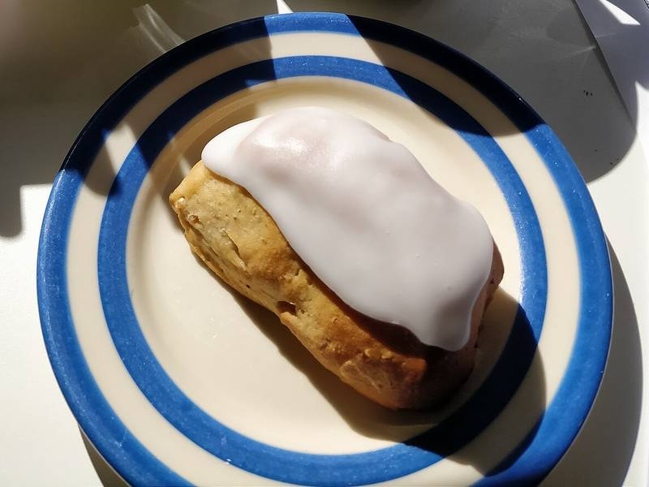 | Paul Downey · [CC BY 2.0](https://creativecommons.org/licenses/by/2.0) [Source photograph](https://commons.wikimedia.org/wiki/File:Homemade_iced_bun.jpg) | Long yeast buns with white icing, matching the recipe rather than cream-filled buns. |
| **Leberkase** (`leberkase`) 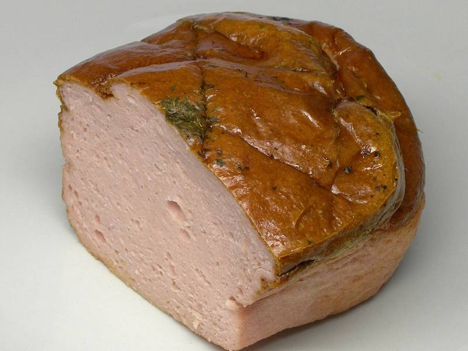 | Rainer Z ... · [CC BY-SA 3.0](https://creativecommons.org/licenses/by-sa/3.0) [Source photograph](https://commons.wikimedia.org/wiki/File:Leberk%C3%A4se-1.jpg) | Cooked finely ground meat loaf with a browned crust and pink interior; matches Leberkäse. |
| **Schweinshaxe** (`schweinshaxe`) 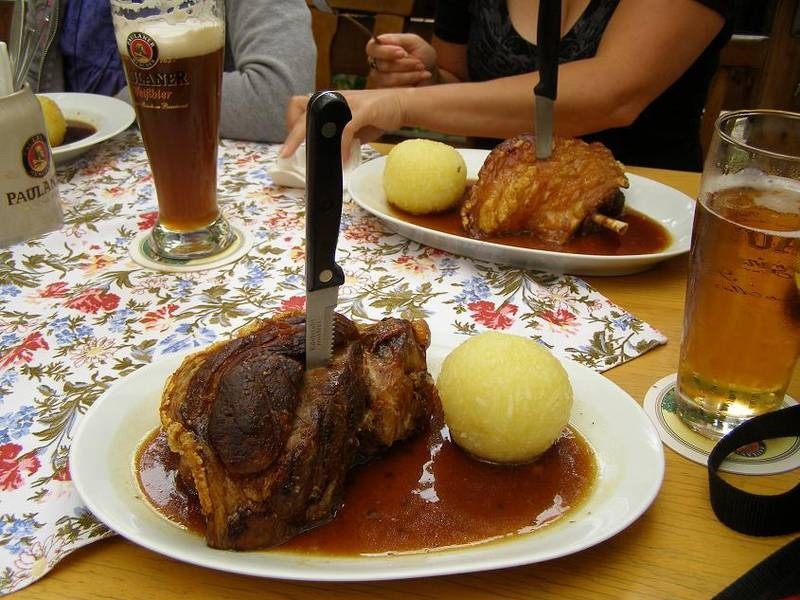 | Erich Ferdinand · [CC BY 2.0](https://creativecommons.org/licenses/by/2.0) [Source photograph](https://commons.wikimedia.org/wiki/File:00ane_Haxen.jpg) | Roasted pork knuckle with brown gravy. Potato dumplings and beer are serving accompaniments, not additional recipe instructions. |
| **Toltott Kaposzta** (`toltott-kaposzta`) 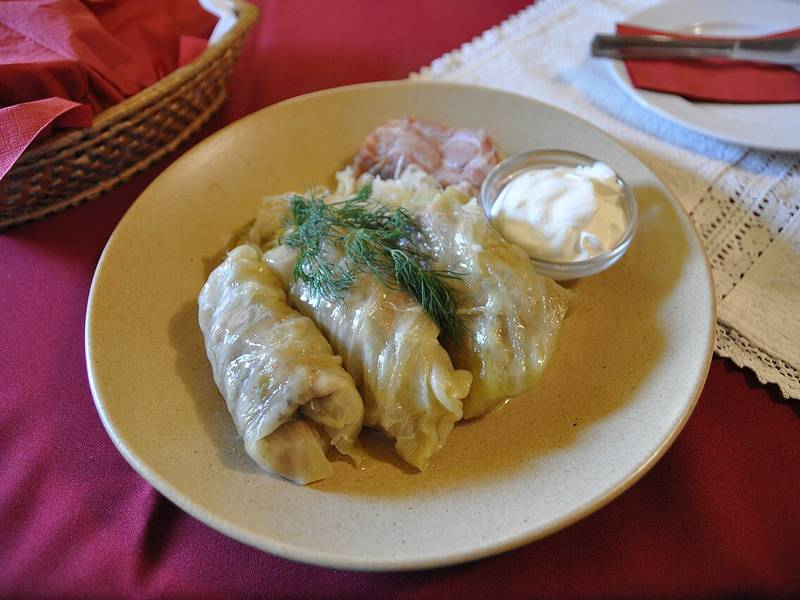 | Christo · [CC BY-SA 4.0](https://creativecommons.org/licenses/by-sa/4.0) [Source photograph](https://commons.wikimedia.org/wiki/File:T%C3%B6lt%C3%B6tt_k%C3%A1poszta,_2.jpg) | Stuffed cabbage rolls with smoked meat and soured cream. Dill is an additional serving garnish. |
| **Vinegar Pie** (`vinegar-pie`) 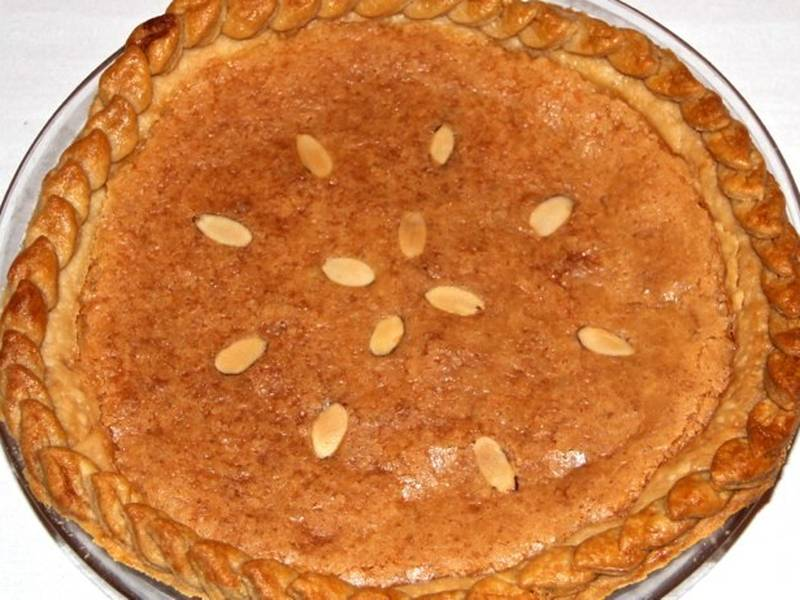 | Michon Boston Group Ltd · [CC BY 2.0](https://creativecommons.org/licenses/by/2.0) [Source photograph](https://commons.wikimedia.org/wiki/File:Old-Fashioned_Vinegar.jpg) | Baked custard-style vinegar pie in a pastry shell; the photographed pie has almond-flake decoration not specified in the recipe. No nut-free claim is made. |
| **Spritz Veneziano** (`spritz-veneziano`) 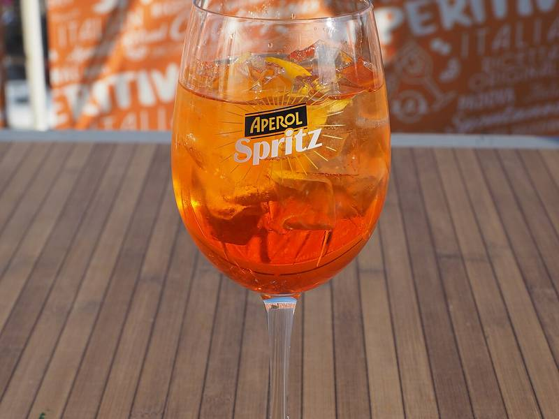 | JIP · [CC BY-SA 4.0](https://creativecommons.org/licenses/by-sa/4.0) [Source photograph](https://commons.wikimedia.org/wiki/File:Aperol_Spritz_aboard_Viking_Mariella.jpg) | Prepared orange spritz with ice and orange in a branded Aperol glass. This is a served cocktail, not a bottle or packaged product. |
| **Italian Wedding Cookies** (`italian-wedding-cookies`) 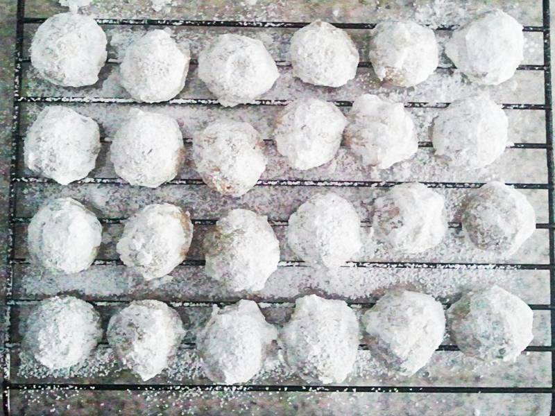 | Stacy Spensley · [CC BY 2.0](https://creativecommons.org/licenses/by/2.0) [Source photograph](https://commons.wikimedia.org/wiki/File:Russian_teacakes_(8307560889).jpg) | Powdered-sugar-coated walnut/pecan shortbread balls on a cooling rack. The source calls the same cookie family Russian tea cakes; the recipe permits walnuts or pecans. |
| **Italian Seasoning** (`italian-seasoning`) 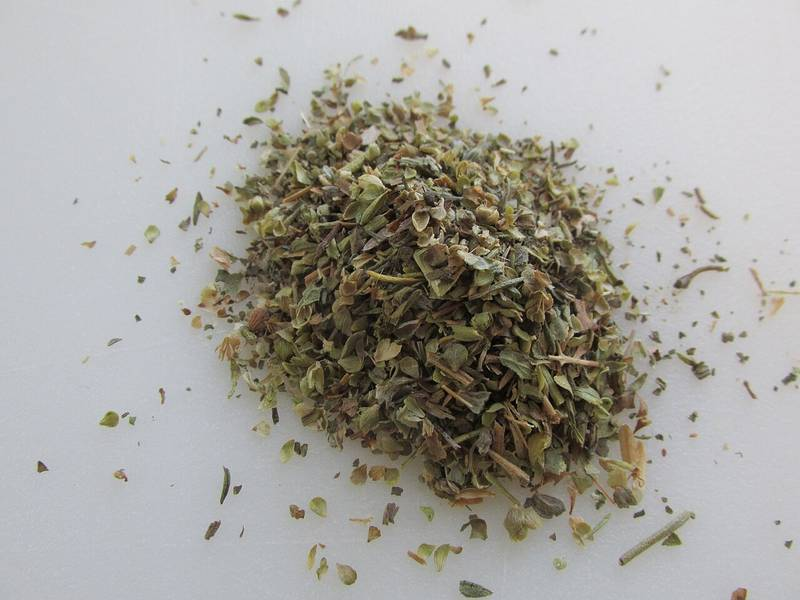 | John Phelan · [CC BY-SA 3.0](https://creativecommons.org/licenses/by-sa/3.0) [Source photograph](https://commons.wikimedia.org/wiki/File:Italian_Herb_Mix,_Penzeys_Spices,_Arlington_Heights_MA.jpg) | Mixed dried herbs without a visible package or brand. Muted green/brown herbs on a white background are a genuine color photograph, despite the monochrome heuristic. |
| **Creme Anglaise** (`creme-anglaise`) 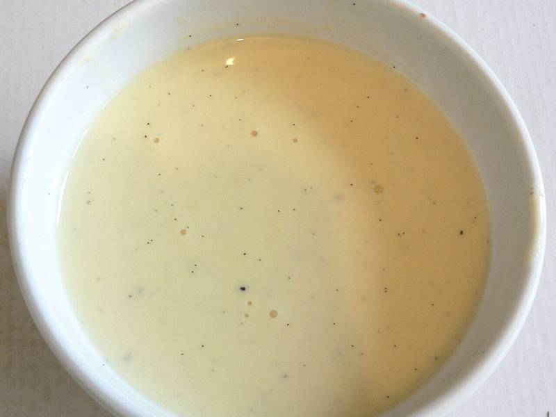 | David Monniaux · [CC BY-SA 3.0](http://creativecommons.org/licenses/by-sa/3.0/) [Source photograph](https://commons.wikimedia.org/wiki/File:Creme_anglaise_p1050159.jpg) | A bowl of pale vanilla custard sauce, with no bread or cake that would contradict the gluten-free label. |
| **Oat Cakes** (`oat-cakes`) 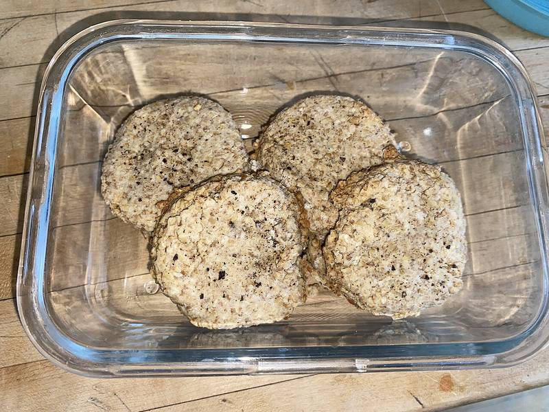 | Fitzhenrymort · [CC BY-SA 4.0](https://creativecommons.org/licenses/by-sa/4.0) [Source photograph](https://commons.wikimedia.org/wiki/File:Oatcakes_with_pepper.jpg) | Flat round baked oat crackers, not sweet breakfast pancakes. The photograph includes black pepper, which is not specified in this recipe. |
| **Vegan Burgers** (`vegan-burgers`) 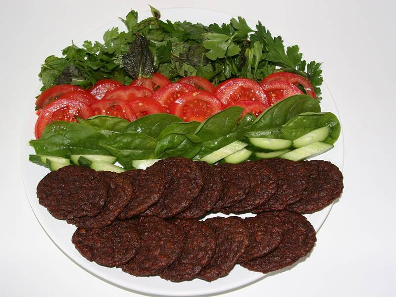 | AilinParsa · [CC0](http://creativecommons.org/publicdomain/zero/1.0/deed.en) [Source photograph](https://commons.wikimedia.org/wiki/File:Ailin3VeganBurgers.jpg) | Cooked plant-based patties with fresh tomato, cucumber and herbs. Source explicitly identifies vegan burgers; buns are not shown. No meat or dairy is visible. |
| **Arroz de Pato** (`arroz-de-pato`) 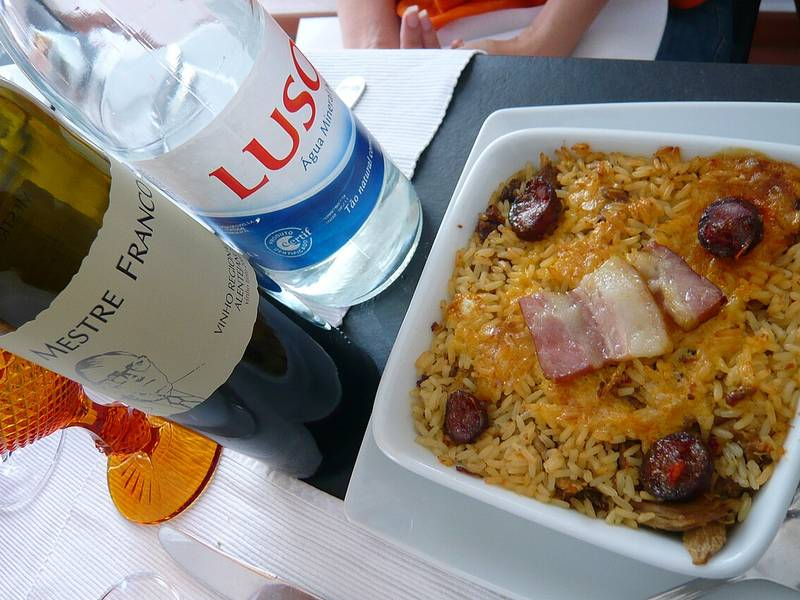 | ricardo from London · [CC BY 2.0](https://creativecommons.org/licenses/by/2.0) [Source photograph](https://commons.wikimedia.org/wiki/File:Arroz_de_Pato_(4948416093).jpg) | Baked duck rice with sliced chorizo in a casserole. A few bacon-like pieces appear as an additional topping; water and wine are table accompaniments. |
| **Ayam Percik** (`ayam-percik`) 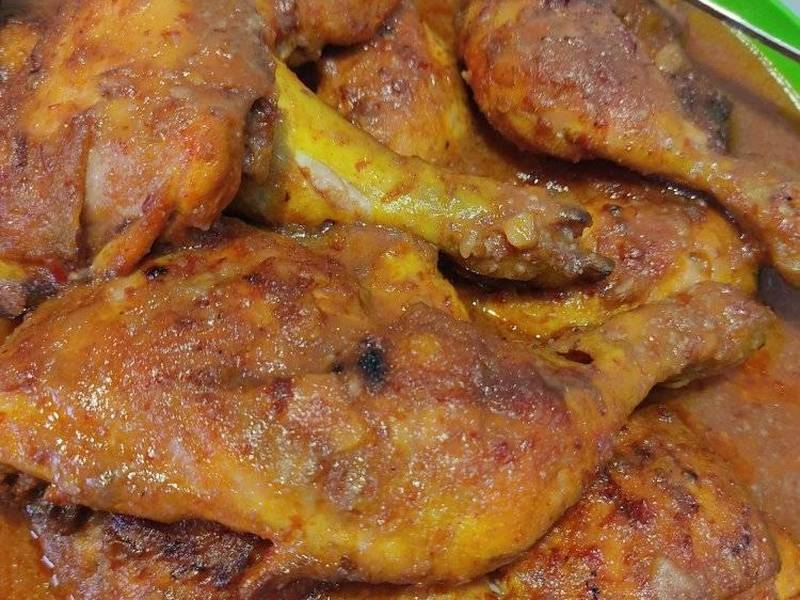 | Dr.Francostein1975 · [CC BY-SA 4.0](https://creativecommons.org/licenses/by-sa/4.0) [Source photograph](https://commons.wikimedia.org/wiki/File:Ayam_Bakar_Percik.jpg) | Grilled bone-in chicken with a golden spice/coconut coating, matching ayam percik rather than plain fried chicken. |
| **Cochinillo Asado** (`cochinillo-asado`) 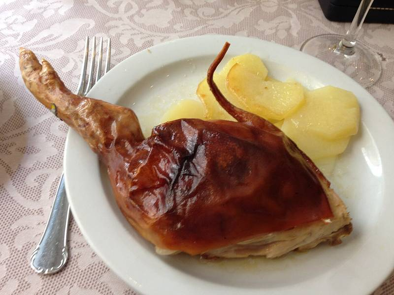 | Eric Titcombe · [CC BY 2.0](https://creativecommons.org/licenses/by/2.0) [Source photograph](https://commons.wikimedia.org/wiki/File:Cochinillo_(14862047187).jpg) | A portion of roast suckling pig with crisp skin and potatoes. The potatoes are sliced rather than the wedges specified in the recipe. |
| **Flaeskesteg** (`flaeskesteg`) 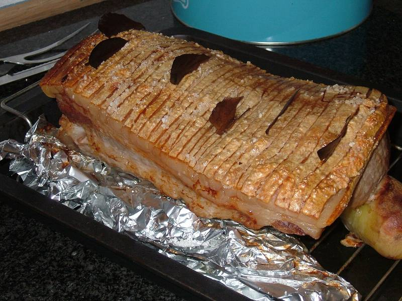 | fru_green · [CC BY-SA 2.0](https://creativecommons.org/licenses/by-sa/2.0) [Source photograph](https://commons.wikimedia.org/wiki/File:Flaeskesteg_med_svaer.jpg) | Cooked pork roast with scored crackling and bay leaves; the cream gravy and cabbage are not shown. |
| **Huevos Divorciados** (`huevos-divorciados`) 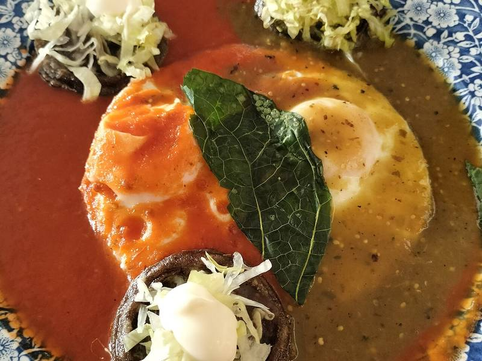 | Pequeño mar · [CC BY-SA 4.0](https://creativecommons.org/licenses/by-sa/4.0) [Source photograph](https://commons.wikimedia.org/wiki/File:Huevos_divorciados.jpg) | Eggs under separate red and green sauces, with vegetarian bean sopes, lettuce, cream and cheese. Source description confirms the accompaniments; the recipe uses tortillas and refried beans rather than sopes. |
| **Kapustnica** (`kapustnica`) 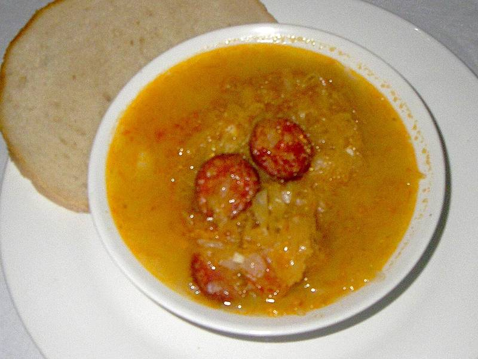 | Foxburg (original file); Off-shell (this derivative work) · [Public domain]() [Source photograph](https://commons.wikimedia.org/wiki/File:Kapustnica_(cropped).JPG) | Cooked sauerkraut soup with smoked sausage slices. Bread is a serving accompaniment; this recipe has no gluten-free label. |
| **Kohlrouladen** (`kohlrouladen`) 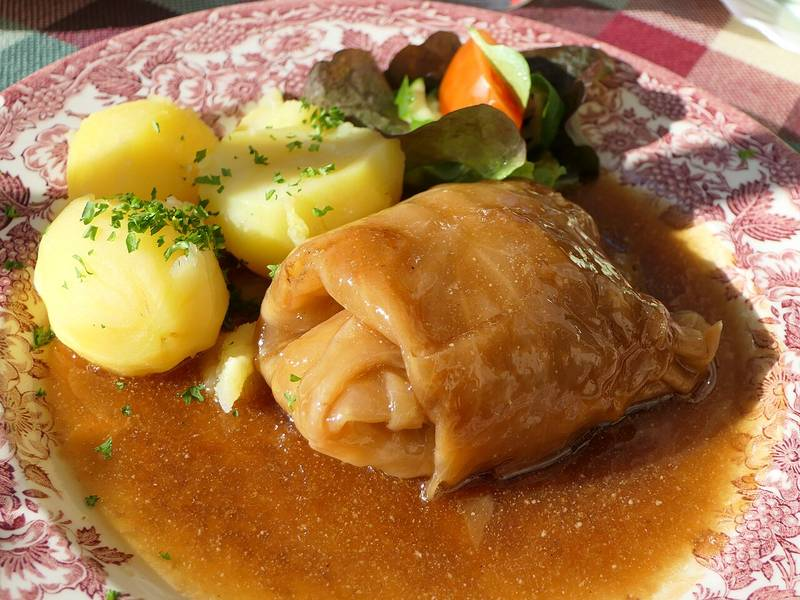 | Dr. Bernd Gross · [CC BY-SA 3.0 de](https://creativecommons.org/licenses/by-sa/3.0/de/deed.en) [Source photograph](https://commons.wikimedia.org/wiki/File:Kohlroulade.JPG) | Cooked stuffed cabbage roll in brown gravy, served with potatoes and salad. The cream finish is less prominent than in the recipe; no dairy-free claim is made. |
| **Koulouri** (`koulouri`) 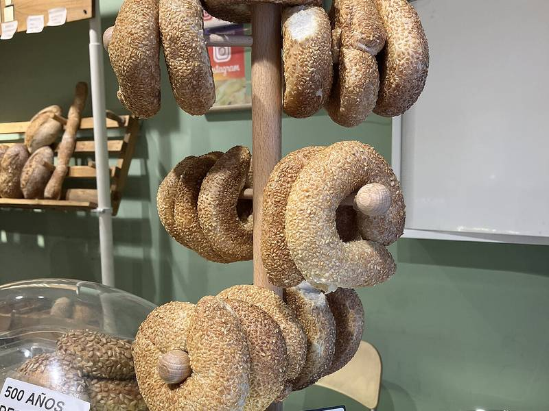 | El Mono Español · [CC BY-SA 4.0](https://creativecommons.org/licenses/by-sa/4.0) [Source photograph](https://commons.wikimedia.org/wiki/File:Kuluri_griego.jpg) | Prepared sesame-coated bread rings on a bakery display. The food itself is visible, without packaged-product artwork; it is not a shop exterior. |
| **Lapin Chasseur** (`lapin-chasseur`) 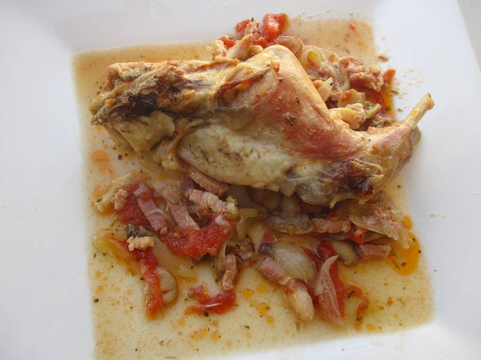 | Arnaud 25 · [CC BY-SA 4.0](https://creativecommons.org/licenses/by-sa/4.0) [Source photograph](https://commons.wikimedia.org/wiki/File:Lapin_chasseur_003.jpg) | A finished rabbit portion with tomato, onion and wine-style sauce. The photograph also shows lardons not included in this recipe; no vegetarian or meat-exclusion label applies. |
| **Malfatti** (`malfatti`) 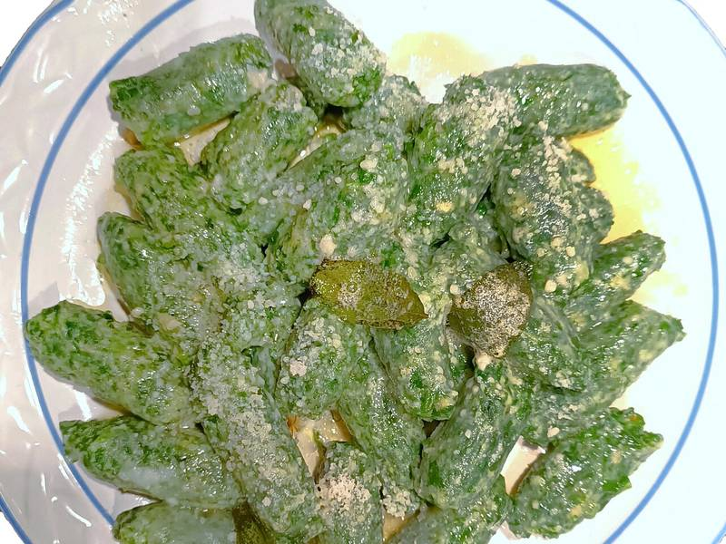 | Teseo · [CC BY-SA 4.0](https://creativecommons.org/licenses/by-sa/4.0) [Source photograph](https://commons.wikimedia.org/wiki/File:Piatto_di_malfatti.jpg) | Green spinach/ricotta dumplings with grated cheese. The elongated shape differs from a hand-rolled round but matches the same cooked dish. |
| **Marrons Glaces** (`marrons-glaces`) 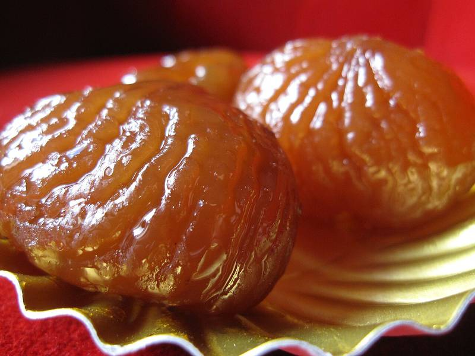 | Kate Hopkins from Seattle, WA · [CC BY 2.0](https://creativecommons.org/licenses/by/2.0) [Source photograph](https://commons.wikimedia.org/wiki/File:Closeup_of_marrons_glac%C3%A9s_in_Palermo_(5200071943).jpg) | Close-up of intact glazed chestnuts in paper cups, rather than an unrelated chocolate assortment. |
| **Piernik** (`piernik`) 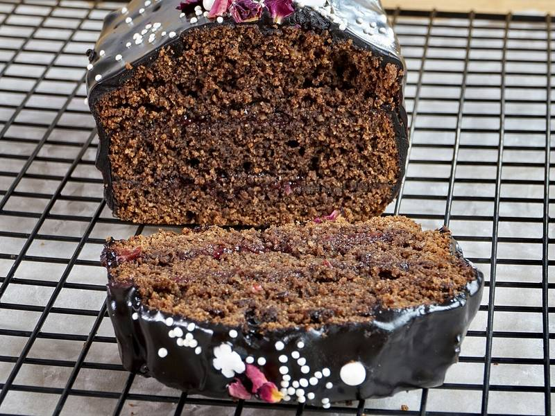 | Ewelina Podrez-Siama · [CC BY 2.0](https://creativecommons.org/licenses/by/2.0) [Source photograph](https://commons.wikimedia.org/wiki/File:Gingerbread_with_chocolate_and_jam_(KETO,_LCHF,_Low_Carb,_Gluten_free,_FIT)_-_52774942945.jpg) | A chocolate-glazed gingerbread loaf with a jam layer. The source describes a low-carbohydrate variation; the page makes no such claim, and the visible dish/structure match. Decorative sugar and flowers differ from the plain chocolate glaze. |
| **Rocky Road Ice Cream** (`rocky-road-ice-cream`) 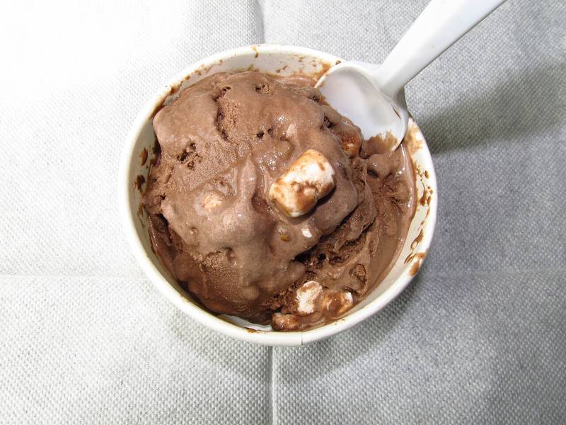 | Willis Lam · [CC BY-SA 2.0](https://creativecommons.org/licenses/by-sa/2.0) [Source photograph](https://commons.wikimedia.org/wiki/File:Joe%27s_Ice_Cream_Rocky_Road_(18394396602).jpg) | Chocolate ice cream with marshmallows and nuts in a plain bowl, matching the specified mix-ins. |
| **Sweet Potato Gnocchi** (`sweet-potato-gnocchi`) 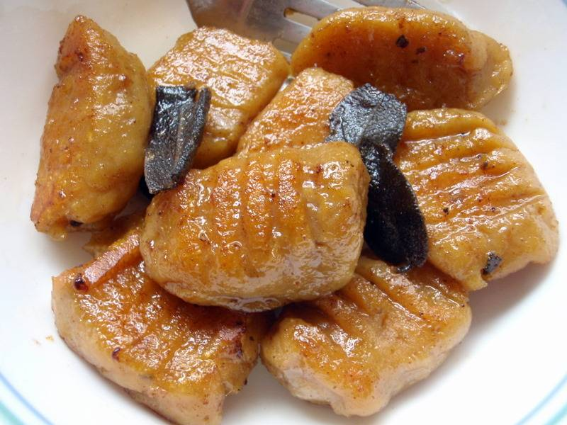 | Joy · [CC BY 2.0](https://creativecommons.org/licenses/by/2.0) [Source photograph](https://commons.wikimedia.org/wiki/File:Pan-fried_Sweet_Potato_Gnocchi.jpg) | Orange sweet-potato gnocchi with browned butter and sage. Parmesan is not visible; the core ingredients and preparation match. |
| **Texas Chili** (`texas-chili`) 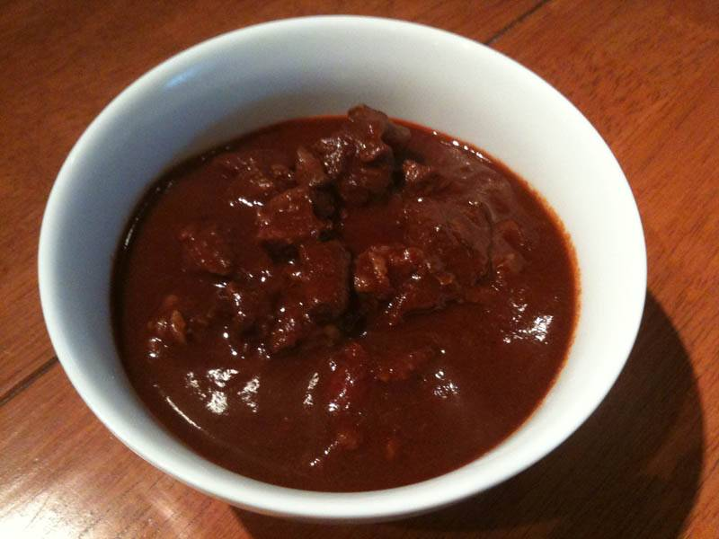 | Agentseven at en.wikipedia · [Public domain]() [Source photograph](https://commons.wikimedia.org/wiki/File:Bowl_of_Chili_No_Beans.jpg) | A bowl of dark red beef chili with no beans, cheese or soured cream, matching the dairy-free beef-chuck recipe. |
| **Torta di Mele** (`torta-di-mele`) 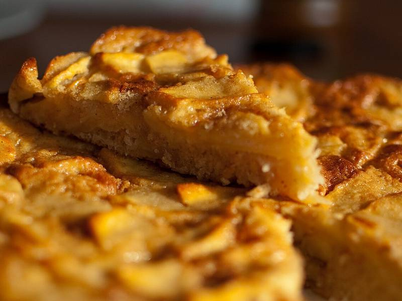 | ilaria from florence, italy · [CC BY 2.0](https://creativecommons.org/licenses/by/2.0) [Source photograph](https://commons.wikimedia.org/wiki/File:Torta_di_mele_e_cannella_1_(4568682698).jpg) | Italian apple cake with visible apple pieces. The photographed cake has cinnamon and no icing-sugar dusting; these are presentation differences. |
| **Toucinho do Ceu** (`toucinho-do-ceu`) 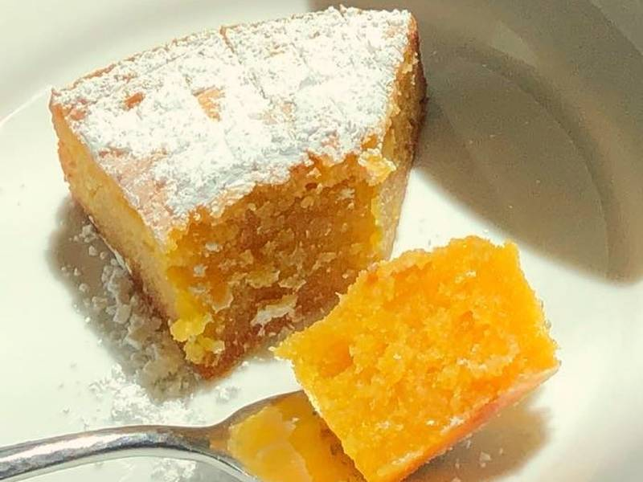 | Chedlund808 · [CC BY-SA 4.0](https://creativecommons.org/licenses/by-sa/4.0) [Source photograph](https://commons.wikimedia.org/wiki/File:Toucinhoceu.jpg) | A slice of dense golden almond/egg cake dusted with icing sugar. No flour-based pastry or breadcrumb coating is visible. |
| **Waterzooi** (`waterzooi`) 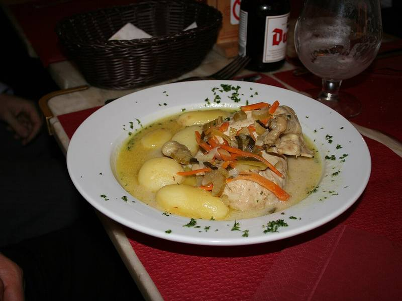 | Tamorlan · [CC BY-SA 3.0](http://creativecommons.org/licenses/by-sa/3.0/) [Source photograph](https://commons.wikimedia.org/wiki/File:Image-Waterzooi_(Fastaff)_2.jpg) | Chicken, carrots, leeks and potatoes in a pale creamy broth, matching chicken waterzooi rather than a fish variant. |
| **Chokladbollar** (`chokladbollar`) 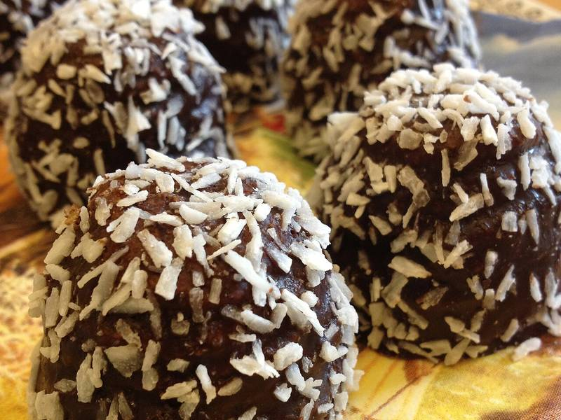 | Susanne Nilsson · [CC BY-SA 2.0](https://creativecommons.org/licenses/by-sa/2.0) [Source photograph](https://commons.wikimedia.org/wiki/File:01_Chokladbollar.jpg) | Cocoa-oat balls rolled in shredded coconut. This alternative has a clear photographer credit and matches the coating specified in the recipe. |
| **Butterfly Cakes** (`butterfly-cakes`) 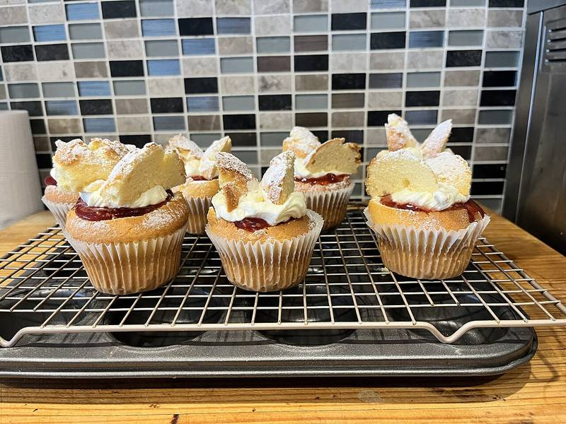 | AlphaLemur · [CC BY 4.0](https://creativecommons.org/licenses/by/4.0) [Source photograph](https://commons.wikimedia.org/wiki/File:Australian_butterfly_cupcakes_03.jpg) | Small sponge cakes with cut sponge wings, jam, cream and icing sugar. The photographed filling appears to be whipped cream rather than the recipe's buttercream; both are vegetarian. |
| **Kir Royale** (`kir-royale`) 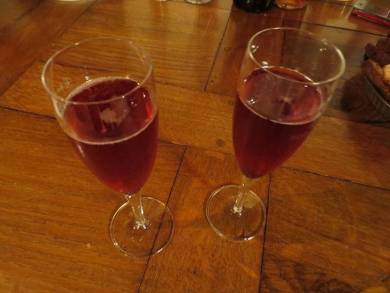 | Arnaud 25 · [CC BY-SA 3.0](https://creativecommons.org/licenses/by-sa/3.0) [Source photograph](https://commons.wikimedia.org/wiki/File:Kir_royal.JPG) | Two flutes of red cassis/sparkling-wine cocktail, without a garnish; the recipe's berry garnish is optional. |
| **Pickled Eggs** (`pickled-eggs`) 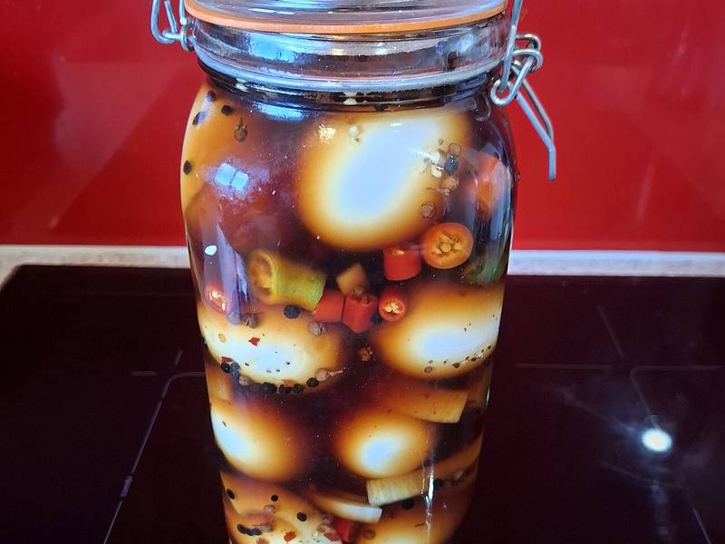 | TarnishedPath · [CC BY-SA 4.0](https://creativecommons.org/licenses/by-sa/4.0) [Source photograph](https://commons.wikimedia.org/wiki/File:Vinegar_pickled_eggs.jpg) | Peeled hard-boiled eggs in dark spiced vinegar in a clear jar. Fresh chopped chilli and onion differ from the recipe's dried chilli and garlic. Use is illustrative, not evidence of canning or room-temperature storage. |
| **Martini** (`martini`) 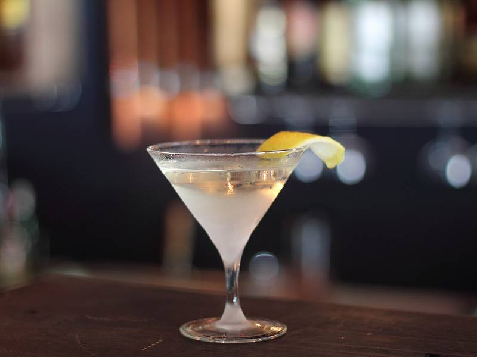 | Cocktailmarler · [CC BY-SA 4.0](https://creativecommons.org/licenses/by-sa/4.0) [Source photograph](https://commons.wikimedia.org/wiki/File:Martini_Cocktail.JPG) | Clear martini with a lemon-peel twist in a stemmed glass, matching the recipe's lemon-or-olive choice. No dairy or wheat accompaniment is visible. |
| **Leche Flan** (`leche-flan`) 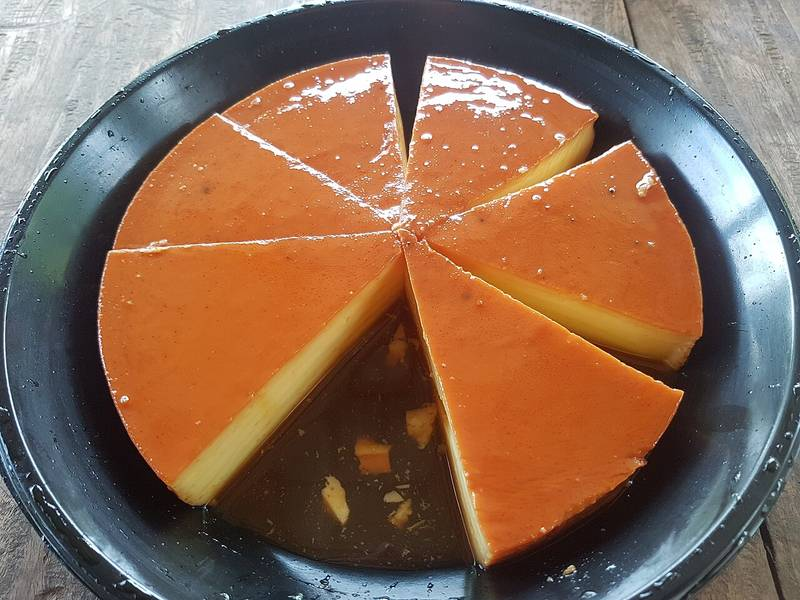 | Obsidian Soul · [CC0](http://creativecommons.org/publicdomain/zero/1.0/deed.en) [Source photograph](https://commons.wikimedia.org/wiki/File:Leche_flan_(Philippines)_02.jpg) | Dense yellow Filipino leche flan with a smooth caramel top, cut into wedges. Public-domain dedication is recorded as CC0; the photographer is still credited. |
| **Pisto** (`pisto`) 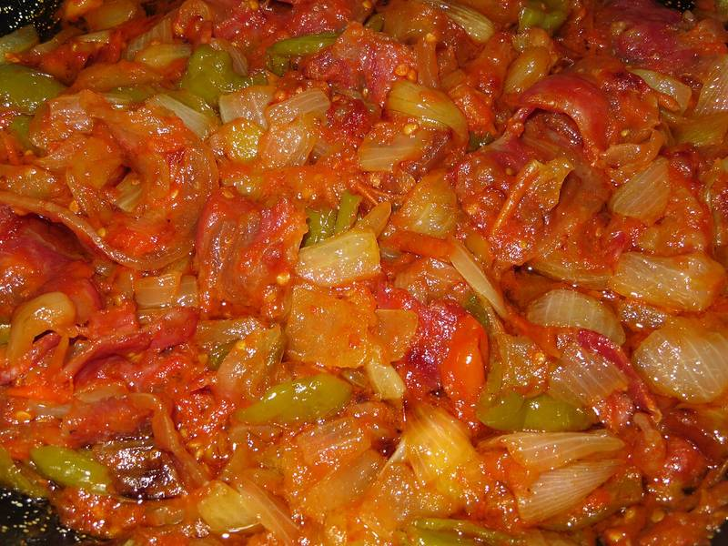 | Juan Emilio Prades Bel · [CC BY 4.0](https://creativecommons.org/licenses/by/4.0) [Source photograph](https://commons.wikimedia.org/wiki/File:Pisto,_sofrito_de_verduras.jpg) | Cooked red/green peppers, tomato and onion in a thick pisto sauce. No egg, meat, dairy or wheat accompaniment is visible; the source identifies pisto/sofrito de verduras. |
| **Pulla** (`pulla`) 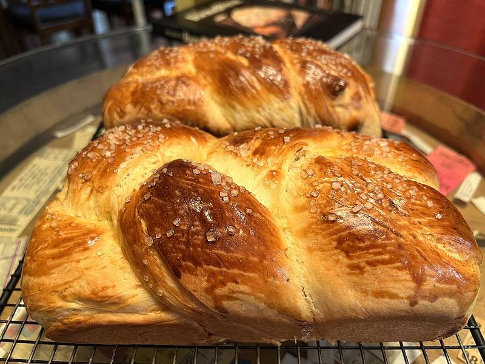 | Capvideo · [CC BY 4.0](https://creativecommons.org/licenses/by/4.0) [Source photograph](https://commons.wikimedia.org/wiki/File:Finnish_Cardamom_Bread.jpg) | Braided Finnish cardamom loaves with a shiny egg glaze and coarse sugar; closer to the recipe than the alternative with icing drizzle. Almonds are not visible. |
| **Appeltaart** (`appeltaart`) 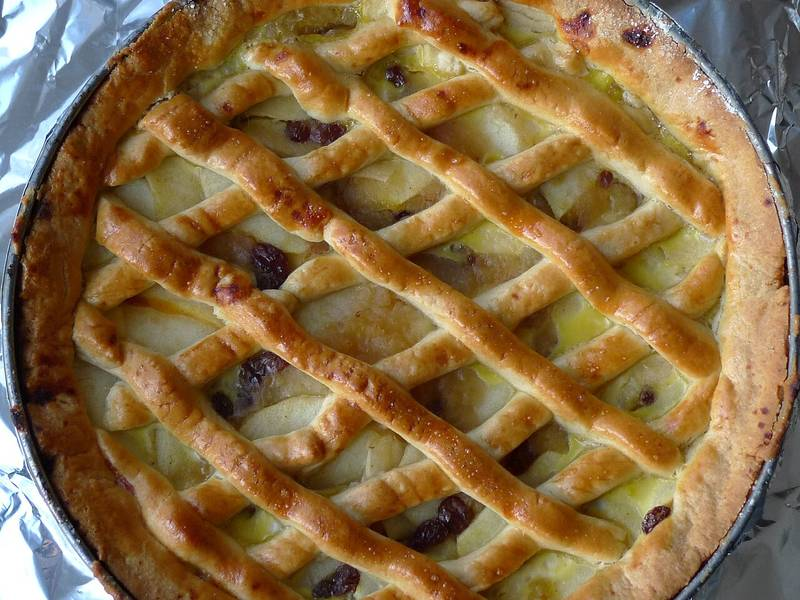 | Remko van Dokkum from Amsterdam, The Netherlands · [CC BY 2.0](https://creativecommons.org/licenses/by/2.0) [Source photograph](https://commons.wikimedia.org/wiki/File:Appeltaart_-_Applepie_(3050350180).jpg) | Deep Dutch apple pie with apple pieces, raisins and a pastry lattice. Whipped cream is not shown, but the core assembled dish matches. |
| **Bastani Sonnati** (`bastani-sonnati`) 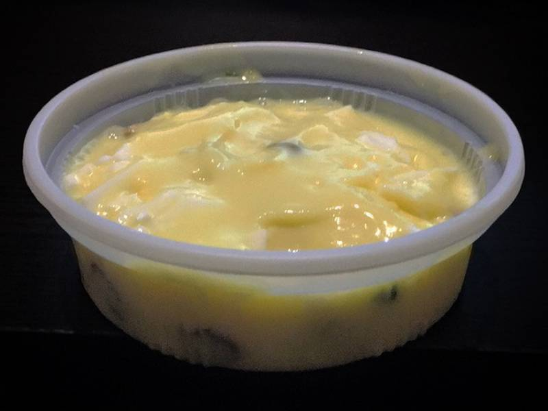 | Rye-96 · [CC BY-SA 4.0](https://creativecommons.org/licenses/by-sa/4.0) [Source photograph](https://commons.wikimedia.org/wiki/File:Saffron_ice_cream.jpg) | Yellow saffron ice cream with pistachio and cream pieces, in an unbranded bowl. The source explicitly identifies Iranian traditional saffron ice cream; no wheat wafer is present. |
| **Cookies and Cream Ice Cream** (`cookies-and-cream-ice-cream`) 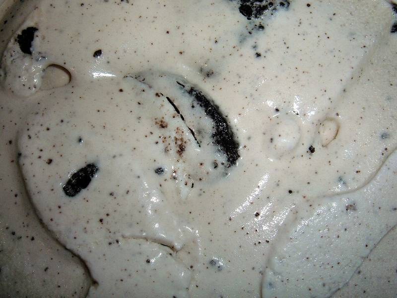 | BrokenSphere · [CC BY-SA 3.0](http://creativecommons.org/licenses/by-sa/3.0/) [Source photograph](https://commons.wikimedia.org/wiki/File:Cookies_and_cream.JPG) | Close-up of pale ice cream with broken dark sandwich cookies. This genuine color photograph has very low channel spread because of the white ice cream; its warm tones and texture were verified at full size. |
| **Kluski Slaskie** (`kluski-slaskie`) 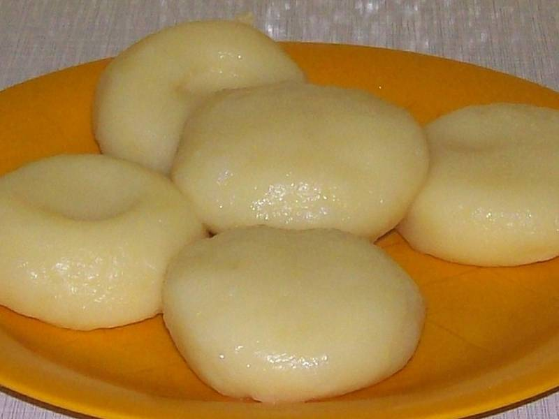 | Ewkaa · [CC BY-SA 4.0](https://creativecommons.org/licenses/by-sa/4.0) [Source photograph](https://commons.wikimedia.org/wiki/File:Kluski_%C5%9Bl%C4%85skie_01.jpg) | Plain cooked Silesian potato dumplings with characteristic dimples. The recipe also serves beef gravy and parsley, which are not pictured. |
| **Ginger Ale** (`ginger-ale`) 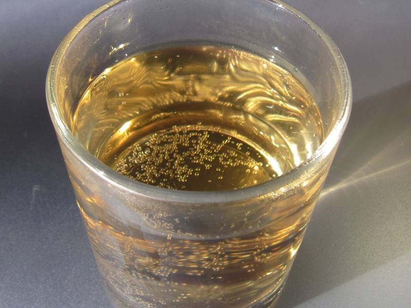 | GeoTrinity · [CC BY-SA 3.0](https://creativecommons.org/licenses/by-sa/3.0) [Source photograph](https://commons.wikimedia.org/wiki/File:Ginger_Ale_1.jpg) | An unbranded glass of pale golden carbonated ginger ale, identified by the archive source. Ice and lemon garnish are not shown; this is not a packaged drink product photo. |
| **Savarin** (`savarin`) 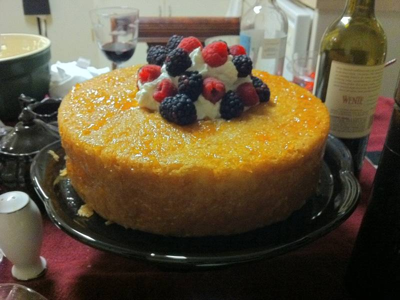 | Brandon Daniel from USA · [CC BY-SA 2.0](https://creativecommons.org/licenses/by-sa/2.0) [Source photograph](https://commons.wikimedia.org/wiki/File:Savarin_(5197803222).jpg) | A glazed ring-shaped savarin topped with cream and mixed berries. The photo includes raspberries/blackberries instead of the recipe's strawberries. |
| **Waffle Fries** (`waffle-fries`) 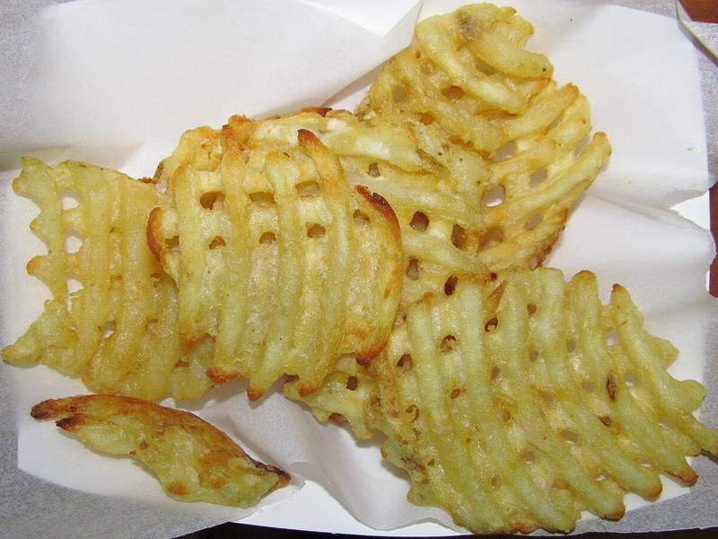 | Willis Lam · [CC BY-SA 2.0](https://creativecommons.org/licenses/by-sa/2.0) [Source photograph](https://commons.wikimedia.org/wiki/File:Loop_Neighborhood_Stores_Waffle_Fries_(26583899591).jpg) | Cooked criss-cross potato waffle fries on plain paper. No meat accompaniment is visible; the recipe's soured-cream/chive dip is not shown. |
| **Arnold Palmer** (`arnold-palmer`) 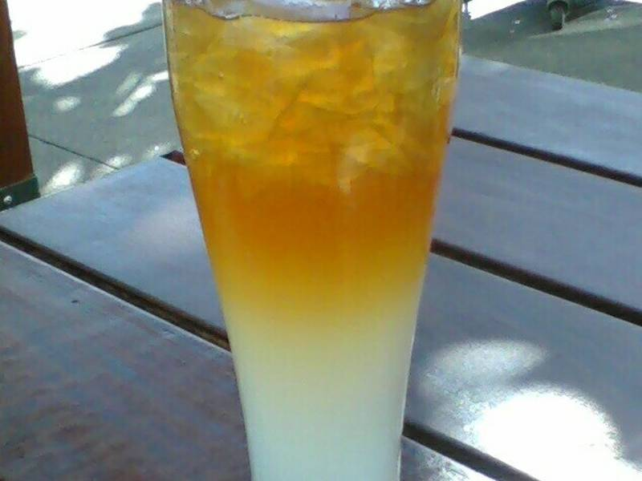 | irina slutsky from san francisco, USA · [CC BY 2.0](https://creativecommons.org/licenses/by/2.0) [Source photograph](https://commons.wikimedia.org/wiki/File:My_new_obsession_the_arnold_palmer!!!_(5184944881).jpg) | An iced tea/lemonade drink in an unbranded glass, identified as an Arnold Palmer by the source. Lemon and mint garnishes are not visible; the recipe's dairy-free/vegan labels fit the pictured drink. |
| **BBQ Chicken Pizza** (`bbq-chicken-pizza`) 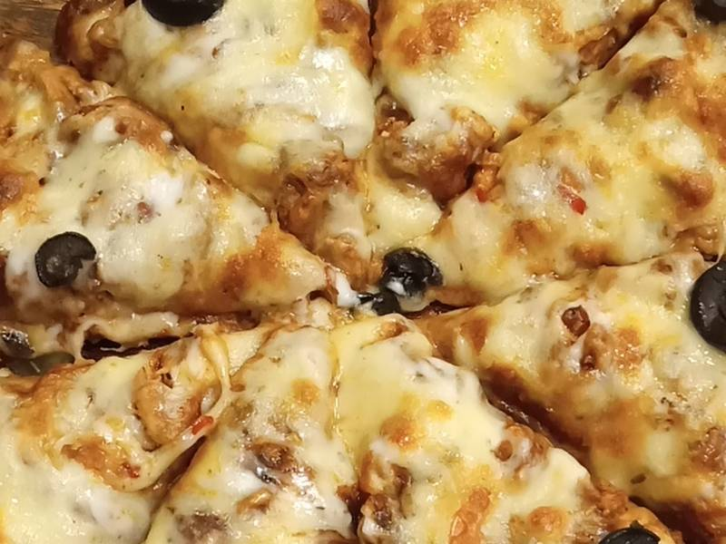 | Cbhavani02 · [CC BY-SA 4.0](https://creativecommons.org/licenses/by-sa/4.0) [Source photograph](https://commons.wikimedia.org/wiki/File:Chicken_BBQ_Pizza.jpg) | Cooked chicken pizza with browned mozzarella and barbecue sauce. The source explicitly describes BBQ chicken, red onion and cilantro; black olive slices are an additional visible topping not listed in the recipe. |
| **Brioche Buns** (`brioche-buns`) 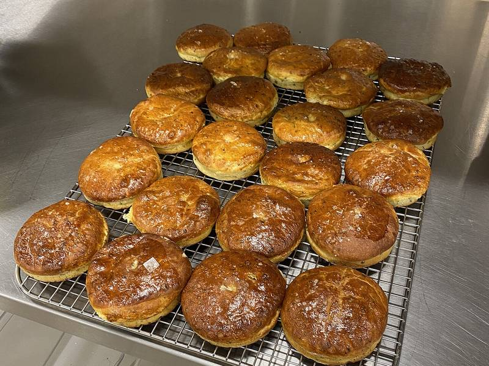 | Fitzhenrymort · [CC BY-SA 4.0](https://creativecommons.org/licenses/by-sa/4.0) [Source photograph](https://commons.wikimedia.org/wiki/File:Brioche_buns.jpg) | Golden glazed brioche buns on a cooling rack. The source specifies a savory chive/scallion/ricotta variation, whereas this recipe is plain brioche. The central bread form and vegetarian label match; the buns in the photo are flatter than typical burger buns. |
| **Chirashi Bowl** (`chirashi-bowl`)  | Boydstun215 · [CC BY 4.0](https://creativecommons.org/licenses/by/4.0) [Source photograph](https://commons.wikimedia.org/wiki/File:Japanese_Food_Truck_7.jpg) | A chirashi rice bowl with raw salmon/tuna and cucumber. The photograph adds roe, eel and other toppings beyond the recipe's salmon/tuna/avocado version. No dairy is visible; it illustrates the dish family rather than these exact ingredients. |
| **Cod in Parsley Sauce** (`cod-in-parsley-sauce`)  | Andy / Andrew Fogg from near Cambridge, UK · [CC BY 2.0](https://creativecommons.org/licenses/by/2.0) [Source photograph](https://commons.wikimedia.org/wiki/File:Tfafp_(8418321278).jpg) | Cooked cod under a milk-based fresh parsley sauce, explicitly identified in the source description. Rosti and broad beans are photographed as serving accompaniments, not ingredients of the sauce recipe. |
| **Cream of Chicken Soup** (`cream-of-chicken-soup`)  | Miansari66 · [CC0](http://creativecommons.org/publicdomain/zero/1.0/deed.en) [Source photograph](https://commons.wikimedia.org/wiki/File:Cream_of_Chicken_Soup.jpg) | A bowl of pale creamy chicken soup with visible shredded chicken and vegetables. Carrot/red vegetable pieces are additional to the recipe's onion and celery; this is neither noodle soup nor a plated roast. |
| **Eggy Bread** (`eggy-bread`)  | Ocdp · [CC0](http://creativecommons.org/publicdomain/zero/1.0/deed.en) [Source photograph](https://commons.wikimedia.org/wiki/File:French_toast_001.jpg) | Bread coated in egg/milk and pan-fried golden, served with a knob of butter. Source calls it French toast; this recipe is the same basic eggy-bread preparation served with ketchup instead. The pictured bread is not dusted with sugar or cinnamon. |
| **Garlic Parmesan Fries** (`garlic-parmesan-fries`)  | HarshLight · [CC BY 2.0](https://creativecommons.org/licenses/by/2.0) [Source photograph](https://commons.wikimedia.org/wiki/File:Pommes_Frites_-_Cafe_Orleans.jpg) | Potato fries with grated cheese, garlic and green herbs. The visible crumbly topping is Parmesan, not a breadcrumb coating; a dip is an additional serving accompaniment. No wheat noodles, bread or breaded coating is visible on the gluten-free recipe illustration. |
| **Mango Sorbet** (`mango-sorbet`)  | Christine Leiser from Ocala, FL, US · [CC BY 2.0](https://creativecommons.org/licenses/by/2.0) [Source photograph](https://commons.wikimedia.org/wiki/File:Mango_sorbet_dessert_(3460219556).jpg) | Bright yellow scoops of mango sorbet in a plain bowl, identified as sorbet in the archive. Mint is an additional garnish; no cream, wafer or other dairy/wheat accompaniment is visible. |
| **Mornay Sauce** (`mornay-sauce`)  | Pranj97 · [CC BY-SA 4.0](https://creativecommons.org/licenses/by-sa/4.0) [Source photograph](https://commons.wikimedia.org/wiki/File:Mornay_Sauce.jpg) | Finished pale Mornay cheese sauce in an unbranded transparent jar, identified by the photographer. No commercial product label or raw ingredient arrangement is shown; the photograph is not a storage/canning instruction. |
| **Peach Crumble** (`peach-crumble`)  | Neil Conway from Oakland, USA · [CC BY 2.0](https://creativecommons.org/licenses/by/2.0) [Source photograph](https://commons.wikimedia.org/wiki/File:Leftover_peach_crumble_at_3PM_on_a_Saturday%3F_Sure,_why_not%3F_(9328443401).jpg) | Cooked peach crumble with a coarse golden topping in a baking dish, explicitly identified by the photographer. This is a close phone photograph of leftovers; it is less polished than the cake/bread photographs but shows the actual dessert. |
| **Loaded Baked Potatoes** (`loaded-baked-potatoes`)  | Missvain · [CC BY 4.0](https://creativecommons.org/licenses/by/4.0) [Source photograph](https://commons.wikimedia.org/wiki/File:Harris_Ranch_Prime_Steakhouse_-_September_2023_-_Sarah_Stierch_05.jpg) | A split baked potato with melted cheddar, bacon pieces, cream and chives. A green vegetable side appears in the background; the recipe has no vegetarian or dairy-free label. |
| **Ploughmans Sandwich** (`ploughmans-sandwich`)  | Thumperward · [CC BY-SA 4.0](https://creativecommons.org/licenses/by-sa/4.0) [Source photograph](https://commons.wikimedia.org/wiki/File:Cheese_ploughman%27s_sandwich.jpg) | A cut cheese ploughman's sandwich with leafy filling and pickle, identified as cheese rather than ham by the source. Wholemeal bread and a tomato-like slice differ from the recipe's crusty bread/apple serving. |
| **Sausage Hash** (`sausage-hash`)  | jeffreyw · [CC BY 2.0](https://creativecommons.org/licenses/by/2.0) [Source photograph](https://commons.wikimedia.org/wiki/File:Hash_browns_and_sausages_(30628511107).jpg) | Browned diced-potato hash, pork sausages and fried eggs. The sausages are served as whole links rather than removed from their skins and crumbled into the hash. |
| **Soy Sauce Eggs** (`soy-sauce-eggs`)  | Chloe Lim from Seoul, South Korea · [CC BY 2.0](https://creativecommons.org/licenses/by/2.0) [Source photograph](https://commons.wikimedia.org/wiki/File:Boiled_eggs_in_soy_sauce_-Jangjolim-_(6275954552).jpg) | Soy-browned boiled eggs, some cut to show the yolks, with no dairy or meat accompaniment. The source identifies soy-sauce eggs; the photographed yolks are firmly cooked. |
| **Spanish Garlic Soup** (`spanish-garlic-soup`)  | Adriao · [CC BY 3.0](https://creativecommons.org/licenses/by/3.0) [Source photograph](https://commons.wikimedia.org/wiki/File:Sopa_castelhana.JPG) | Sopa castellana in an earthenware bowl with bread pieces in a paprika-colored broth. The source names the actual Spanish soup, rather than a generic vegetable or noodle soup. |
| **Spinach Lasagna** (`spinach-lasagna`)  | Joey Doll · [CC BY 2.0](https://creativecommons.org/licenses/by/2.0) [Source photograph](https://commons.wikimedia.org/wiki/File:Spinach_lasagna_(43178519801).jpg) | A cooked slice of layered spinach/ricotta lasagna with tomato and cheese. This is the spinach photo, not the alternative explicitly containing spicy sausage. Extra red vegetable pieces appear in the photographed sauce. |
| **Strawberry Lemonade** (`strawberry-lemonade`)  | Kim Scarborough from Chicago, IL · [CC BY-SA 2.0](https://creativecommons.org/licenses/by-sa/2.0) [Source photograph](https://commons.wikimedia.org/wiki/File:Strawberry_lemonade_(Medici)_(53448898).jpg) | An iced pink strawberry lemonade in a plain glass, explicitly identified by the source. Visible fruit pulp fits a blended-strawberry drink; no packaged product or alcoholic ingredient is shown. |
| **Sun Tea** (`sun-tea`)  | Renee Comet (photographer) · [Public domain]() [Source photograph](https://commons.wikimedia.org/wiki/File:NCI_iced_tea.jpg) | A glass of finished iced black tea with ice and lemon. This illustrates the served drink, not proof of any brewing, food-safety or testing claim. The photographer is credited despite the public-domain license. |
| **Air Fryer Baked Potato** (`air-fryer-baked-potato`)  | Gatorfan252525 · [CC BY-SA 4.0](https://creativecommons.org/licenses/by-sa/4.0) [Source photograph](https://commons.wikimedia.org/wiki/File:Baked_potatoes_cooked_in_an_air_fryer.jpg) | Cooked baked potatoes in an air-fryer basket, explicitly identified as air-fryer baked potatoes by the photographer. Butter, cheese, soured cream and chive toppings are not shown. |
| **Alcachofas con Jamon** (`alcachofas-con-jamon`)  | Juan Emilio Prades Bel · [CC BY 4.0](https://creativecommons.org/licenses/by/4.0) [Source photograph](https://commons.wikimedia.org/wiki/File:Alcachofas_cocidas_y_salteadas_con_jam%C3%B3n_curado.jpg) | Cooked artichoke quarters with small pieces of ham, identified as sautéed artichokes with jamón. Bread is not pictured; the recipe has no vegetarian label. |
| **Almond Crescent Cookies** (`almond-crescent-cookies`)  | Schlurcher · [CC BY 4.0](https://creativecommons.org/licenses/by/4.0) [Source photograph](https://commons.wikimedia.org/wiki/File:Vanillekipferl-Nahaufnahme.jpg) | Pale baked almond/vanilla crescent cookies dusted with sugar. The same cookie family is named Vanillekipferl by the source; the visible crescent form matches the recipe. |
| **Apple Danish** (`apple-danish`)  | Willis Lam · [CC BY-SA 2.0](https://creativecommons.org/licenses/by-sa/2.0) [Source photograph](https://commons.wikimedia.org/wiki/File:Bob%27s_Donuts_Apple_Danish_(38911420942).jpg) | A cooked flaky Danish pastry with apple filling. The source pastry is round with a glossy/custard-like filling rather than the recipe's folded, cinnamon-apple puff-pastry squares and icing drizzle. |
| **Arroz con Conejo y Caracoles** (`arroz-con-conejo-y-caracoles`)  | Avicentegil · [CC BY-SA 4.0](https://creativecommons.org/licenses/by-sa/4.0) [Source photograph](https://commons.wikimedia.org/wiki/File:Arroz_y_conejo_con_caracoles,_Murcia.jpg) | A pan of yellow rabbit rice with identifiable snail shells, explicitly named rabbit/snail rice from Murcia. Red pepper pieces are additional to the recipe's tomato/green-bean vegetables; no wheat accompaniment is shown. |
| **Asian Slaw** (`asian-slaw`)  | T.Tseng · [CC BY 2.0](https://creativecommons.org/licenses/by/2.0) [Source photograph](https://commons.wikimedia.org/wiki/File:Asian_herb_slaw,_rau_ram,_shiso,_holy_basil,_peanuts,_sesame.jpg) | A bowl of shredded cabbage/herb slaw with a generous chopped-peanut and sesame topping. The source describes Asian herb slaw; no meat or dairy is visible. The herb mix includes rau ram, shiso and holy basil beyond the listed coriander. |
| **Bacalao a la Vizcaina** (`bacalao-a-la-vizcaina`)  | Tamorlan · [CC BY-SA 3.0](https://creativecommons.org/licenses/by-sa/3.0) [Source photograph](https://commons.wikimedia.org/wiki/File:Bacalao_Vizcaina_(Marug%C3%A1n).jpg) | Cooked cod portions covered in red pepper-style vizcaína sauce, identified by the source as Bacalao Vizcaína. This is neither plain fish nor an unrelated red meat dish. |
| **Bacalhau com Grao** (`bacalhau-com-grao`)  | Adriao · [CC BY 3.0](https://creativecommons.org/licenses/by/3.0) [Source photograph](https://commons.wikimedia.org/wiki/File:Meia_desfeita.jpg) | Portuguese flaked salt cod with chickpeas, onion, egg and parsley. The source calls the same combination meia desfeita; potato chunks and parsley replace/add to the recipe's coriander-based serving. |
| **Bacon Wrapped Chicken** (`bacon-wrapped-chicken`)  | Michele Frazier from USA · [CC BY 2.0](https://creativecommons.org/licenses/by/2.0) [Source photograph](https://commons.wikimedia.org/wiki/File:Bacon-wrapped_Chicken_Breast_(10508565854).jpg) | A cooked chicken breast wrapped in browned bacon, cut to show cooked white chicken. No cheese filling, breaded coating or dairy accompaniment is visible on this gluten-free/dairy-free recipe illustration. |
| **Baked Halibut** (`baked-halibut`)  | Andy / Andrew Fogg from near Cambridge, UK · [CC BY 2.0](https://creativecommons.org/licenses/by/2.0) [Source photograph](https://commons.wikimedia.org/wiki/File:Albert_(263264281).jpg) | A cooked halibut fillet with lemon, baked potato and green beans; the source explicitly identifies halibut. The source says lightly grilled with butter rather than this recipe's oven method. The browned side is a baked potato, not bread. |
| **Bamies** (`bamies`)  | Robert Kindermann · [CC BY-SA 2.5](https://creativecommons.org/licenses/by-sa/2.5) [Source photograph](https://commons.wikimedia.org/wiki/File:BamiesLaderes(RobertK).JPG) | Cooked okra in tomato/onion sauce, identified by the source as bamies laderes. Feta is not shown, and no meat, bread or other gluten-containing accompaniment is visible. |
| **Banana Bread French Toast** (`banana-bread-french-toast`)  | Ruth Hartnup from Vancouver, Canada · [CC BY 2.0](https://creativecommons.org/licenses/by/2.0) [Source photograph](https://commons.wikimedia.org/wiki/File:Banana_bread_French_toast_with_blueberries_(35504201734).jpg) | A slice of banana bread cooked as French toast, with syrup and fruit. Blueberries, melon and orange are served alongside instead of the recipe's sliced banana. |
| **Banana Cupcakes** (`banana-cupcakes`)  | Veganbaking.net from USA · [CC BY-SA 2.0](https://creativecommons.org/licenses/by-sa/2.0) [Source photograph](https://commons.wikimedia.org/wiki/File:Vegan_Chocolate_and_Banana_Cupcakes_(5557819230).jpg) | A frosted banana cupcake with banana pieces. The source version is vegan chocolate/banana, whereas this recipe uses eggs and cream-cheese frosting; chocolate is an additional flavor and the photographed frosting is a different style. |
| **Bear Claws** (`bear-claws`)  | Glane23 · [CC BY-SA 3.0](https://creativecommons.org/licenses/by-sa/3.0) [Source photograph](https://commons.wikimedia.org/wiki/File:Bear_claw_pastry.JPG) | Cooked almond bear-claw pastries with slashed edges, flaked almonds and icing. A few dark raisin-like pieces appear in the source pastry but are not specified in this recipe. |
| **Bechamel Sauce** (`bechamel-sauce`)  | Kai Hendry from Singapore, Malaysia · [CC BY 2.0](https://creativecommons.org/licenses/by/2.0) [Source photograph](https://commons.wikimedia.org/wiki/File:Bechamel_sauce_(2428653187).jpg) | Finished thick pale béchamel in a saucepan. This is the plain sauce photo, not the alternative explicitly containing mushrooms. |
| **Beef Noodle Stir Fry** (`beef-noodle-stir-fry`)  | jeffreyw · [CC BY 2.0](https://creativecommons.org/licenses/by/2.0) [Source photograph](https://commons.wikimedia.org/wiki/File:Beef_noodle_stir_fry_(4765940970).jpg) | Cooked beef strips, noodles, broccoli and red pepper in a glossy sauce, matching the central ingredients. Carrot and green pepper are additional visible vegetables; the recipe is dairy-free, not gluten-free. |
| **Beef Pasties** (`beef-pasties`)  | David Johnson [1] · [CC BY-SA 3.0](http://creativecommons.org/licenses/by-sa/3.0/) [Source photograph](https://commons.wikimedia.org/wiki/File:Cornish_pasty_-_cut.jpeg) | A cut Cornish-style pasty showing cooked beef and potato/root-vegetable filling inside crimped shortcrust pastry, matching the recipe's beef skirt, potato and swede preparation. |
| **Beef Tagliata** (`beef-tagliata`)  | pelican from Tokyo, Japan · [CC BY-SA 2.0](https://creativecommons.org/licenses/by-sa/2.0) [Source photograph](https://commons.wikimedia.org/wiki/File:Beef_steak_(11888070325).jpg) | Cooked seared beef sliced to show a pink center. Broccoli and other vegetables replace the recipe's rocket and shaved-Parmesan presentation; no wheat accompaniment is visible. |
| **Bharwa Baingan** (`bharwa-baingan`)  | Foodieseats · [CC BY-SA 4.0](https://creativecommons.org/licenses/by-sa/4.0) [Source photograph](https://commons.wikimedia.org/wiki/File:Bharwa-baingan-recipe.jpg) | Whole small aubergines split/stuffed and cooked in a red-brown nut/spice-style gravy. The source explicitly identifies bharwa baingan; no dairy or meat accompaniment is visible. |
| **Black Bean Brownies** (`black-bean-brownies`)  | A Healthier Michigan from Detroit, United States · [CC BY-SA 2.0](https://creativecommons.org/licenses/by-sa/2.0) [Source photograph](https://commons.wikimedia.org/wiki/File:Black_bean_Brownies_(34470711140).jpg) | Dark chocolate brownies, explicitly identified as black-bean brownies by the source. The photo has a heart cut-out rather than square pieces; no wheat-based accompaniment or package is visible. |
| **Blueberry Coffee Cake** (`blueberry-coffee-cake`)  | Vegan Feast Catering · [CC BY 2.0](https://creativecommons.org/licenses/by/2.0) [Source photograph](https://commons.wikimedia.org/wiki/File:Vegan_Blueberry_Fig_Crumble_Coffee_Cake_(4825357808).jpg) | A cut blueberry coffee cake with a coarse crumb topping. The photographed version also contains figs and is vegan; the site's recipe instead uses butter, eggs and soured cream and makes no vegan claim. |
| **Bohnensuppe** (`bohnensuppe`)  | DrKssn · [CC BY-SA 3.0](https://creativecommons.org/licenses/by-sa/3.0) [Source photograph](https://commons.wikimedia.org/wiki/File:Bohnensuppe_serbisch.jpg) | A cooked white-bean and vegetable soup with carrots, potatoes and herbs. The source describes Serbian-style Bohnensuppe; bacon and Bockwurst from this recipe are not visibly prominent, and no dairy garnish is shown. |
| **Bolo Rei** (`bolo-rei`)  | José Conçalves · [CC BY-SA 3.0](https://creativecommons.org/licenses/by-sa/3.0) [Source photograph](https://commons.wikimedia.org/wiki/File:Bolo_Rei_-_Natal.JPG) | Portuguese Bolo Rei, a rich ring bread decorated with large candied fruit and nuts. The source also dusts it generously with sugar, whereas the recipe specifies an apricot-jam glaze. |
| **Bourride** (`bourride`)  | voyages provence · [CC BY 2.0](https://creativecommons.org/licenses/by/2.0) [Source photograph](https://commons.wikimedia.org/wiki/File:Bourride_%C3%A0_la_s%C3%A9toise_(cropped).jpg) | Cooked white fish in pale aioli-style sauce with vegetables, explicitly identified as bourride à la sétoise. Carrots and a sprout garnish are additional to this recipe's leek/fennel serving. |
| **Bretzel Alsacien** (`bretzel-alsacien`)  | Arnaud 25 · [CC BY-SA 4.0](https://creativecommons.org/licenses/by-sa/4.0) [Source photograph](https://commons.wikimedia.org/wiki/File:Bretzel_03.JPG) | Baked brown twisted soft pretzels with coarse salt, in a bakery basket; the shape and topping match Alsatian bretzels. |
| **Broa de Milho** (`broa-de-milho`)  | María Alabau · [CC BY-SA 4.0](https://creativecommons.org/licenses/by-sa/4.0) [Source photograph](https://commons.wikimedia.org/wiki/File:Broa_de_milho_(Portugal),_Brona_de_millo_(Galicia).jpg) | A baked round Portuguese corn/rye-style loaf with a cracked flour-dusted crust, explicitly identified as broa de milho. No animal-food accompaniment is shown on this vegan recipe illustration. |
| **Brownie Cookies** (`brownie-cookies`)  | Robert S. Donovan · [CC BY 2.0](https://creativecommons.org/licenses/by/2.0) [Source photograph](https://commons.wikimedia.org/wiki/File:Brownie_cookies,_May_2009.jpg) | Baked dark chocolate brownie cookies with cracked tops on a cooling rack. The source photograph retains narrow black border bands; the food is clear and matches the recipe. |
| **Brunede Kartofler** (`brunede-kartofler`)  | Comrade King (Jens Rost) · [CC BY-SA 2.0](https://creativecommons.org/licenses/by-sa/2.0) [Source photograph](https://commons.wikimedia.org/wiki/File:Brunede_kartofler,_2011.jpg) | Small cooked potatoes coated in a glossy brown caramel/butter glaze, matching Danish brunede kartofler; no meat or bread accompanies them. |
| **Brutti ma Buoni** (`brutti-ma-buoni`)  | Tulumnes · [CC BY-SA 4.0](https://creativecommons.org/licenses/by-sa/4.0) [Source photograph](https://commons.wikimedia.org/wiki/File:Ugly_but_delicious.jpg) | Baked rough hazelnut-meringue-style cookies on parchment, with browned cracked tops. They are flatter than some versions; no dairy topping or wheat accompaniment is visible. |
| **Canneles** (`canneles`)  | Rhododendrites · [CC BY-SA 4.0](https://creativecommons.org/licenses/by-sa/4.0) [Source photograph](https://commons.wikimedia.org/wiki/File:Cannele_(12559).jpg) | A single baked fluted cannelé with a deep golden-brown crust, matching the milk/egg/rum pastry rather than an unrelated cake or vase. |
| **Caramel Macchiato** (`caramel-macchiato`)  | Theactivistuk · [CC BY-SA 4.0](https://creativecommons.org/licenses/by-sa/4.0) [Source photograph](https://commons.wikimedia.org/wiki/File:Caramel_Latte_Macchiato.jpg) | A layered milk-and-espresso drink with foam in a clear mug, explicitly identified as caramel latte macchiato. A separate caramel drizzle is not visible. |
| **Castagnole** (`castagnole`)  | Massimo Telò · [CC BY-SA 3.0](https://creativecommons.org/licenses/by-sa/3.0) [Source photograph](https://commons.wikimedia.org/wiki/File:Castagnole.jpg) | Small fried golden dough balls/pieces rolled in sugar, explicitly identified as Italian castagnole. The hand-cut shapes are less round than the recipe's rolled balls. |
| **Charlotte aux Fraises** (`charlotte-aux-fraises`)  | Mythe · [CC BY-SA 3.0](https://creativecommons.org/licenses/by-sa/3.0) [Source photograph](https://commons.wikimedia.org/wiki/File:Charlotte_au_fraises.jpg) | A dome of sponge fingers enclosing a strawberry charlotte, with strawberries on top. Kiwi is an additional garnish not in this recipe. |
| **Chicken Goujons** (`chicken-goujons`)  | Dan Brian Gerona from Cebu City, Philippines · [CC BY 2.0](https://creativecommons.org/licenses/by/2.0) [Source photograph](https://commons.wikimedia.org/wiki/File:Lutong_Bahay_-_Chicken_Strips_with_%22Chinese%22_Sauce.jpg) | Fried breaded chicken strips with a dipping sauce, explicitly identified as chicken strips. Some coating is visibly flakier than fine breadcrumbs; the photographed red sauce replaces the recipe's honey-mustard dip. |
| **Chicken Tamales** (`chicken-tamales`)  | LRD615 · [CC BY-SA 2.0](https://creativecommons.org/licenses/by-sa/2.0) [Source photograph](https://commons.wikimedia.org/wiki/File:Chicken_Tamales_from_Delta_Fast_Food.jpg) | Prepared red chicken tamales wrapped in corn husks, identified by the source as chicken tamales. The serving is a takeaway portion, not an unopened packaged product or raw ingredient layout. |
| **Chicken Tikka Pizza** (`chicken-tikka-pizza`)  | Lucrucia98 · [CC BY-SA 4.0](https://creativecommons.org/licenses/by-sa/4.0) [Source photograph](https://commons.wikimedia.org/wiki/File:Chicken_Tikka_at_a_restaurant.jpg) | A cooked chicken tikka pizza with spiced chicken strips, peppers, onion and melted cheese. The photographed pizza is thicker than the recipe's flatbread bases; yoghurt/mint finishing sauce is not shown. |
| **Chipirones en su Tinta** (`chipirones-en-su-tinta`)  | Mover el Bigote · [CC BY 2.0](https://creativecommons.org/licenses/by/2.0) [Source photograph](https://commons.wikimedia.org/wiki/File:Zaragoza_-_Antiguo_Bar_La_Jota_-_Calamares_en_su_tinta.jpg) | Cooked squid in a deep black ink sauce, identified as calamares en su tinta. The squid are larger than the recipe's baby squid; rice is not shown and bread is a background accompaniment. |
| **Chlodnik** (`chlodnik`)  | Dmitry Dzema · [CC BY-SA 4.0](https://creativecommons.org/licenses/by-sa/4.0) [Source photograph](https://commons.wikimedia.org/wiki/File:Chlodnik_(Cold_Borscht).jpg) | Cold pink beetroot/dairy soup with dill-like herbs and egg garnish, explicitly identified as chłodnik. Egg is an additional garnish; no wheat accompaniment is visible on the gluten-free illustration. |
| **Chocolate Chip Scones** (`chocolate-chip-scones`)  | Infrogmation of New Orleans · [CC BY-SA 4.0](https://creativecommons.org/licenses/by-sa/4.0) [Source photograph](https://commons.wikimedia.org/wiki/File:Chocolate_cinnamon_scones.jpg) | Cooked crumbly scones with visible chocolate chips, identified as chocolate-cinnamon scones. Cinnamon is an additional flavor not specified by this recipe. |
| **Chocolate Covered Pretzels** (`chocolate-covered-pretzels`)  | Vegan Feast Catering · [CC BY 2.0](https://creativecommons.org/licenses/by/2.0) [Source photograph](https://commons.wikimedia.org/wiki/File:Vegan_Chocolate_Covered_Pretzels_(4216679799).jpg) | Mini pretzel twists covered in dark chocolate. The source uses vegan chocolate; the recipe uses milk and dark chocolate and makes no vegan claim. Sprinkles are not shown. |
| **Ciorba de Legume** (`ciorba-de-legume`)  | Sacha47 · [CC BY-SA 4.0](https://creativecommons.org/licenses/by-sa/4.0) [Source photograph](https://commons.wikimedia.org/wiki/File:Ciorb%C4%83_de_legume_2.jpg) | A bowl of Romanian vegetable soup with potatoes, carrots, tomatoes and green vegetables, explicitly identified as ciorbă de legume. Soured cream is not shown; no bread or meat accompanies the bowl. |
| **Coban Salatasi** (`coban-salatasi`)  | Tərxan Paşazadə · [CC BY-SA 4.0](https://creativecommons.org/licenses/by-sa/4.0) [Source photograph](https://commons.wikimedia.org/wiki/File:Bo%C5%9Fqabda_bol_reyhanl%C4%B1_%C3%A7oban_salat%C4%B1.jpg) | Tomato, cucumber and onion shepherd's salad with a generous purple-basil/herb topping. The source identifies çoban salatı; purple basil and larger pieces differ from this recipe's finely chopped parsley version. No animal food is visible. |
| **Cocktail Sausages** (`cocktail-sausages`)  | Calgary Reviews · [CC BY 2.0](https://creativecommons.org/licenses/by/2.0) [Source photograph](https://commons.wikimedia.org/wiki/File:Cocktail_smokies.jpg) | Cooked red-brown cocktail smokies in a plain bowl, identified by the source. The honey/wholegrain-mustard glaze from the recipe is not visibly prominent; these illustrate the prepared cocktail sausages. |
| **Crab Salad** (`crab-salad`)  | Waspstar · [CC BY 3.0](https://creativecommons.org/licenses/by/3.0) [Source photograph](https://commons.wikimedia.org/wiki/File:Crab_Louie_Salad.jpg) | Crab Louie-style salad with crab, lettuce and avocado, identified as Crab Louie by the source. Hard-boiled eggs, cucumber, tomato and a separate pink Louis-style dressing are additions to this recipe's simpler mayonnaise salad; the archive does not document the dressing ingredients. |
| **Cranberry Pistachio Biscotti** (`cranberry-pistachio-biscotti`)  | terri_bateman · [CC0](http://creativecommons.org/publicdomain/zero/1.0/deed.en) [Source photograph](https://commons.wikimedia.org/wiki/File:Cranberry_pistachio_biscotti_-_just_needs_the_white_chocolate_(22805221094).jpg) | Twice-baked-looking biscuit slices with visible cranberries and pistachios. The source caption says white chocolate is still to be added; the selected photograph itself has no white-chocolate coating or dairy accompaniment. |
| **Cream Cheese Brownies** (`cream-cheese-brownies`)  | Thriving Vegetarian · [CC BY 2.0](https://creativecommons.org/licenses/by/2.0) [Source photograph](https://commons.wikimedia.org/wiki/File:Cream_Cheese_Brownies_-_11886160323.jpg) | A cut dark chocolate brownie with a baked cream-cheese swirl, matching the recipe's two mixtures and marbled finish. |
| **Croquetas de Bacalao** (`croquetas-de-bacalao`)  | Juan Emilio Prades Bel · [CC BY-SA 4.0](https://creativecommons.org/licenses/by-sa/4.0) [Source photograph](https://commons.wikimedia.org/wiki/File:Croquetas_de_bacalao,_patata_cocida,_huevo,_ajo_y_perejil_(Espa%C3%B1a).jpg) | Cooked golden cod croquettes with a crisp coating, explicitly identified as croquetas de bacalao. The source uses potato/egg in the filling rather than this recipe's milk/béchamel filling; the same named cooked dish is shown. |
| **Crostata alla Nutella** (`crostata-alla-nutella`)  | kochtopf · [CC BY-SA 2.0](https://creativecommons.org/licenses/by-sa/2.0) [Source photograph](https://commons.wikimedia.org/wiki/File:Crostata_alla_Nutella_for_World_Nutella_Day.jpg) | A baked chocolate-hazelnut spread tart with pastry decoration and surrounding hazelnuts. Heart-shaped pastry pieces replace the recipe's lattice decoration; icing sugar is an additional finish. |
| **Cuberdons** (`cuberdons`)  | DimiTalen · [CC0](http://creativecommons.org/publicdomain/zero/1.0/deed.en) [Source photograph](https://commons.wikimedia.org/wiki/File:6_cuberdons.JPG) | Six prepared purple/red conical cuberdon sweets from Ghent on a pale background. Full-size review confirms genuine colored candy photography despite its low channel spread; these are not monochrome archival objects. |
| **Devilled Eggs** (`devilled-eggs`)  | Marshall Astor from San Pedro, United States · [CC BY-SA 2.0](https://creativecommons.org/licenses/by-sa/2.0) [Source photograph](https://commons.wikimedia.org/wiki/File:Deviled_Eggs_-_3-23-08.jpg) | Halved boiled eggs with seasoned yolk/mayonnaise-style filling and paprika on leafy greens, explicitly identified as deviled eggs. Chives are not shown; no dairy topping is visible. |
| **Fijian Kokoda** (`fijian-kokoda`)  | yuko_ppp2501 · [CC BY 2.0](https://creativecommons.org/licenses/by/2.0) [Source photograph](https://commons.wikimedia.org/wiki/File:Kokodafood.jpg) | Prepared lime-marinated fish with coconut cream and diced vegetables, served in a coconut shell and explicitly identified as kokoda. Tomato/cucumber and lettuce garnish the serving. The photograph is not evidence of parasite freezing or recipe testing. |
| **Focaccia Pugliese** (`focaccia-pugliese`)  | Simona.IT · [CC BY-SA 4.0](https://creativecommons.org/licenses/by-sa/4.0) [Source photograph](https://commons.wikimedia.org/wiki/File:Focaccia_Pugliese.jpg) | A baked round focaccia topped with cherry tomato halves and herbs, identified as focaccia pugliese. Black olives are not visible. |
| **Forelle Müllerin** (`forelle-mullerin`)  | Catatine · [CC0](http://creativecommons.org/publicdomain/zero/1.0/deed.en) [Source photograph](https://commons.wikimedia.org/wiki/File:Forelle_M%C3%BCllerin.jpg) | A cooked whole trout with a browned flour/butter-style crust and parsley potatoes, explicitly identified as Forelle Müllerin. Cucumber salad and a pink side sauce are additional serving accompaniments. |
| **Frankfurter Green Sauce** (`frankfurter-green-sauce`)  | Gerda Arendt · [CC0](http://creativecommons.org/publicdomain/zero/1.0/deed.en) [Source photograph](https://commons.wikimedia.org/wiki/File:Eggs_with_Frankfurt_green_sauce,_Bad_Soden.jpg) | Frankfurt herb sauce with hard-boiled eggs and potatoes, matching the recipe. The photographed potatoes are browned/roasted rather than served simply boiled; cucumber is an additional garnish. |
| **Full Irish Breakfast** (`full-irish-breakfast`)  | jules · [CC BY 2.0](https://creativecommons.org/licenses/by/2.0) [Source photograph](https://commons.wikimedia.org/wiki/File:Full_irish_breakfast_55.jpg) | A cooked Irish breakfast skillet with bacon, fried eggs and black pudding, identified as a full Irish breakfast by the source. This partial serving does not show every listed component, including white pudding, sausages, beans and soda bread. |
| **Gingerbread Cake** (`gingerbread-cake`)  | HarshLight · [CC BY 2.0](https://creativecommons.org/licenses/by/2.0) [Source photograph](https://commons.wikimedia.org/wiki/File:Gingerbread_Bundt_Cake.jpg) | A baked dark gingerbread Bundt cake, identified by the source. The shape is a small Bundt rather than the recipe's baking-tin shape; white icing is an additional finish. |
| **Gingersnaps** (`gingersnaps`)  | Pattie · [CC BY-SA 2.0](https://creativecommons.org/licenses/by-sa/2.0) [Source photograph](https://commons.wikimedia.org/wiki/File:Ginger_cookie.jpg) | Baked brown ginger cookies with cracked surfaces, identified as ginger cookies. The photograph illustrates the cookie form; it does not establish crispness or prove a cooking/test experience. |
| **Gluten-Free Waffles** (`gluten-free-waffles`)  | Thriving Vegetarian · [CC BY 2.0](https://creativecommons.org/licenses/by/2.0) [Source photograph](https://commons.wikimedia.org/wiki/File:My_Best_Gluten_Free_Vegan_Waffles.jpg) | A cooked waffle with syrup/butter-style topping. The source explicitly identifies gluten-free vegan waffles; the site's gluten-free recipe instead contains eggs and dairy and makes no vegan claim. |
| **Gnocchi with Gorgonzola** (`gnocchi-with-gorgonzola`)  | cyclonebill · [CC BY-SA 2.0](https://creativecommons.org/licenses/by-sa/2.0) [Source photograph](https://commons.wikimedia.org/wiki/File:Flickr_-_cyclonebill_-_Gnocchi_med_gorgonzola_og_valn%C3%B8dder.jpg) | Potato gnocchi in a creamy blue-cheese sauce with walnuts, explicitly identified as gnocchi with Gorgonzola and walnuts. No meat accompaniment is visible. |
| **Goat Cheese Tart** (`goat-cheese-tart`)  | Glen MacLarty · [CC BY 2.0](https://creativecommons.org/licenses/by/2.0) [Source photograph](https://commons.wikimedia.org/wiki/File:Goat_cheese_tarts_on_a_rack,_2007.jpg) | Cooked goat-cheese and red-onion tarts on a cooling rack, matching the recipe's main fillings. The source makes individual small tarts rather than one large tart. |
| **Golonka** (`golonka`)  | Petar Milošević · [CC BY-SA 3.0](https://creativecommons.org/licenses/by-sa/3.0) [Source photograph](https://commons.wikimedia.org/wiki/File:Galicijska_golonka.JPG) | A cooked pork knuckle with gravy, roasted potatoes, pickles and greens, identified as Galician golonka. Those vegetables replace the recipe's sauerkraut/horseradish serving; sauce ingredients are not documented, and no identifiable dairy garnish is visible. |
| **Haitian Griot** (`haitian-griot`)  | Lëa-Kim Châteauneuf · [CC BY-SA 2.0](https://creativecommons.org/licenses/by-sa/2.0) [Source photograph](https://commons.wikimedia.org/wiki/File:Griot_ha%C3%AFtien_(42675563925).jpg) | Cooked dark fried pork pieces with fried plantain and pickled-vegetable-style salad, explicitly identified as Haitian griot. These sides are serving accompaniments; no dairy or wheat-based food is visible. |
| **Haselnussmakronen** (`haselnussmakronen`)  | Geolina163 · [CC BY-SA 4.0](https://creativecommons.org/licenses/by-sa/4.0) [Source photograph](https://commons.wikimedia.org/wiki/File:Weihnachten_2020_Weihnachtspl%C3%A4tzchen_05.jpg) | Two baked hazelnut meringue macaroons with a whole hazelnut on top. The source explicitly names Haselnussmakronen; no dairy or meat accompaniment is visible. Whole-nut decoration is additional to the ground-nut recipe. |
| **Hawaiian Lau Lau** (`hawaiian-lau-lau`)  | arnold | inuyaki · [CC BY 2.0](https://creativecommons.org/licenses/by/2.0) [Source photograph](https://commons.wikimedia.org/wiki/File:Lau_lau.jpg) | A cooked leafy lau lau parcel on a plate, explicitly identified as traditional Hawaiian lau lau. The filling is enclosed and cannot be verified visually; traditional taro leaves differ from the spinach substitute used by this recipe. No wheat accompaniment is visible. |
| **Hungarian Mushroom Soup** (`hungarian-mushroom-soup`)  | Cajsa Lilliehook from Portland · [CC BY-SA 2.0](https://creativecommons.org/licenses/by-sa/2.0) [Source photograph](https://commons.wikimedia.org/wiki/File:Hungarian_Mushroom_Soup_(8429188306).jpg) | Creamy paprika-colored mushroom soup with sliced mushrooms and fresh herbs, explicitly identified as Hungarian mushroom soup. The central soup matches the mushroom, paprika and soured-cream recipe. |
| **Irish Potato Cakes** (`irish-potato-cakes`)  | Gunk 78 via en.wikipedia.org (talk) Derivative work: Ubcule (talk) · [Public domain]() [Source photograph](https://commons.wikimedia.org/wiki/File:Irwins_potato_cakes_modified.jpg) | Two browned potato farls on a plain plate. The photographer identifies Irish potato cakes; these are square rather than the recipe's round cut cakes. No commercial packaging or meat accompaniment is shown. |
| **Jamaican Bun and Cheese** (`jamaican-bun-and-cheese`)  | Xaymacan · [CC BY-SA 4.0](https://creativecommons.org/licenses/by-sa/4.0) [Source photograph](https://commons.wikimedia.org/wiki/File:Jamaican_spice_bun.jpg) | Sliced dark Jamaican spiced fruit bun with a slice of yellow cheese. Both main components match the recipe; the cheese is shown between bun slices rather than alongside. |
| **Irish Scones** (`irish-scones`)  | Lou Sander · [CC BY-SA 4.0](https://creativecommons.org/licenses/by-sa/4.0) [Source photograph](https://commons.wikimedia.org/wiki/File:Large_Irish_Scone_with_Sultanas.jpg) | A plain baked fruit scone photographed in County Mayo, with visible dark dried fruit. It matches the sultana scone recipe and vegetarian label; the recipe's optional jam and cream serving is absent. |
| **Jamaican Red Pea Soup** (`jamaican-red-pea-soup`)  | Xaymacan · [CC BY-SA 4.0](https://creativecommons.org/licenses/by-sa/4.0) [Source photograph](https://commons.wikimedia.org/wiki/File:Jamaican_red_peas_soup.jpg) | Cooked kidney-bean soup with root vegetables and pork, explicitly identified as Jamaican red peas soup. The source uses pig tail and additional peas instead of the recipe's ham hock or salted beef; no restrictive diet label is claimed. |
| **Kasekuchen** (`kasekuchen`)  | MyName (Claus Ableiter) · [CC BY-SA 3.0](http://creativecommons.org/licenses/by-sa/3.0/) [Source photograph](https://commons.wikimedia.org/wiki/File:K%C3%A4sekuchen.JPG) | A cooked plain German quark cheesecake with a pastry crust and a slice removed. The source specifically identifies quark cheesecake, matching the recipe rather than an American cream-cheese or fruit-topped variant. |
| **Kerala Parotta** (`kerala-parotta`)  | Ganesh Mohan T · [CC BY-SA 4.0](https://creativecommons.org/licenses/by-sa/4.0) [Source photograph](https://commons.wikimedia.org/wiki/File:Parotta_01.jpg) | Cooked flaky layered Kerala parotta on a plate, explicitly identified by the source. The visible laminated flatbread matches the vegetarian wheat-flour recipe; no meat curry accompanies it. |
| **Kerala Prawn Roast** (`kerala-prawn-roast`)  | Dhanyagopalakrishnan · [CC BY-SA 4.0](https://creativecommons.org/licenses/by-sa/4.0) [Source photograph](https://commons.wikimedia.org/wiki/File:Kerala_Style_Prawns_Roast.jpg) | Cooked prawns in a thick reddish Kerala-style roast masala, explicitly identified as spicy prawn roast. Diced vegetables are an additional garnish; no dairy, wheat pasta or bread is visible. |
| **Lahanodolmades** (`lahanodolmades`)  | howtomakeitworkforyou.blogspot · [CC BY-SA 2.0](https://creativecommons.org/licenses/by-sa/2.0) [Source photograph](https://commons.wikimedia.org/wiki/File:%CE%9B%CE%B1%CF%87%CE%B1%CE%BD%CE%BF%CE%BD%CF%84%CE%BF%CE%BB%CE%BC%CE%AC%CE%B4%CE%B5%CF%82.jpg) | Cooked cabbage rolls under egg-lemon avgolemono sauce. The source confirms the sauce is egg and lemon, not dairy, and identifies one darker roll as chard rather than cabbage. No wheat accompaniment is visible. |
| **Lapin a la Moutarde** (`lapin-a-la-moutarde`)  | Arnaud 25 · [CC0](http://creativecommons.org/publicdomain/zero/1.0/deed.en) [Source photograph](https://commons.wikimedia.org/wiki/File:Lapin_%C3%A0_la_moutarde_02.jpg) | Cooked rabbit in a creamy wholegrain-mustard sauce, explicitly named lapin a la moutarde. Carrot, onions and bacon pieces are additional to the recipe; the recipe has no vegetarian or dairy-free label. |
| **Langues de Chat** (`langues-de-chat`)  | Andy Li · [CC0](http://creativecommons.org/publicdomain/zero/1.0/deed.en) [Source photograph](https://commons.wikimedia.org/wiki/File:Langues_de_Chat_-_Biscuiterie_de_l%27Horloge_2026-05-18.jpg) | A finished thin golden cat's-tongue butter biscuit held in a hand. The source identifies the French biscuit; bakery wrapping is behind the exposed food. It is not the unrelated banana-filled sandwich-cookie alternative. |
| **Lemon Bundt Cake** (`lemon-bundt-cake`)  | Stacy · [CC BY 2.0](https://creativecommons.org/licenses/by/2.0) [Source photograph](https://commons.wikimedia.org/wiki/File:Lemon_bundt_cake_(2),_January_2010.jpg) | A close view of cooked golden lemon Bundt cake with white icing drips. The ring shape and lemon-glaze presentation match the recipe. The selected angle shows the top and ring, unlike the rejected side-only macro. |
| **Lemon Poppy Seed Cake** (`lemon-poppy-seed-cake`)  | Jason Lam · [CC BY 2.0](https://creativecommons.org/licenses/by/2.0) [Source photograph](https://commons.wikimedia.org/wiki/File:Lemon_Poppy_Seed_Tea_Cake_from_Tartine_-_04.jpg) | A slice of golden lemon poppy-seed loaf cake, explicitly identified as lemon poppy-seed tea cake. The photo has a light exterior glaze/sugar coating, whereas the recipe uses a lemon syrup. |
| **Lemon Roast Chicken** (`lemon-roast-chicken`)  | Cajsa Lilliehook from Portland · [CC BY-SA 2.0](https://creativecommons.org/licenses/by-sa/2.0) [Source photograph](https://commons.wikimedia.org/wiki/File:Lemon_%26_Garlic_Roasted_Chicken_(8733072162).jpg) | A browned whole roast chicken in a baking dish, identified by the photographer as lemon-garlic roast chicken. This is a close crop of the cooked bird, not a raw bird or the still-life painting alternative. |
| **Luxembourg Judd mat Gaardebounen** (`luxembourg-judd-mat-gaardebounen`)  | UnorthodoxY · [CC BY-SA 2.0](https://creativecommons.org/licenses/by-sa/2.0) [Source photograph](https://commons.wikimedia.org/wiki/File:Judd_mat_Gaardebounen.jpg) | Slices of cooked smoked pork collar with broad beans and boiled potatoes. The source explicitly identifies Judd mat Gaardebounen; all three main components match the recipe. |
| **Makaronilaatikko** (`makaronilaatikko`)  | Suvi Korhonen · [CC BY 2.5](https://creativecommons.org/licenses/by/2.5) [Source photograph](https://commons.wikimedia.org/wiki/File:Makaronilaatikko.jpg) | Cooked Finnish macaroni casserole in a glass baking dish with a browned top. The source identifies makaronilaatikko. It illustrates the casserole family; individual beef pieces are beneath the surface. |
| **Mandelhörnchen** (`mandelhornchen`)  | SKopp · [CC BY-SA 3.0](https://creativecommons.org/licenses/by-sa/3.0) [Source photograph](https://commons.wikimedia.org/wiki/File:Mandelhoernchen.jpg) | A baked marzipan almond crescent coated in flaked almonds and dipped at both ends in chocolate. The source confirms this is an almond macaroon made with marzipan, rather than a wheat croissant, matching the gluten-free recipe. |
| **Meat Lovers Pizza** (`meat-lovers-pizza`)  | Elsie Hui · [CC BY 2.0](https://creativecommons.org/licenses/by/2.0) [Source photograph](https://commons.wikimedia.org/wiki/File:Sammy%27s_Pizza_Falher_Alberta_Meat_Lovers_Pizza_(10354092396).jpg) | A cooked cheese pizza topped with ham and other browned meat pieces, explicitly identified as meat-lovers pizza. Individual meat proportions cannot be established from a third-party photograph. |
| **Milk Bread** (`milk-bread`)  | ChrisHamby · [CC BY-SA 2.0](https://creativecommons.org/licenses/by-sa/2.0) [Source photograph](https://commons.wikimedia.org/wiki/File:Japanese_Milk_Bread.jpg) | A cut homemade milk-bread loaf with a soft white interior and browned top. The source specifically identifies Japanese milk bread; it illustrates a milk-enriched loaf rather than sourdough or an unrelated braided pastry. |
| **Mojo Picon** (`mojo-picon`)  | jules · [CC BY 2.0](https://creativecommons.org/licenses/by/2.0) [Source photograph](https://commons.wikimedia.org/wiki/File:Mojo_picon_(cropped).jpg) | Finished red mojo picon sauce in a small plain glass, explicitly identified by the photographer. No bread, meat or dairy accompaniment is visible on this vegan/gluten-free recipe illustration. |
| **Nussecken** (`nussecken`)  | SKopp · [CC BY-SA 3.0](https://creativecommons.org/licenses/by-sa/3.0) [Source photograph](https://commons.wikimedia.org/wiki/File:Nussecke,_cut_open.jpg) | A cut triangular German Nussecke with shortbread base, caramelized hazelnuts and chocolate edges. The source confirms those layers; the photographed slice has an additional macaroon-style layer. |
| **Paneer Pakora** (`paneer-pakora`)  | Vidurmayor · [CC BY-SA 4.0](https://creativecommons.org/licenses/by-sa/4.0) [Source photograph](https://commons.wikimedia.org/wiki/File:Paneer_Pakora_-_Cottage_Cheese_Fritters.jpg) | Golden cooked paneer fritters with white paneer visible at a cut edge. The source explicitly identifies cottage-cheese pakora; the mint-chutney sandwich layer in this recipe is not visible. |
| **Pizza Sauce** (`pizza-sauce`)  | Sonia Goyal Jaipur · [CC BY-SA 2.0](https://creativecommons.org/licenses/by-sa/2.0) [Source photograph](https://commons.wikimedia.org/wiki/File:Pizza_Sauce_Recipe_From_Italian_Cuisine_By_Sonia_Goyal.jpg) | Finished red tomato pizza sauce in a plain glass jug, explicitly identified as pizza sauce. The source preparation additionally lists onion and chilli flakes. No dairy, wheat or meat accompaniment is visible. |
| **Pork Adobo** (`pork-adobo`)  | pulaw · [CC BY 2.0](https://creativecommons.org/licenses/by/2.0) [Source photograph](https://commons.wikimedia.org/wiki/File:Pork_Adobo_with_Sinangag.jpg) | Cooked pork adobo pieces with garlic rice and pickled vegetables, confirmed by the source title and description. These are serving accompaniments; the photograph does not show dairy. |
| **Pork Larb** (`pork-larb`)  | Vee Satayamas · [CC BY 4.0](https://creativecommons.org/licenses/by/4.0) [Source photograph](https://commons.wikimedia.org/wiki/File:%E0%B8%A5%E0%B8%B2%E0%B8%9A%E0%B8%AB%E0%B8%A1%E0%B8%B9_%E0%B8%9A%E0%B9%89%E0%B8%B2%E0%B8%99%E0%B8%84%E0%B8%A3%E0%B8%B9%E0%B8%AD%E0%B8%B5%E0%B9%8A%E0%B8%94.jpg) | Cooked minced-pork larb with chopped herbs, shallots and a vegetable garnish. The source explicitly identifies pork laab, not the sliced-pork alternative. No wheat or dairy accompaniment is visible. |
| **Pote Gallego** (`pote-gallego`)  | Takeaway · [CC BY-SA 3.0](https://creativecommons.org/licenses/by-sa/3.0) [Source photograph](https://commons.wikimedia.org/wiki/File:Madrid_caldo_gallega.JPG) | A bowl of Galician cabbage-and-pork soup, explicitly identified as caldo gallego. Beans and greens are visible; the meat is mostly submerged. No wheat or dairy accompaniment is visible. |
| **Poulet a l'Estragon** (`poulet-a-lestragon`)  | Lars Plougmann · [CC BY-SA 2.0](https://creativecommons.org/licenses/by-sa/2.0) [Source photograph](https://commons.wikimedia.org/wiki/File:Tarragon_chicken_-_one_of_my_favourite_dishes.jpg) | Cooked chicken pieces in a pale cream sauce with generous fresh tarragon, explicitly identified as poulet a l'estragon creme. Bread and a vegetable side are separate serving accompaniments; the recipe has no restrictive diet label. |
| **Poulet au Vinaigre** (`poulet-au-vinaigre`)  | Arnaud 25 · [CC BY-SA 4.0](https://creativecommons.org/licenses/by-sa/4.0) [Source photograph](https://commons.wikimedia.org/wiki/File:Poulet_jaune_au_vinaigre_d%27Orl%C3%A9ans.jpg) | Browned cooked chicken in vinegar sauce, explicitly identified as poulet jaune au vinaigre. Potato pieces accompany the chicken, and the sauce is paler than this recipe's tomato version. No restrictive diet label is claimed. |
| **Puerto Rican Alcapurrias** (`puerto-rican-alcapurrias`)  | Dave Cook / Flickr user: Eating In Translation · [CC BY 2.0](https://creativecommons.org/licenses/by/2.0) [Source photograph](https://commons.wikimedia.org/wiki/File:Alcapurria-inside.jpg) | A cut cooked alcapurria shows its golden plantain/root-vegetable shell and minced-meat filling. The source explicitly names the fritter. No wheat wrapper, dairy or unrelated side dish is visible. |
| **Pulled Pork Tacos** (`pulled-pork-tacos`)  | Willis Lam · [CC BY-SA 2.0](https://creativecommons.org/licenses/by-sa/2.0) [Source photograph](https://commons.wikimedia.org/wiki/File:Dickey%27s_Barbecue_Pit_Pulled_Pork_Tacos_(29984427902).jpg) | Two soft pulled-pork tacos with lettuce, cheese and green onion, explicitly identified as pulled-pork tacos. Lettuce and cheese are additional toppings beyond the recipe's pickled-onion/coriander serving; no restrictive diet label is claimed. |
| **Rizogalo** (`rizogalo`)  | Ross Berteig from Monrovia, California, USA · [CC BY 2.0](https://creativecommons.org/licenses/by/2.0) [Source photograph](https://commons.wikimedia.org/wiki/File:Rice_pudding_cinnamon.jpg) | Cooked pale rice pudding in a bowl, sprinkled with cinnamon. The source describes milk rice pudding chilled after simmering. No wafer, bread or other wheat garnish is visible on the gluten-free recipe illustration. |
| **Roasted Vegetable Pasta** (`roasted-vegetable-pasta`)  | Mack Male from Edmonton, AB, Canada · [CC BY-SA 2.0](https://creativecommons.org/licenses/by-sa/2.0) [Source photograph](https://commons.wikimedia.org/wiki/File:Roasted_Vegetable_Pasta_(2897941006).jpg) | Cooked penne with roasted courgette, red pepper, onions and tomato sauce. The source identifies roasted vegetable pasta; green peas are an additional ingredient in the pictured dish. |
| **Rolada Slaska** (`rolada-slaska`)  | Ewkaa · [CC BY-SA 4.0](https://creativecommons.org/licenses/by-sa/4.0) [Source photograph](https://commons.wikimedia.org/wiki/File:Rolada_%C5%9Bl%C4%85ska.jpg) | A cooked sliced Silesian beef roulade in gravy with visible rolled filling. The source names Rolada slaska; it is not the alternative general Silesian dinner plate. |
| **Sambal Udang** (`sambal-udang`)  | Mdsheth1986 · [CC BY-SA 4.0](https://creativecommons.org/licenses/by-sa/4.0) [Source photograph](https://commons.wikimedia.org/wiki/File:Udang_Sambal_Petai.jpg) | Cooked prawns coated in red sambal, explicitly identified as udang sambal petai. The photographed prawns are shell-on and have additional petai beans, unlike the peeled-prawn recipe. No dairy is visible. |
| **Schweinebraten** (`schweinebraten`)  | Benreis · [CC BY-SA 4.0](https://creativecommons.org/licenses/by-sa/4.0) [Source photograph](https://commons.wikimedia.org/wiki/File:Schweinebraten_Goldener_Adler_M%C3%BCrsbach.jpg) | Cooked sliced German roast pork with gravy, potato dumplings and sauerkraut. The source names Schweinebraten; sides are separate accompaniments, and no identifiable dairy garnish is visible. |
| **Soufflé au Fromage** (`souffle-au-fromage`)  | Jules Morgan from Montreal, Canada · [CC BY 2.0](https://creativecommons.org/licenses/by/2.0) [Source photograph](https://commons.wikimedia.org/wiki/File:Cheese_souffl%C3%A9_(4441967258).jpg) | A cooked risen golden cheese souffle in a ramekin, explicitly identified as cheese souffle by the photographer. It illustrates the recipe's individual ramekin preparation rather than a cake or raw mixture. |
| **Southern Mac and Cheese** (`southern-mac-and-cheese`)  | David Reber from Kansas City, USA · [CC BY-SA 2.0](https://creativecommons.org/licenses/by-sa/2.0) [Source photograph](https://commons.wikimedia.org/wiki/File:The_Food_at_Davids_Kitchen_024.jpg) | Cooked elbow macaroni baked with browned orange cheese. The source describes baked macaroni and cheese with crumbled croutons on top; the recipe uses no croutons and makes no gluten-free claim. |
| **Sri Lankan Chicken Curry** (`sri-lankan-chicken-curry`)  | Swarnamala Priyadarshani · [CC BY-SA 4.0](https://creativecommons.org/licenses/by-sa/4.0) [Source photograph](https://commons.wikimedia.org/wiki/File:Sri_lankan_chicken_curry.jpg) | Cooked chicken portions in a dark roasted-spice curry sauce, explicitly identified as Sri Lankan chicken curry. No wheat bread or pasta is visible on this gluten-free recipe illustration. |
| **St Louis Ribs** (`st-louis-ribs`)  | Willis Lam · [CC BY-SA 2.0](https://creativecommons.org/licenses/by-sa/2.0) [Source photograph](https://commons.wikimedia.org/wiki/File:Memphis_Minnie%27s_St_Louis_Smoked_Pork_Ribs_%26_sauces_(19416525465).jpg) | Cooked smoked St Louis pork ribs with a dark spice bark, confirmed by the source. Vinegar and mustard sauces appear separately; the recipe instead brushes barbecue sauce onto the ribs. No wheat or identifiable dairy accompaniment is visible. |
| **Sweet Potato Biscuits** (`sweet-potato-biscuits`)  | KaMan · [CC BY-SA 4.0](https://creativecommons.org/licenses/by-sa/4.0) [Source photograph](https://commons.wikimedia.org/wiki/File:Southern_Sweet-Potato_Biscuits.jpg) | Cooked pale golden American sweet-potato biscuits, explicitly linked by the source to a Southern sweet-potato biscuit recipe. The pictured biscuits are square rather than round and have no meat accompaniment. |
| **Tarte a l'Oignon** (`tarte-a-loignon`)  | Kirsten Loza · [CC BY 2.0](https://creativecommons.org/licenses/by/2.0) [Source photograph](https://commons.wikimedia.org/wiki/File:Tarte_%C3%A0_l%27oignon_des_C%C3%A9vennes.jpg) | A cooked golden French onion tart in a fluted baking dish, explicitly identified as tarte a l'oignon. It matches the vegetarian onion/custard tart family; no meat topping is visible. |
| **Tarte aux Poireaux** (`tarte-aux-poireaux`)  | Syced · [CC0](http://creativecommons.org/publicdomain/zero/1.0/deed.en) [Source photograph](https://commons.wikimedia.org/wiki/File:Guingamp_2007,_Tarte_aux_poireaux_fait_maison_4.jpg) | A cooked homemade leek tart with browned grated cheese on top, explicitly identified as tarte aux poireaux. The dark pieces are cooked leeks; the source does not name a meat filling. |
| **Vegan Shortbread** (`vegan-shortbread`)  | Veganbaking.net · [CC BY-SA 2.0](https://creativecommons.org/licenses/by-sa/2.0) [Source photograph](https://commons.wikimedia.org/wiki/File:Buttery_Vegan_Shortbread_-_16213109930.jpg) | Cooked pale shortbread cut into small squares and sprinkled with sugar. The source explicitly identifies buttery vegan shortbread. The square shape differs from the recipe's fingers; no dairy serving is shown. |
| **Zarzuela de Pescado** (`zarzuela-de-pescado`)  | Arnaud 25 · [CC BY-SA 4.0](https://creativecommons.org/licenses/by-sa/4.0) [Source photograph](https://commons.wikimedia.org/wiki/File:Zarzuela.jpg) | Cooked fish and shellfish stew with visible mussels and whole prawns in tomato-colored sauce. The source explicitly identifies sarsuela; prawns are shell-on rather than peeled and no dairy is visible. |
| **Zuppa di Farro** (`zuppa-di-farro`)  | fugzu · [CC BY 2.0](https://creativecommons.org/licenses/by/2.0) [Source photograph](https://commons.wikimedia.org/wiki/File:Zuppa_di_farro_della_garfagnana.jpg) | A bowl of cooked farro soup with tomato-colored broth and grated cheese. The source identifies Garfagnana farro soup, matching the recipe's grain-and-bean soup family; no restrictive diet label is claimed. |
| **Kerala Puttu** (`kerala-puttu`)  | Ramesh NG · [CC BY-SA 2.0](https://creativecommons.org/licenses/by-sa/2.0) [Source photograph](https://commons.wikimedia.org/wiki/File:Puttu_-_Kerala_food.jpg) | Cooked white rice-and-coconut puttu cylinders, explicitly identified by the source. No wheat bread, dairy or meat accompaniment is shown. Full-size review confirmed a genuine color food photograph; its white grains and grey metal background explain the low saturation. |
| **Lemon Sorbet** (`lemon-sorbet`)  | jules · [CC BY 2.0](https://creativecommons.org/licenses/by/2.0) [Source photograph](https://commons.wikimedia.org/wiki/File:Lebanese_lemonade_sorbet_(365151867).jpg) | White scoops of lemonade sorbet in a plain cup, explicitly named by the photographer. No cream, wafer or wheat accompaniment is visible. Full-size review confirmed a color photograph of pale sorbet and a white background, not an archival monochrome document. |
| **Vanilla Milkshake** (`vanilla-milkshake`)  | jencu from bay area, usa · [CC BY 2.0](https://creativecommons.org/licenses/by/2.0) [Source photograph](https://commons.wikimedia.org/wiki/File:Vanilla_milkshake_at_Lunchbox_Laboratories.jpg) | A finished white vanilla milkshake topped with whipped cream in an unbranded glass. The source explicitly names vanilla milkshake; the recipe contains milk and ice cream. Full-size review confirmed a genuine color photograph with a dark background and pale drink. |
