# Reviewed photo previews

64 real photographs selected for this review branch. Each is an illustration of the named dish, not a claim that the photographer cooked or tested this exact recipe. Variations are recorded below. Crops/resizing/compression only. CC BY-SA adaptations retain their original licence. See [selected.csv](selected.csv) and [selected.json](selected.json) for source evidence and hashes.

## Anzac Slice

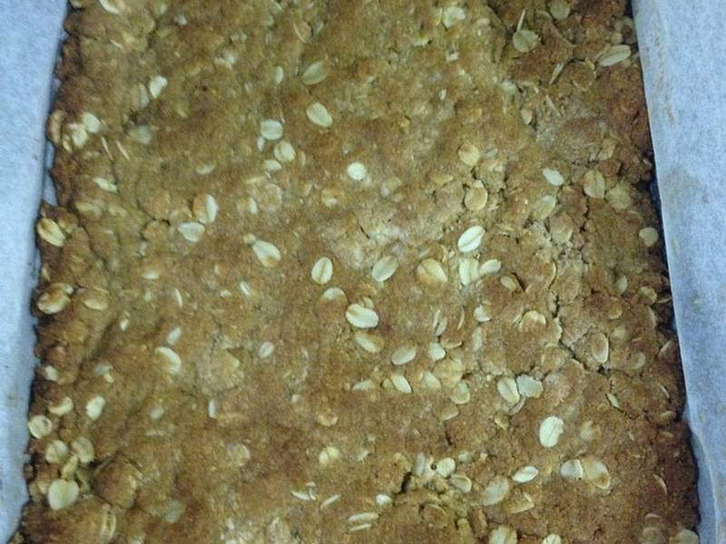

Photo: [Fiona Henderson](https://www.flickr.com/photos/25925793@N00/14814939554/) · [CC BY 2.0](https://creativecommons.org/licenses/by/2.0/) · [original photo and title](https://www.flickr.com/photos/25925793@N00/14814939554/).

Full-size final crop shows a baked oat-and-coconut ANZAC tray slice in its tin, matching the recipe form and Vegetarian label. Rustic unportioned surface rather than the recipe cut into bars; source caption explicitly identifies ANZAC slice.

## BBQ Pulled Pork Nachos

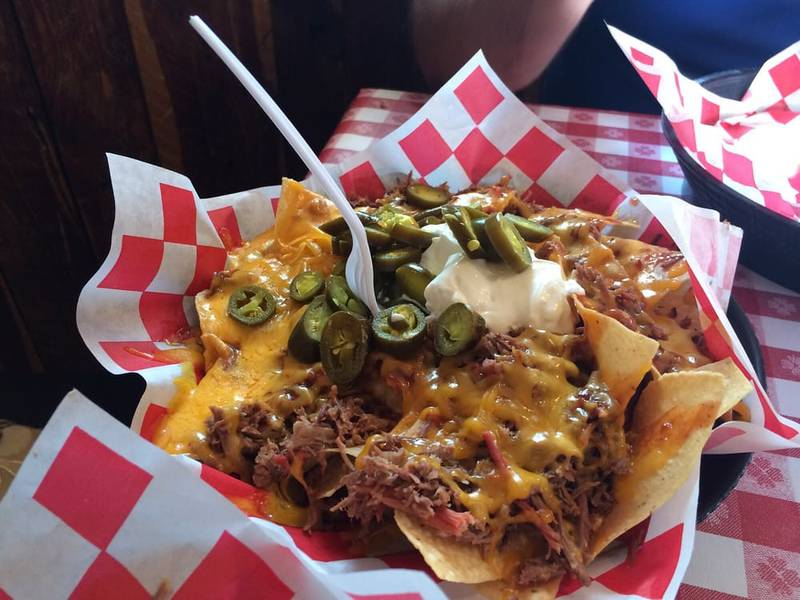

Photo: [Lindell Dillon](https://www.flickr.com/photos/38635198@N04/33590884200/) · [Public domain](https://creativecommons.org/publicdomain/mark/1.0/) · [original photo and title](https://www.flickr.com/photos/38635198@N04/33590884200/).

Full-size final crop shows tortilla chips, pulled pork, melted cheese, jalapenos and sour cream. Matches the named barbecue pork nachos; restaurant basket/plastic fork are serving props. No restricted diet label is asserted.

## Cajun Salmon

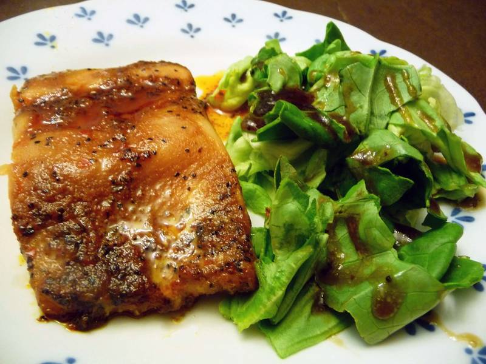

Photo: [Bev Sykes](https://www.flickr.com/photos/11399912@N00/3486340036/) · [CC BY 2.0](https://creativecommons.org/licenses/by/2.0/) · [original photo and title](https://www.flickr.com/photos/11399912@N00/3486340036/).

Full-size final crop shows an unbreaded seasoned cooked salmon fillet. Individual source caption says Cajun spiced salmon with salad. No visible cheese filling, cream or wheat; salad is a serving side, not a claim it is in the recipe. A different source stuffed with goat cheese was rejected against the Dairy-Free label.

## Chilli Jam

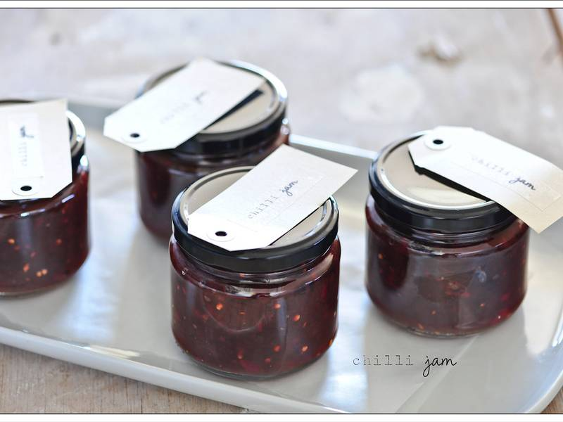

Photo: [jules](https://www.flickr.com/photos/58367355@N00/6444192811/) · [CC BY 2.0](https://creativecommons.org/licenses/by/2.0/) · [original photo and title](https://www.flickr.com/photos/58367355@N00/6444192811/).

Full-size final crop shows red chilli jam with visible seeds in glass jars, on pale fabric. Source title/labels identify chilli jam; no visible animal products or wheat. Packaged jars are serving/storage props, not a claim this recipe is tested for shelf-stable storage. No kitchen-testing or shelf-life evidence is implied.

## Chocolate Mint Cake

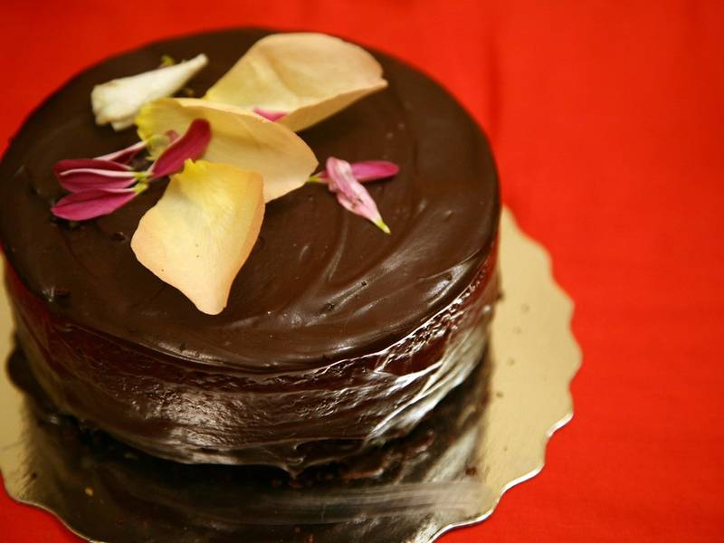

Photo: [Simon Law](https://www.flickr.com/photos/50642338@N00/2052045844/) · [CC BY-SA 2.0](https://creativecommons.org/licenses/by-sa/2.0/) · [original photo and title](https://www.flickr.com/photos/50642338@N00/2052045844/). This resized/cropped copy is shared under the same licence.

Full-size final crop shows a round chocolate-frosted cake; individual source title identifies chocolate-mint cake. Flower/petal decorations differ from the recipe serving, but do not replace the named cake. Compatible with Vegetarian label; no claim this exact recipe was cooked.

## Coca-Cola Cake

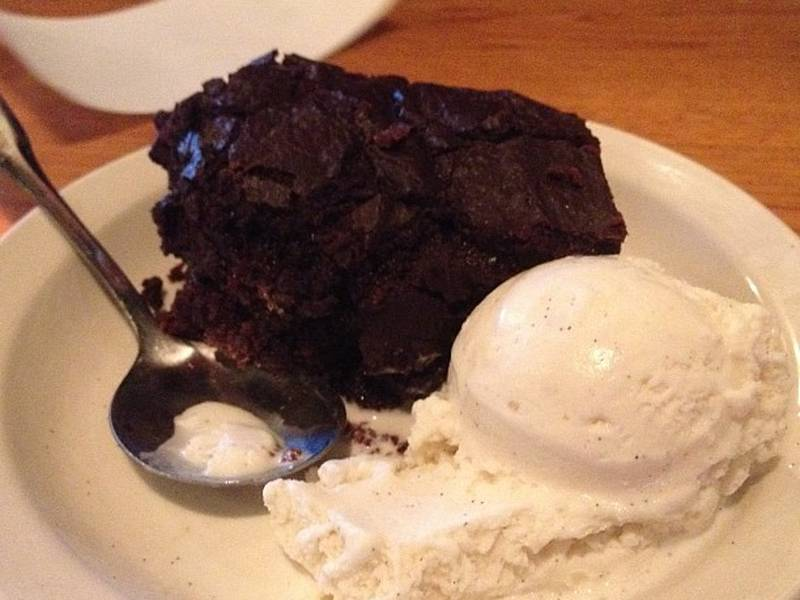

Photo: [ROBREEPRODUCTIONS](https://www.flickr.com/photos/61696948@N05/7376839488/) · [CC BY-SA 2.0](https://creativecommons.org/licenses/by-sa/2.0/) · [original photo and title](https://www.flickr.com/photos/61696948@N05/7376839488/). This resized/cropped copy is shared under the same licence.

Full-size final crop shows a served piece of iced dark chocolate Coca-Cola cake, identified by the source caption. Ice cream is an optional serving prop in the photo and not added to the ingredient list or dietary claims.

## Cornbread Stuffing

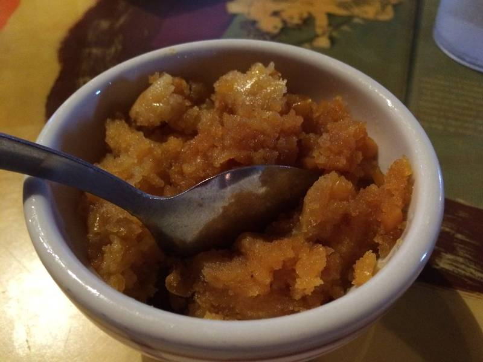

Photo: [tinyfroglet](https://www.flickr.com/photos/20868483@N00/20121030282/) · [CC BY 2.0](https://creativecommons.org/licenses/by/2.0/) · [original photo and title](https://www.flickr.com/photos/20868483@N00/20121030282/).

Full-size final crop shows prepared golden-brown crumbed cornbread stuffing in a serving bowl. Caption explicitly identifies cornbread stuffing; plating differs from the baking dish in the recipe. This photo does not verify cooking temperatures or this exact method.

## Eggplant Curry

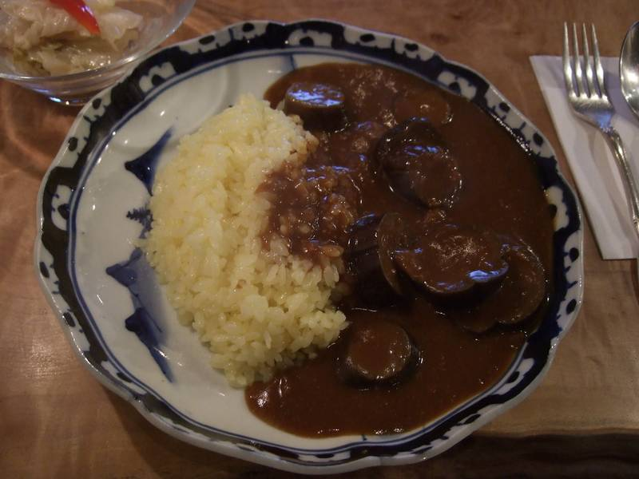

Photo: [pelican](https://www.flickr.com/photos/85936780@N00/3109552749/) · [CC BY-SA 2.0](https://creativecommons.org/licenses/by-sa/2.0/) · [original photo and title](https://www.flickr.com/photos/85936780@N00/3109552749/). This resized/cropped copy is shared under the same licence.

Full-size final crop shows aubergine pieces in curry sauce with rice; source caption explicitly identifies eggplant curry. Source uses aubergine rounds, while the recipe cuts cubes; rice is a serving side. No visible meat, dairy or bread contradicts the recipe labels; the photograph is not a dietary certification.

## Blackberry Jam

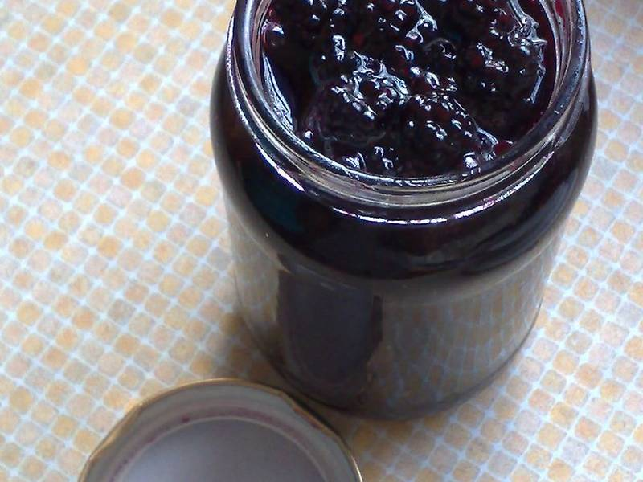

Photo: [Wapster](https://www.flickr.com/photos/91198056@N00/2892760492/) · [CC BY 2.0](https://creativecommons.org/licenses/by/2.0/) · [original photo and title](https://www.flickr.com/photos/91198056@N00/2892760492/).

Full-size final crop shows dark purple blackberry jam in a glass jar; source title identifies blackberry jam. Final crop contains no wheat/bread or dairy. It illustrates the prepared jam, not an independently validated preservation process.

## Garlic Butter Pasta

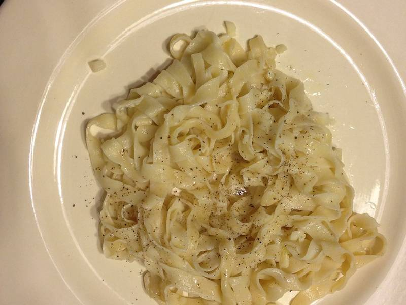

Photo: [vasasd1825](https://www.flickr.com/photos/126406896@N07/14587637038/) · [CC BY 2.0](https://creativecommons.org/licenses/by/2.0/) · [original photo and title](https://www.flickr.com/photos/126406896@N07/14587637038/).

Full-size crop and individual caption verify homemade pasta with garlic-butter sauce and black pepper. Source uses short curled pasta rather than the recipe spaghetti; same named sauce and no restricted-diet conflict. The shape variation is disclosed, not a claim this exact recipe was photographed.

## Hot Roast Pork Roll

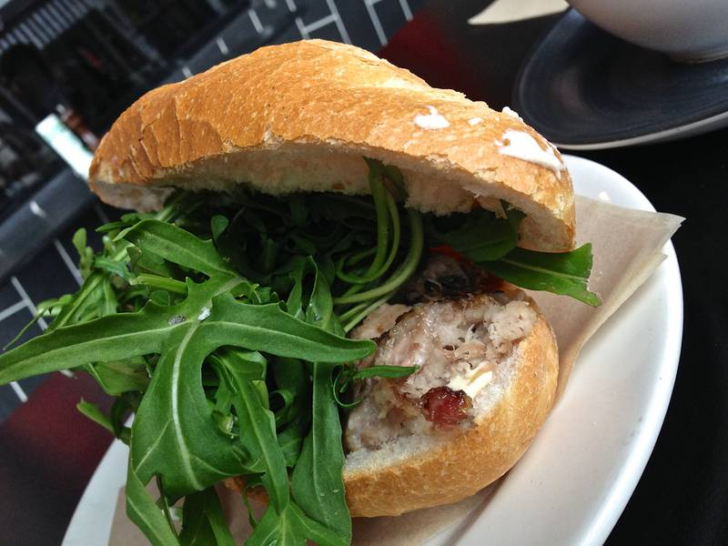

Photo: [Katherine Lim](https://www.flickr.com/photos/34948727@N00/10243597516/) · [CC BY 2.0](https://creativecommons.org/licenses/by/2.0/) · [original photo and title](https://www.flickr.com/photos/34948727@N00/10243597516/).

Full-size crop shows roast pork in a crusty roll; individual source identifies hot spit-roast pork roll. Rocket is an additional serving garnish rather than an ingredient added to the recipe. No gluten-free or vegetarian label is claimed.

## Ice Cream Cake

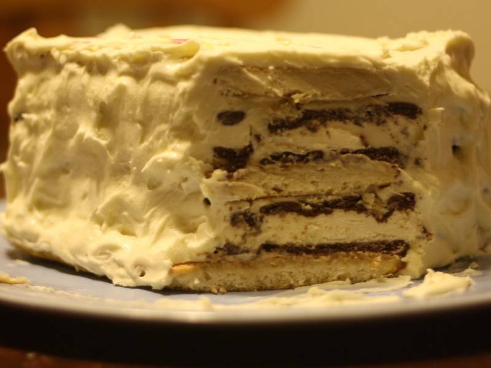

Photo: [Jessie Pearl](https://www.flickr.com/photos/21656109@N00/4751917933/) · [CC BY 2.0](https://creativecommons.org/licenses/by/2.0/) · [original photo and title](https://www.flickr.com/photos/21656109@N00/4751917933/).

Full-size crop shows a sliced layered ice-cream cake with chocolate biscuit/wafer layers. Layer arrangement differs from the recipe vanilla/chocolate ice cream and biscuit base; same dessert identity. This is an illustrative ice-cream-cake photograph, not a photograph of a tested site recipe.

## Kiwi Fruit Pavlova

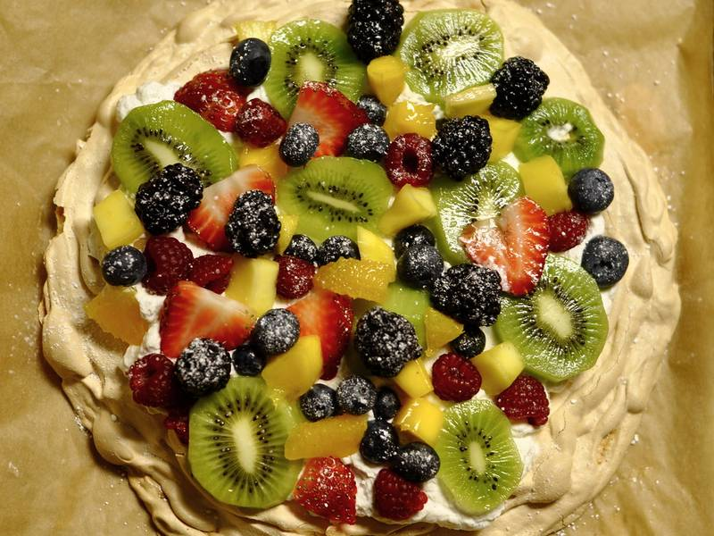

Photo: [Kimberly Vardeman](https://www.flickr.com/photos/87542849@N00/5406345827/) · [CC BY 2.0](https://creativecommons.org/licenses/by/2.0/) · [original photo and title](https://www.flickr.com/photos/87542849@N00/5406345827/).

Full-size crop shows a baked meringue pavlova with cream and prominent kiwi slices. The source includes other berries and yellow fruit as serving decorations; the recipe ingredient list remains kiwi only. Vegetarian-compatible visual content.

## Lamb Samosas

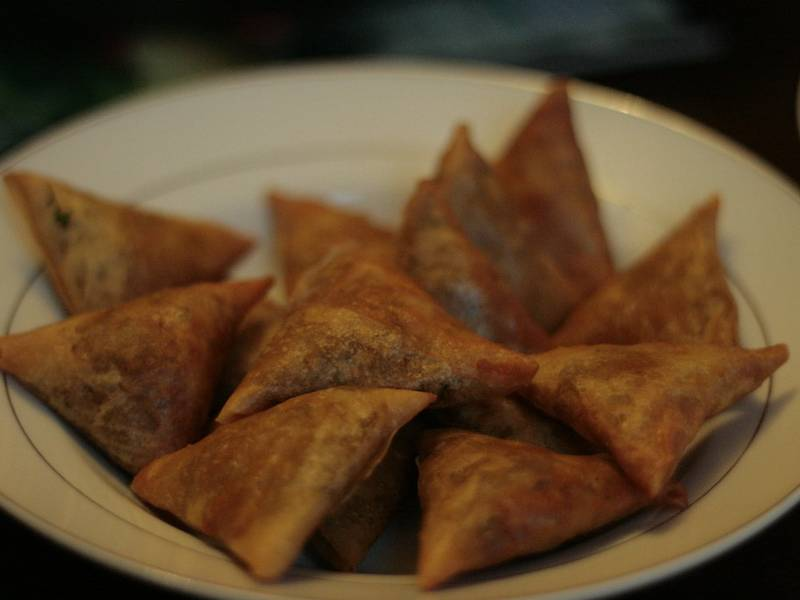

Photo: [eatingeast](https://www.flickr.com/photos/51811984@N02/4942830597/) · [CC BY 2.0](https://creativecommons.org/licenses/by/2.0/) · [original photo and title](https://www.flickr.com/photos/51811984@N02/4942830597/).

Full-size crop shows prepared golden triangular lamb samosas, explicitly named by the source. Source pastry appears thicker than the recipe filo; no claim the source used the exact site pastry or cooking method. No incompatible dietary label.

## Panettone French Toast

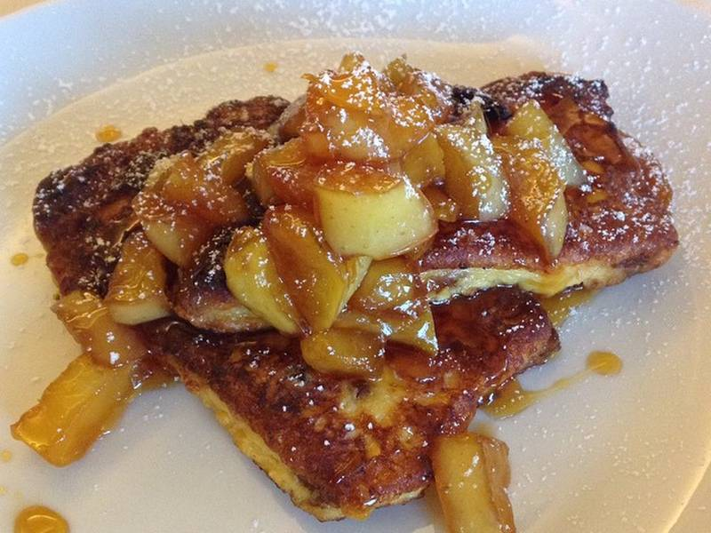

Photo: [judywitts](https://www.flickr.com/photos/40687317@N00/15619403404/) · [CC BY 2.0](https://creativecommons.org/licenses/by/2.0/) · [original photo and title](https://www.flickr.com/photos/40687317@N00/15619403404/).

Full-size crop shows browned panettone French toast, source explicitly named. Apple topping is a source serving variation beyond the recipe maple syrup and icing sugar; Vegetarian label is not contradicted.

## Peanut Butter Energy Bites

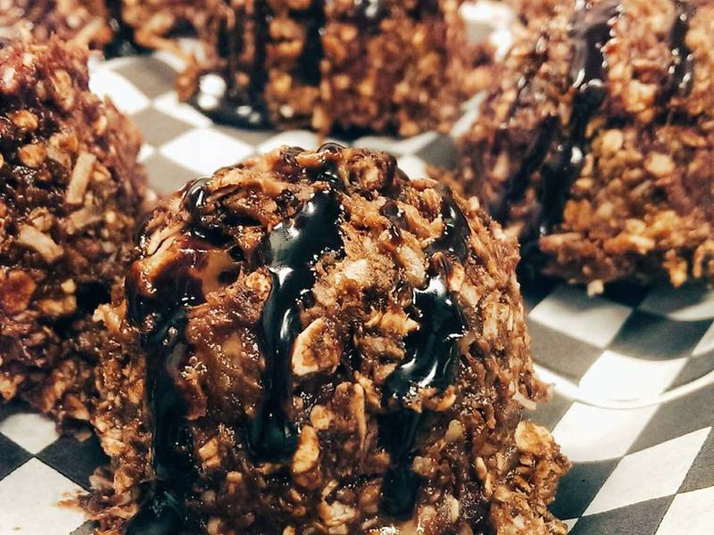

Photo: [Benjamin Davidson](https://www.flickr.com/photos/10863444@N00/22864095121/) · [CC BY 2.0](https://creativecommons.org/licenses/by/2.0/) · [original photo and title](https://www.flickr.com/photos/10863444@N00/22864095121/).

Full-size crop shows chocolate peanut-butter oat energy bites, as explicitly named by the source. Source is labelled vegan, compatible with target Vegetarian; chocolate drizzle is a serving variation on the recipe chocolate chips. Batch photograph is not a portion/nutrition certification.

## Pineapple Casserole

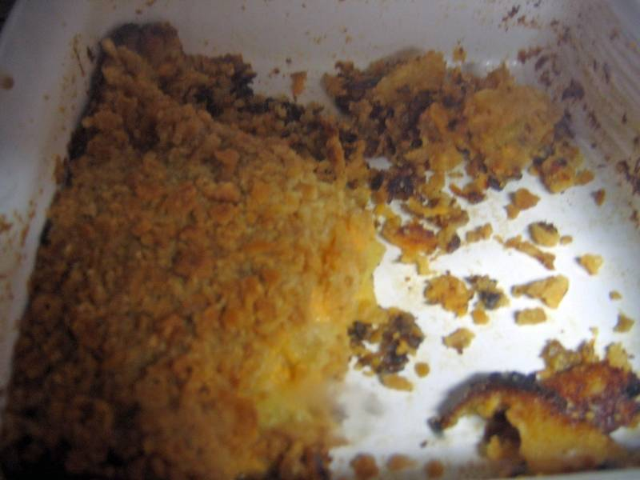

Photo: [Wendy Harman](https://www.flickr.com/photos/96763131@N00/306244839/) · [CC BY 2.0](https://creativecommons.org/licenses/by/2.0/) · [original photo and title](https://www.flickr.com/photos/96763131@N00/306244839/).

Full-size crop shows a partly served pineapple-and-cheese casserole with crumb topping, explicitly named by the source. Matches pineapple/cheddar/cracker ingredients and Vegetarian label. Dim home photograph; quality limitation retained for owner review.

## Pizza Bianca

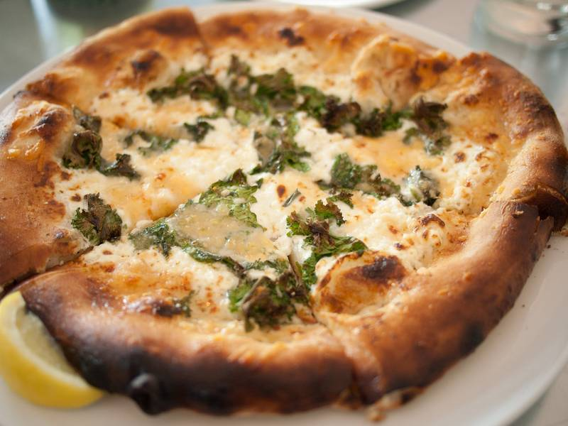

Photo: [Edsel Little](https://www.flickr.com/photos/27119975@N00/5841302390/) · [CC BY-SA 2.0](https://creativecommons.org/licenses/by-sa/2.0/) · [original photo and title](https://www.flickr.com/photos/27119975@N00/5841302390/). This resized/cropped copy is shared under the same licence.

Full-size crop shows a white cheese pizza without tomato sauce, explicitly Pizza Bianca in source. Cheese/greens match mozzarella-ricotta white-pizza identity. Source has a raised pizza crust rather than the recipe flatbread base; Vegetarian compatible.

## Raspberry Coulis

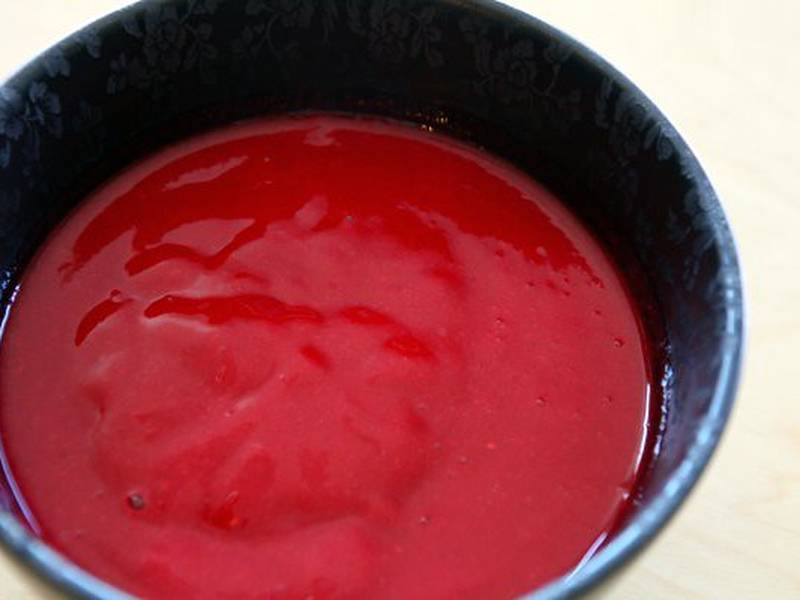

Photo: [Gail](https://www.flickr.com/photos/33904751@N04/4589805463/) · [CC BY 2.0](https://creativecommons.org/licenses/by/2.0/) · [original photo and title](https://www.flickr.com/photos/33904751@N04/4589805463/).

Full-size crop shows prepared smooth red raspberry coulis in a bowl, as named by the source. No visible dairy, wheat or animal products; compatible with the recipe labels. Photo does not validate nutrition thresholds.

## Teriyaki Beef Skewers

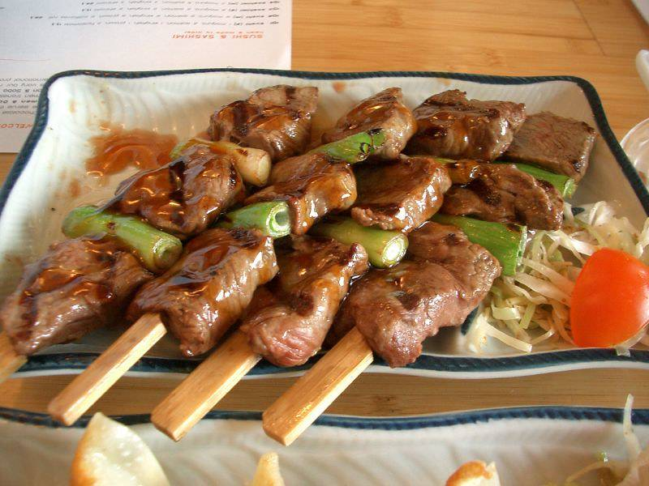

Photo: [Alpha](https://www.flickr.com/photos/10559879@N00/100765796/) · [CC BY-SA 2.0](https://creativecommons.org/licenses/by-sa/2.0/) · [original photo and title](https://www.flickr.com/photos/10559879@N00/100765796/). This resized/cropped copy is shared under the same licence.

Full-size crop shows cooked glazed beef skewers with spring onion, explicitly teriyaki beef skewers in source. Side vegetables are serving props. No visible dairy; same beef rather than substituting chicken.

## Teriyaki Meatballs

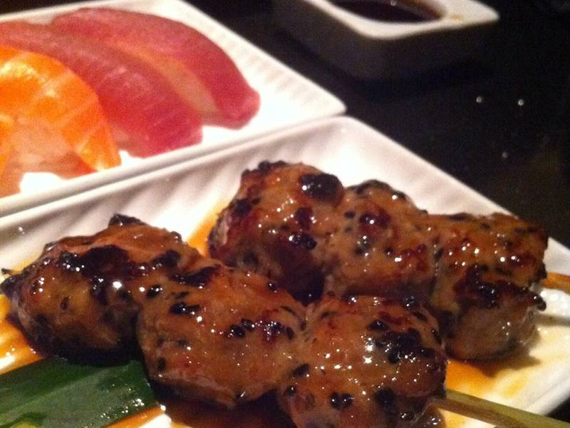

Photo: [Frank Steiner](https://www.flickr.com/photos/21500897@N07/7989630388/) · [CC BY 2.0](https://creativecommons.org/licenses/by/2.0/) · [original photo and title](https://www.flickr.com/photos/21500897@N07/7989630388/).

Full-size crop shows cooked glazed teriyaki meatballs, named by the source. Source meatballs are skewered/elongated rather than the recipe round tray-served balls. No conflicting dietary tag; photograph does not establish exact mince mixture or method.

## Tuna Fish Cakes

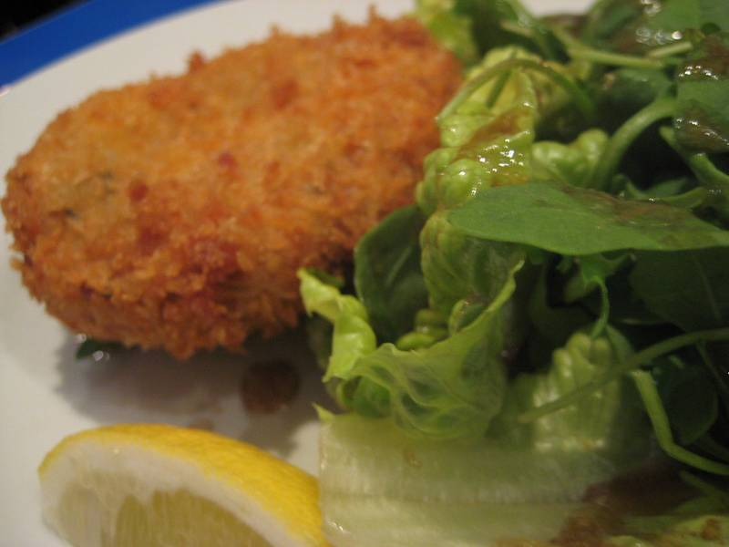

Photo: [Annie Mole](https://www.flickr.com/photos/21309047@N00/6288399015/) · [CC BY 2.0](https://creativecommons.org/licenses/by/2.0/) · [original photo and title](https://www.flickr.com/photos/21309047@N00/6288399015/).

Full-size crop shows a prepared golden breadcrumb-coated tuna fishcake, explicitly identified by source. Salad/lemon are serving sides. Target recipe includes breadcrumbs and is not labelled Gluten-Free, so the visible coating does not contradict a dietary claim.

## Vegan Chocolate Cake

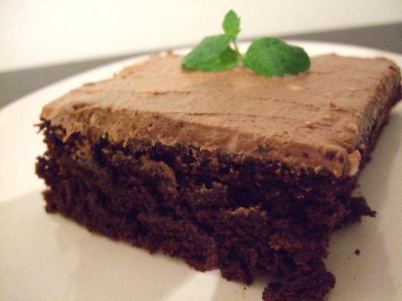

Photo: [Sharon](https://www.flickr.com/photos/11112304@N00/2401989927/) · [CC BY-SA 2.0](https://creativecommons.org/licenses/by-sa/2.0/) · [original photo and title](https://www.flickr.com/photos/11112304@N00/2401989927/). This resized/cropped copy is shared under the same licence.

Full-size crop shows iced vegan chocolate cake, explicitly vegan in source title and supporting caption. Source has mint-flavoured frosting/garnish; recipe is plain chocolate cake. Vegan preparation is source-described, not invented, and no site kitchen test is implied.

## Za'atar Chicken

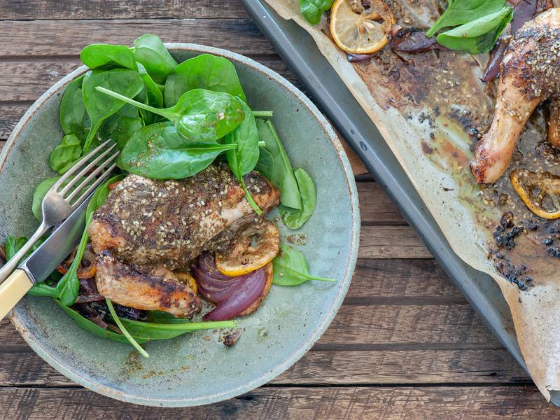

Photo: [jules](https://www.flickr.com/photos/58367355@N00/50650560153/) · [CC BY 2.0](https://creativecommons.org/licenses/by/2.0/) · [original photo and title](https://www.flickr.com/photos/58367355@N00/50650560153/).

Full-size crop shows roasted chicken with zaatar and lemon, matching the named dish. Greens are serving sides; source uses bone-in pieces rather than the exact target cut. No visible wheat or incompatible diet ingredient.

## Alabama White Sauce Chicken

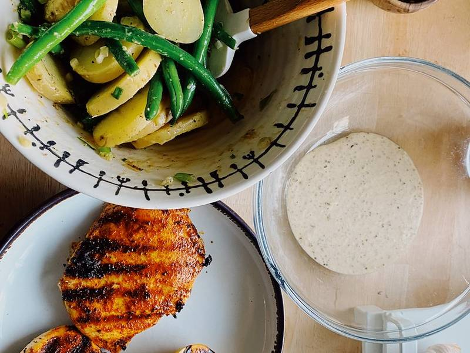

Photo: [Dana L. Brown](https://www.flickr.com/photos/13612227@N02/51420646083/) · [CC BY-SA 2.0](https://creativecommons.org/licenses/by-sa/2.0/) · [original photo and title](https://www.flickr.com/photos/13612227@N02/51420646083/). This resized/cropped copy is shared under the same licence.

Full-size crop shows grilled chicken with Alabama white BBQ sauce in a separate bowl, explicitly named in source. Potatoes/vegetables are serving sides. White sauce is the named mayonnaise-based style, not assumed dairy or a claim of exact recipe testing.

## Almond Crusted Chicken

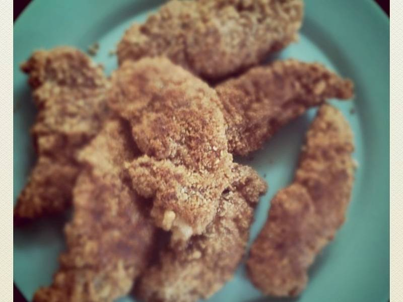

Photo: [ultrakickgirl](https://www.flickr.com/photos/9032130@N03/5834281692/) · [CC BY 2.0](https://creativecommons.org/licenses/by/2.0/) · [original photo and title](https://www.flickr.com/photos/9032130@N03/5834281692/).

Full-size crop shows almond-coated cooked chicken fingers; source explicitly Paleo almond-crusted chicken, avoiding an unsupported wheat-breadcrumb substitution. The finger shape differs from the site cutlets; no visible dairy.

## Apple Cider Pork Tenderloin

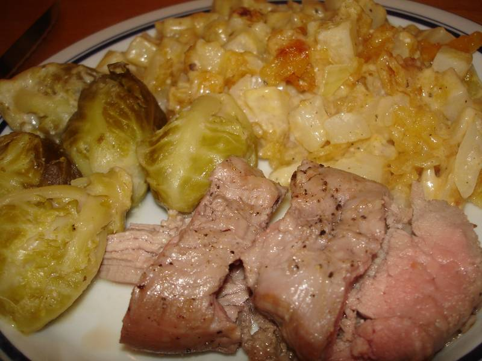

Photo: [@joefoodie](https://www.flickr.com/photos/98178986@N00/4229627664/) · [CC BY 2.0](https://creativecommons.org/licenses/by/2.0/) · [original photo and title](https://www.flickr.com/photos/98178986@N00/4229627664/).

Full-size crop shows sliced apple-cider pork tenderloin, source explicitly named. Potatoes/Brussels sprouts are additional serving sides and are not added to the recipe nutrition or ingredient list. No Dairy-Free or Gluten-Free label is asserted here.

## Ärtsoppa

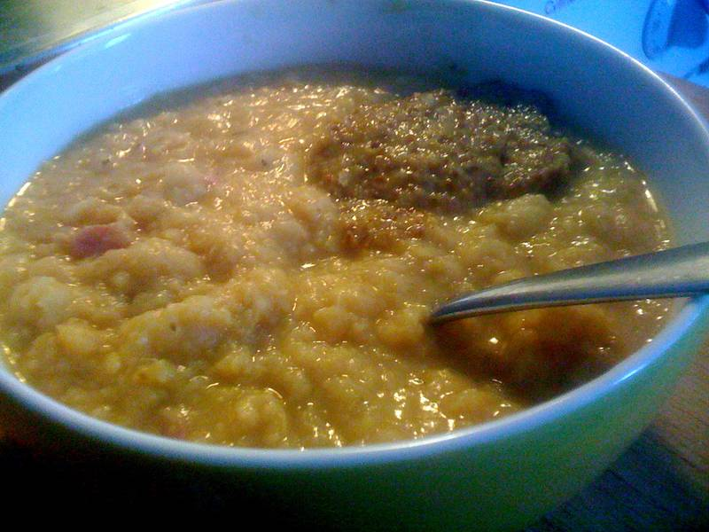

Photo: [hildgrim](https://www.flickr.com/photos/22870477@N04/3459157804/) · [CC BY-SA 2.0](https://creativecommons.org/licenses/by-sa/2.0/) · [original photo and title](https://www.flickr.com/photos/22870477@N04/3459157804/). This resized/cropped copy is shared under the same licence.

Full-size crop shows prepared Swedish yellow-pea artsoppa in a bowl, matching the source dish name. Mustard dollop is a serving variation. Modest home photograph with a blue lighting cast; no change to food content or cooking claims.

## Bacon Jam

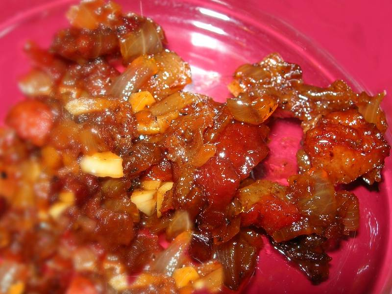

Photo: [Cajsa Lilliehook](https://www.flickr.com/photos/14514578@N08/20370944694/) · [CC BY-SA 2.0](https://creativecommons.org/licenses/by-sa/2.0/) · [original photo and title](https://www.flickr.com/photos/14514578@N08/20370944694/). This resized/cropped copy is shared under the same licence.

Full-size crop shows cooked chopped bacon and onion in a glossy jam-like mixture, explicitly named Bacon Jam by source. A chunky rather than finely minced texture is disclosed; no dairy or bread is visible.

## Bacon Wrapped Meatloaf

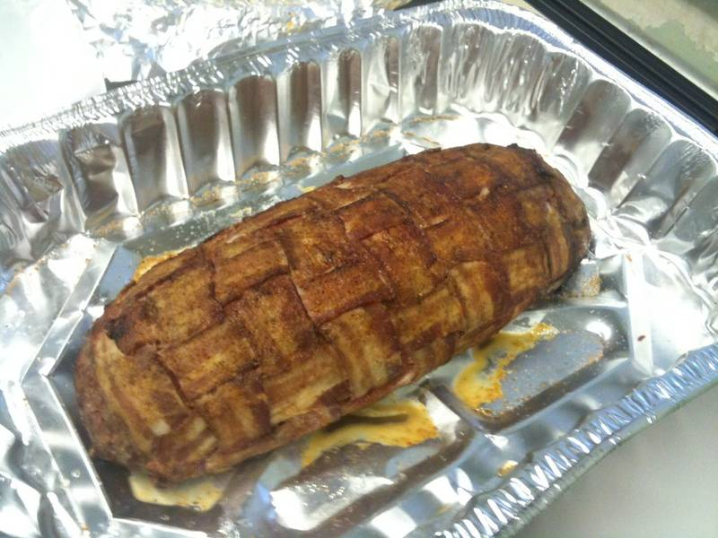

Photo: [eat_pork_rare](https://www.flickr.com/photos/63298022@N03/5758708089/) · [CC BY 2.0](https://creativecommons.org/licenses/by/2.0/) · [original photo and title](https://www.flickr.com/photos/63298022@N03/5758708089/).

Full-size crop shows a baked bacon-wrapped meatloaf with a browned woven bacon exterior, explicitly named by source. Whole-loaf photograph does not imply a site cooking test or internal temperature verification.

## Bacon Wrapped Scallops

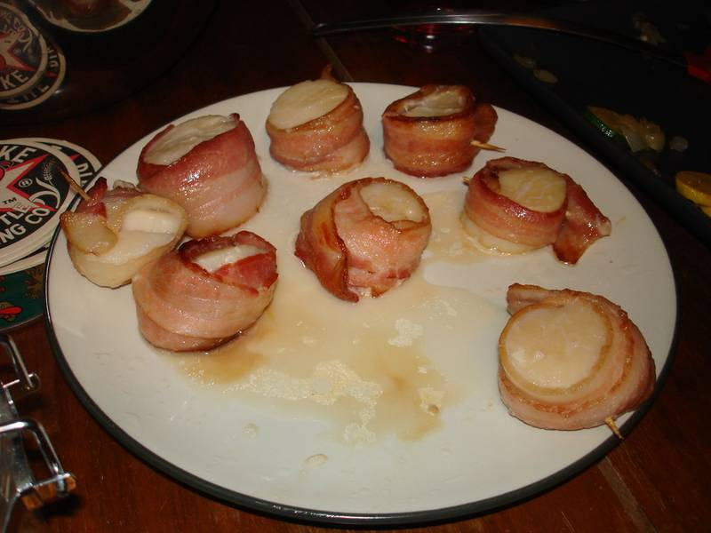

Photo: [Fuzzy Gerdes](https://www.flickr.com/photos/62616836@N00/3018748340/) · [CC BY 2.0](https://creativecommons.org/licenses/by/2.0/) · [original photo and title](https://www.flickr.com/photos/62616836@N00/3018748340/).

Full-size crop shows prepared bacon-wrapped scallops on a plate, source explicitly named. Same seafood and bacon identity; no bread/coating or dairy is visible. Source beer bottles are background props and not recipe ingredients.

## Beef Casserole

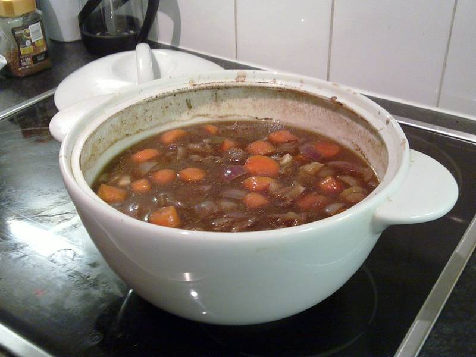

Photo: [whatleydude](https://www.flickr.com/photos/85318305@N00/4287234333/) · [CC BY 2.0](https://creativecommons.org/licenses/by/2.0/) · [original photo and title](https://www.flickr.com/photos/85318305@N00/4287234333/).

Full-size crop shows beef and vegetable casserole in a casserole dish, with brown sauce and carrots, explicitly named by source. Home kitchen background and slight steam/haze are retained. No visible dairy; exact site method is not claimed.

## Beef Lo Mein

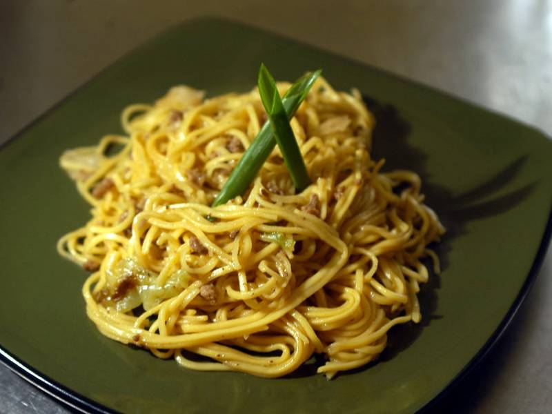

Photo: [GbergT](https://www.flickr.com/photos/59216116@N00/361438781/) · [CC BY 2.0](https://creativecommons.org/licenses/by/2.0/) · [original photo and title](https://www.flickr.com/photos/59216116@N00/361438781/).

Full-size crop shows cooked beef lo mein noodles with spring-onion garnish, explicitly named by source. Same noodle/meat dish, with no visible dairy; photograph is illustrative rather than a portion/nutrition or exact-method claim.

## Beef Yakiniku

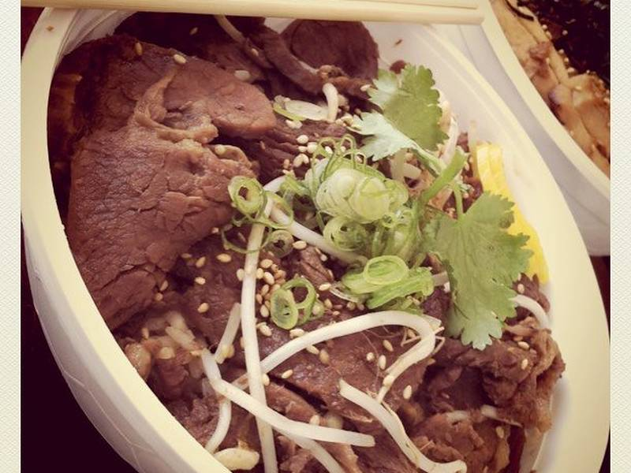

Photo: [|Nicolas|](https://www.flickr.com/photos/26626442@N05/5440674576/) · [CC BY 2.0](https://creativecommons.org/licenses/by/2.0/) · [original photo and title](https://www.flickr.com/photos/26626442@N05/5440674576/).

Full-size crop shows sliced cooked beef yakiniku with bean sprouts and spring onion, named by source. Takeaway container/vegetable garnish are serving differences; no visible dairy.

## Beurre Blanc Sauce

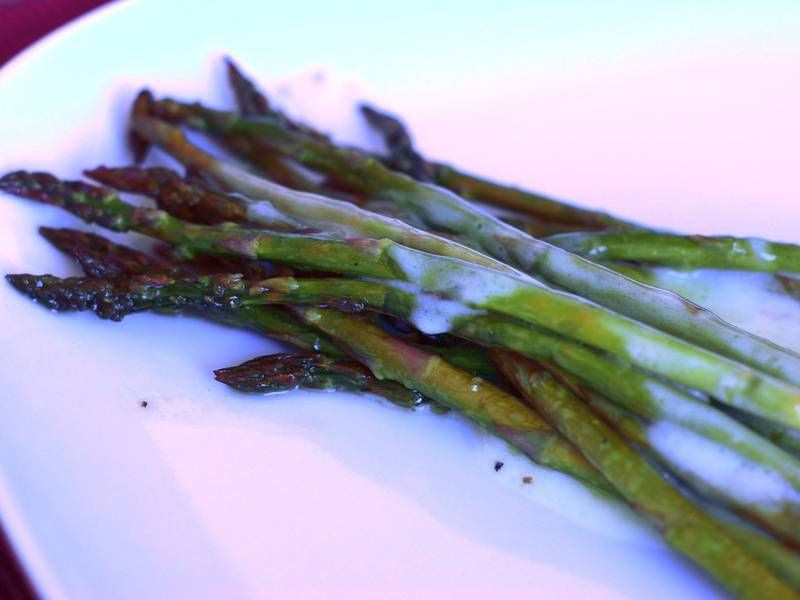

Photo: [chispita_666](https://www.flickr.com/photos/12477719@N00/4340228286/) · [CC BY 2.0](https://creativecommons.org/licenses/by/2.0/) · [original photo and title](https://www.flickr.com/photos/12477719@N00/4340228286/).

Full-size crop shows lemon beurre blanc served over asparagus; source explicitly identifies the sauce. Asparagus is a serving suggestion, not an extra ingredient in the sauce recipe. No meat or wheat visible against Vegetarian/Gluten-Free labels.

## Bugnes

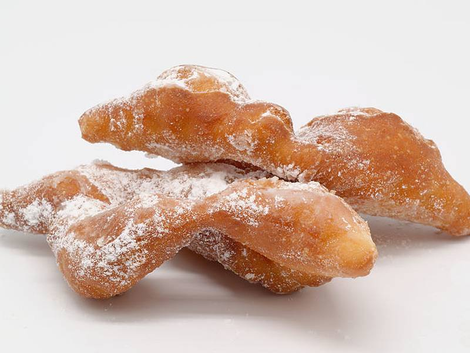

Photo: [The Connexion](https://www.flickr.com/photos/129947512@N06/24547323439/) · [CC BY 2.0](https://creativecommons.org/licenses/by/2.0/) · [original photo and title](https://www.flickr.com/photos/129947512@N06/24547323439/).

Full-size crop shows prepared golden folded French bugnes dusted with sugar, matching dish name and Vegetarian label. The credited source is The Connexion, an organisation; retain correct attribution type rather than inventing a person.

## Treacle Scones

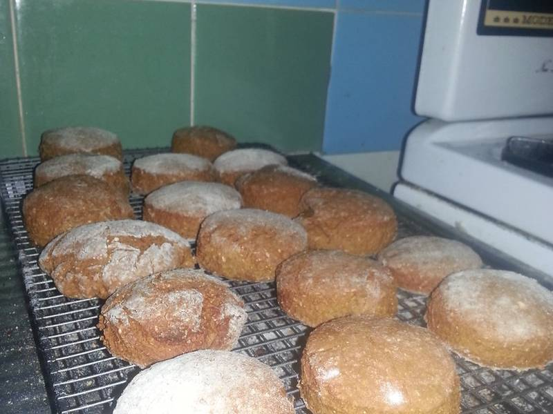

Photo: [Caspia Jackmanson](https://www.flickr.com/photos/58301516@N00/22815795313/) · [CC BY 2.0](https://creativecommons.org/licenses/by/2.0/) · [original photo and title](https://www.flickr.com/photos/58301516@N00/22815795313/).

Full-size crop shows baked browned round treacle scones on a cooling rack, explicitly named in source. Flour-dusted tops are compatible with the wheat-based Vegetarian recipe.

## Fried Apples

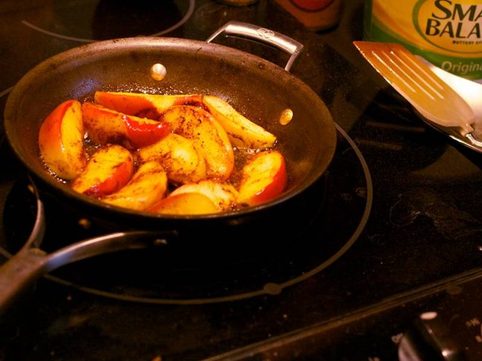

Photo: [David Prasad](https://www.flickr.com/photos/33671002@N00/10900525865/) · [CC BY-SA 2.0](https://creativecommons.org/licenses/by-sa/2.0/) · [original photo and title](https://www.flickr.com/photos/33671002@N00/10900525865/). This resized/cropped copy is shared under the same licence.

Full-size custom crop inspected: cooked sliced apples coated in cinnamon-brown-sugar pan sauce, matching the prepared fried apple dish. Crop centres the cooked skillet; modest kitchen background remains. Illustrative serving, not a claimed cook of this recipe.

## Cheese Grits

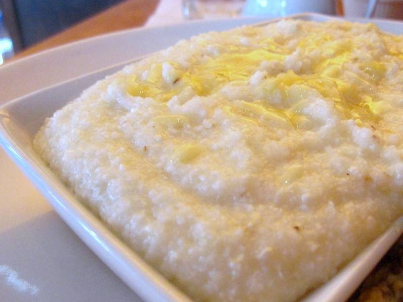

Photo: [Kate Hopkins](https://www.flickr.com/photos/54151899@N00/5166454675/) · [CC BY 2.0](https://creativecommons.org/licenses/by/2.0/) · [original photo and title](https://www.flickr.com/photos/54151899@N00/5166454675/).

Full-size custom crop inspected: creamy cooked cheese grits with melted cheese. Crop isolates the grits bowl, excluding the unrelated side plate; no bread or meat remains visible on this vegetarian/gluten-free recipe.

## Roasted Red Pepper Hummus

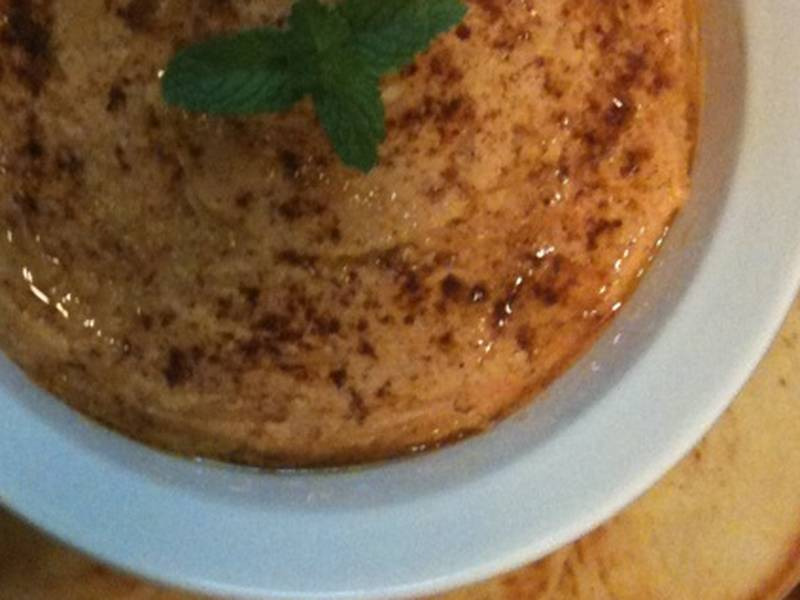

Photo: [Yvonne Esperanza](https://www.flickr.com/photos/12052457@N06/4900918674/) · [CC BY 2.0](https://creativecommons.org/licenses/by/2.0/) · [original photo and title](https://www.flickr.com/photos/12052457@N06/4900918674/).

Full-size custom crop inspected: prepared red pepper hummus in its serving bowl. Crop excludes the surrounding wheat pita, retaining the actual hummus only for the gluten-free recipe; the older source is slightly soft.

## Buttered Peas

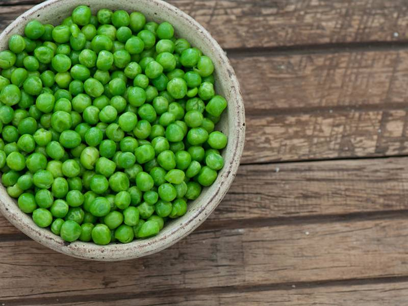

Photo: [jules](https://www.flickr.com/photos/58367355@N00/29375633488/) · [CC BY 2.0](https://creativecommons.org/licenses/by/2.0/) · [original photo and title](https://www.flickr.com/photos/58367355@N00/29375633488/).

Full-size custom crop inspected: bright cooked peas with glossy butter in a rustic bowl; matches the simple prepared side. Crop reduces the empty table while keeping the food intact.

## Cranberry Meatballs

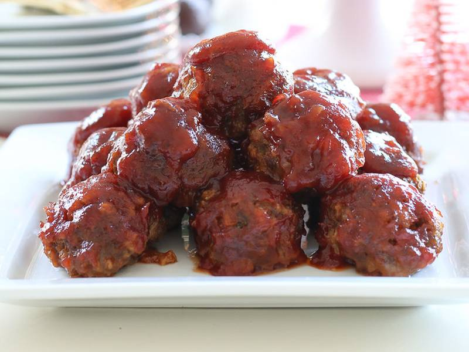

Photo: [Michael Wurm Jr](https://www.berries.com/) · [CC BY 2.0](https://creativecommons.org/licenses/by/2.0/) · [original photo and title](https://www.flickr.com/photos/126560659@N06/24298009686/).

Full-size lower crop inspected: cooked meatballs glazed in red cranberry sauce. Source explicitly identifies photographer Michael Wurm Jr for Shari’s Berries; credit links to the requested berries.com destination. No claim that the archive photo tests this recipe.

## Gooseberry Fool

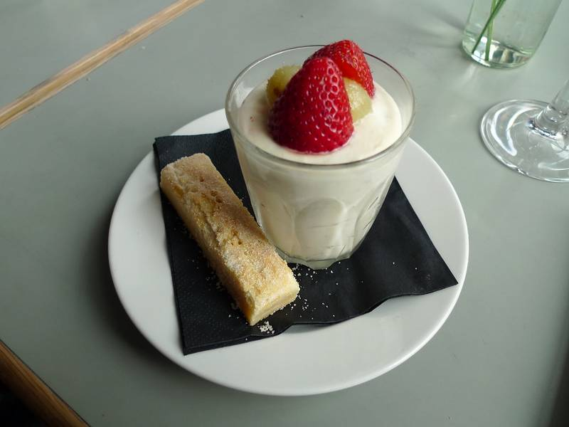

Photo: [Ewan Munro](https://www.flickr.com/photos/55935853@N00/3660393323/) · [CC BY-SA 2.0](https://creativecommons.org/licenses/by-sa/2.0/) · [original photo and title](https://www.flickr.com/photos/55935853@N00/3660393323/). This resized/cropped copy is shared under the same licence.

Full-size crop inspected: source identifies gooseberry and elderflower fool served with shortbread, matching the recipe ingredients and default serving suggestion. This illustrates the default serving, not the gluten-free option; current page already explains that shortbread must be omitted for that option.

## Cast Iron Pizza

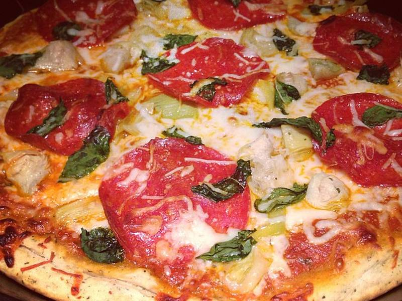

Photo: [ryan harvey](https://www.flickr.com/photos/87933807@N00/8285592875/) · [CC BY-SA 2.0](https://creativecommons.org/licenses/by-sa/2.0/) · [original photo and title](https://www.flickr.com/photos/87933807@N00/8285592875/). This resized/cropped copy is shared under the same licence.

Full-size crop inspected: baked pepperoni and cheese pizza with a thick skillet crust, matching the recipe core identity. Source adds visible fresh tomato and herb garnish; illustrative serving variation recorded.

## Cast Iron Skillet Cookie

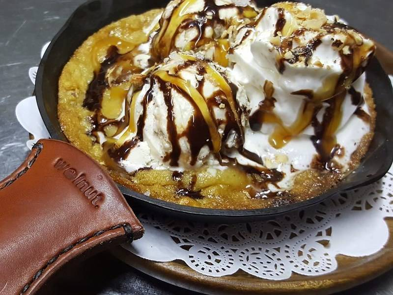

Photo: [Geoffrey Franklin](https://www.flickr.com/photos/47514124@N02/33439676316/) · [CC BY 2.0](https://creativecommons.org/licenses/by/2.0/) · [original photo and title](https://www.flickr.com/photos/47514124@N02/33439676316/).

Full-size crop inspected: cooked skillet cookie served with ice cream and dessert sauces. Cookie identity and skillet presentation match; toppings are an illustrative restaurant serving variation, not a recipe ingredient claim.

## Cheesecake Brownies

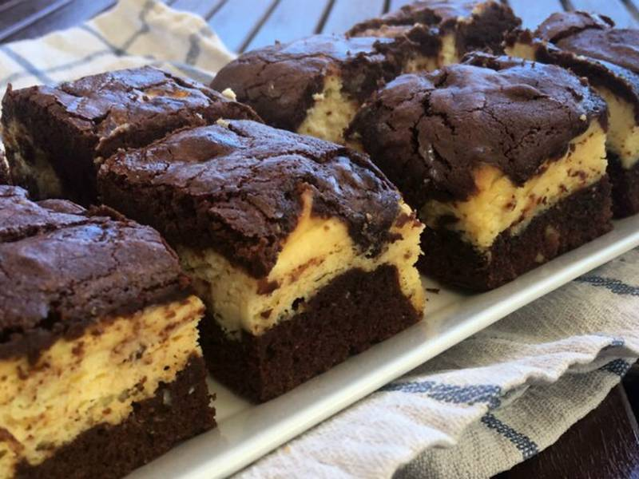

Photo: [Tasty Details](https://www.flickr.com/photos/147506814@N03/34970817516/) · [CC BY 2.0](https://creativecommons.org/licenses/by/2.0/) · [original photo and title](https://www.flickr.com/photos/147506814@N03/34970817516/).

Full-size crop inspected: dark brownie squares with a visible baked cream-cheese layer, matching the swirled cheesecake brownie dish. Layer pattern differs naturally between batches.

## Chewy Ginger Cookies

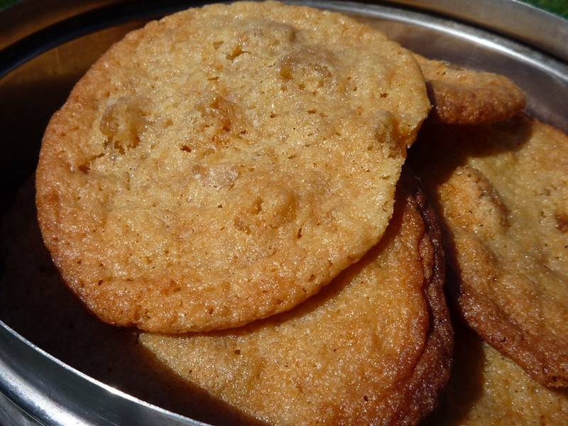

Photo: [Beck](https://www.flickr.com/photos/35468144810@N01/4655993099/) · [CC BY 2.0](https://creativecommons.org/licenses/by/2.0/) · [original photo and title](https://www.flickr.com/photos/35468144810@N01/4655993099/).

Full-size crop inspected: prepared round golden ginger cookies; named source identifies chewy ginger cookies and the recipe blog. Minor surface texture variation; no invented dietary or cooking-test evidence.

## Chicken Carbonara

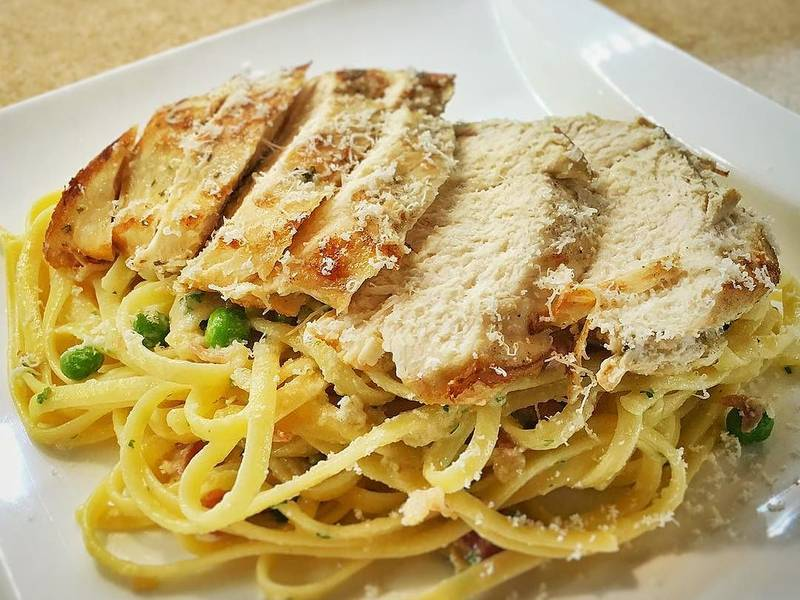

Photo: [Scott Riggle](https://www.flickr.com/photos/25129846@N08/26218393850/) · [CC BY 2.0](https://creativecommons.org/licenses/by/2.0/) · [original photo and title](https://www.flickr.com/photos/25129846@N08/26218393850/).

Full-size crop inspected: cooked chicken over long pasta with a creamy carbonara coating and parmesan. Source explicitly names chicken carbonara. Peas and sliced-chicken plating are restaurant serving variations; not an exact cook of the listed method.

## Chicken Cordon Bleu Casserole

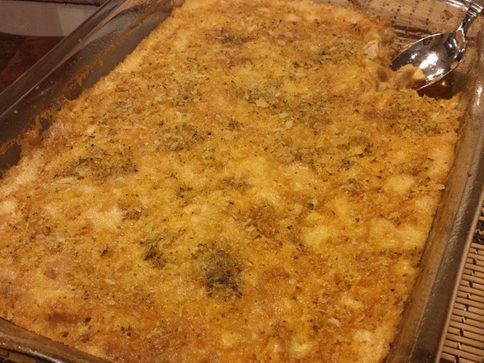

Photo: [Kristin](https://www.flickr.com/photos/73889777@N00/15305975810/) · [CC BY 2.0](https://creativecommons.org/licenses/by/2.0/) · [original photo and title](https://www.flickr.com/photos/73889777@N00/15305975810/).

Full-size crop inspected: baked breadcrumb-topped chicken cordon bleu casserole. Source explicitly names the dish and discloses using cream instead of milk; both are compatible with this non dairy-free recipe. Illustrative baked-dish appearance.

## Chicken Parmesan Sub

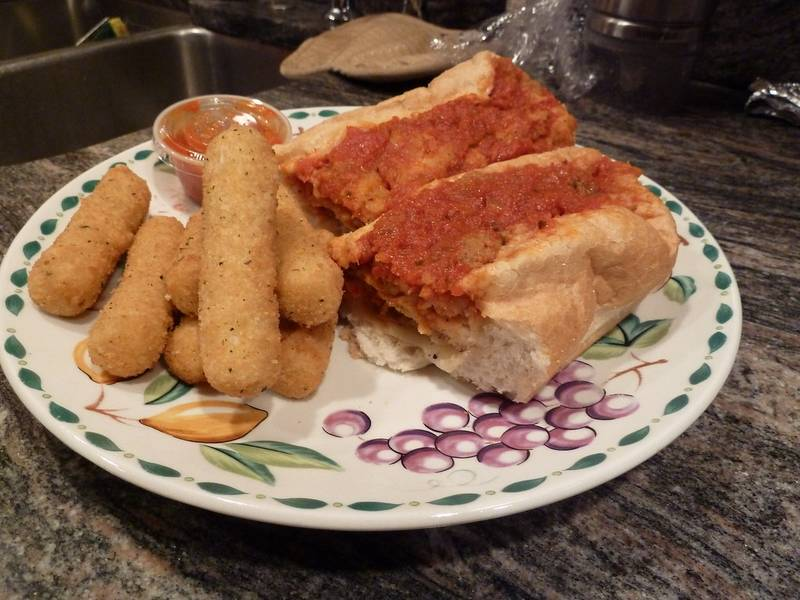

Photo: [mroach](https://www.flickr.com/photos/73569497@N00/5195125189/) · [CC BY-SA 2.0](https://creativecommons.org/licenses/by-sa/2.0/) · [original photo and title](https://www.flickr.com/photos/73569497@N00/5195125189/). This resized/cropped copy is shared under the same licence.

Full-size crop inspected: prepared breaded chicken parmesan in a sub roll with tomato sauce. Source explicitly names chicken parm sub. Mozzarella sticks are an incidental serving side, not an ingredient claim.

## Chicken Scampi

Photo: [Ginny](https://www.flickr.com/photos/78011127@N00/2841110715/) · [CC BY-SA 2.0](https://creativecommons.org/licenses/by-sa/2.0/) · [original photo and title](https://www.flickr.com/photos/78011127@N00/2841110715/). This resized/cropped copy is shared under the same licence.

Full-size crop inspected: cooked chicken and long pasta in garlic sauce, explicitly identified as chicken scampi by photographer. Source includes red pepper and smaller chicken pieces as serving variations.

## Chicken Wellington

Photo: [James Lee](https://www.flickr.com/photos/37176760@N06/4655230212/) · [CC BY 2.0](https://creativecommons.org/licenses/by/2.0/) · [original photo and title](https://www.flickr.com/photos/37176760@N06/4655230212/).

Full-size crop inspected: baked chicken pastry parcel, golden and served with sauce. Photographer supplies chicken, mushroom, spinach and puff pastry method confirming core identity; champagne sauce is a disclosed serving variation.

## Chicons au Gratin

Photo: [Kimberly Vardeman](https://www.flickr.com/photos/87542849@N00/6290089562/) · [CC BY 2.0](https://creativecommons.org/licenses/by/2.0/) · [original photo and title](https://www.flickr.com/photos/87542849@N00/6290089562/).

Full-size crop inspected: browned cheese sauce over prepared chicons au gratin, explicitly named by source. Close view of the gratin surface; no unrelated dish substituted.

## Chocolate Chip Cookie Bars

Photo: [Chocolate-Dessert-Recipes.com](https://www.chocolate-dessert-recipes.com/) · [CC BY 2.0](https://creativecommons.org/licenses/by/2.0/) · [original photo and title](https://www.flickr.com/photos/66677611@N08/6064302347/).

Full-size crop inspected: baked chocolate-chip cookie dough cut into bars. Dark and white chips are visible; recipe ingredient is generic chocolate chips. Source requests a link to chocolate-dessert-recipes.com, included in visible photographer credit.

## Cinnamon Roll Pancakes

Photo: [Rose](https://www.flickr.com/photos/30625405@N02/7540580214/) · [CC BY-SA 2.0](https://creativecommons.org/licenses/by-sa/2.0/) · [original photo and title](https://www.flickr.com/photos/30625405@N02/7540580214/). This resized/cropped copy is shared under the same licence.

Full-size crop inspected: prepared pancakes with cinnamon swirls and pale icing, matching cinnamon roll pancake identity; no dietary conflict or unverified author story added.

## Com Ga

Photo: [Marie](https://www.flickr.com/photos/14671121@N03/11963216533/) · [CC BY-SA 2.0](https://creativecommons.org/licenses/by-sa/2.0/) · [original photo and title](https://www.flickr.com/photos/14671121@N03/11963216533/). This resized/cropped copy is shared under the same licence.

Full-size crop inspected: prepared Vietnamese chicken rice with shredded chicken, herbs and sauce, matching com ga. Garnish is an illustrative serving variation; archive photo is not evidence of recipe testing.

## Crab Mac and Cheese

Photo: [stu_spivack](https://www.flickr.com/photos/35034346243@N01/273346627/) · [CC BY-SA 2.0](https://creativecommons.org/licenses/by-sa/2.0/) · [original photo and title](https://www.flickr.com/photos/35034346243@N01/273346627/). This resized/cropped copy is shared under the same licence.

Full-size crop inspected: creamy macaroni with visible crab pieces, explicitly identified by source as crab mac and cheese. Restaurant plating and green garnish differ from the baked home presentation; core dish remains the same.

## Cranberry Orange Cookies

Photo: [Jamie Pearson](https://www.flickr.com/photos/20764531@N00/5788720388/) · [CC BY 2.0](https://creativecommons.org/licenses/by/2.0/) · [original photo and title](https://www.flickr.com/photos/20764531@N00/5788720388/).

Full-size crop inspected: cooked golden cookies with dried cranberries and orange-coloured zest, explicitly named cranberry orange cookies by source. Matches the named cookie rather than cherry thumbprints.

## Dairy-Free Brownies

Photo: [Terence Reilly](https://www.flickr.com/photos/37308052@N05/23601805169/) · [CC BY-SA 2.0](https://creativecommons.org/licenses/by-sa/2.0/) · [original photo and title](https://www.flickr.com/photos/37308052@N05/23601805169/). This resized/cropped copy is shared under the same licence.

Full-size crop inspected: completed chocolate brownies in a baking dish. Source explicitly states gluten-free and dairy-free brownies; no dairy topping is shown. Uses the photo for the dairy-free recipe without adding gluten-free claims to that recipe.

## Dairy-Free Chocolate Cake

Photo: [Fiona Henderson](https://www.flickr.com/photos/25925793@N00/8619141306/) · [CC BY 2.0](https://creativecommons.org/licenses/by/2.0/) · [original photo and title](https://www.flickr.com/photos/25925793@N00/8619141306/).

Full-size crop inspected: prepared chocolate layer cake with pale cream-style icing and berries. Source explicitly identifies dairy-free chocolate cake, so the visible topping is not assumed to be dairy. Icing is a disclosed serving variation.

## Dairy-Free Chocolate Chip Cookies

Photo: [Amy Stephenson](https://www.flickr.com/photos/24013072@N05/9227817302/) · [CC BY-SA 2.0](https://creativecommons.org/licenses/by-sa/2.0/) · [original photo and title](https://www.flickr.com/photos/24013072@N05/9227817302/). This resized/cropped copy is shared under the same licence.

Full-size crop inspected: baked chocolate chip cookies. Source description explicitly identifies vegan chocolate chip cookies, supporting a dairy-free illustrative dish; no butter-based cookie substituted.

## Vegan Cookies

Photo: [Kari Sullivan](https://commons.wikimedia.org/wiki/File:Tollhouse_Style_Vegan_Chocolate_Chip_Cookies.jpg) · [CC BY 2.0](https://creativecommons.org/licenses/by/2.0) · [original photo and title](https://commons.wikimedia.org/wiki/File:Tollhouse_Style_Vegan_Chocolate_Chip_Cookies.jpg).

Full-size crop inspected: baked golden chocolate chip cookies cooling on a rack. Source explicitly identifies vegan Tollhouse-style chocolate chip cookies, matching the vegan recipe without substituting butter-based cookies.

## Chocolate Pots

Photo: [IndyDina with Mr. Wonderful](https://commons.wikimedia.org/wiki/File:Bijou_(restaurant)_-_October_2006_-_Diana-Roberts_Wakulczyk_03.jpg) · [CC BY 2.0](https://creativecommons.org/licenses/by/2.0) · [original photo and title](https://commons.wikimedia.org/wiki/File:Bijou_(restaurant)_-_October_2006_-_Diana-Roberts_Wakulczyk_03.jpg).

Full-size crop inspected: finished chocolate pot de creme in a cup with cream and a raspberry alongside, matching the chocolate custard and the recipe prose serving suggestion. No wheat biscuit is visible; suitable for the gluten-free recipe. Colour heuristic is a false positive from white plate and cup.

## Beef Ragu

Photo: [Simon_sees](https://www.flickr.com/photos/39551170@N02/51832656086/) · [CC BY 2.0](https://creativecommons.org/licenses/by/2.0/) · [original photo and title](https://www.flickr.com/photos/39551170@N02/51832656086/).

Full-size crop inspected: cooked beef ragu over pasta with parmesan. Source explicitly names Wagyu beef ragu; beef cut, penne shape and pea-shoot garnish are disclosed serving variations from the beef-shin/pappardelle recipe.
